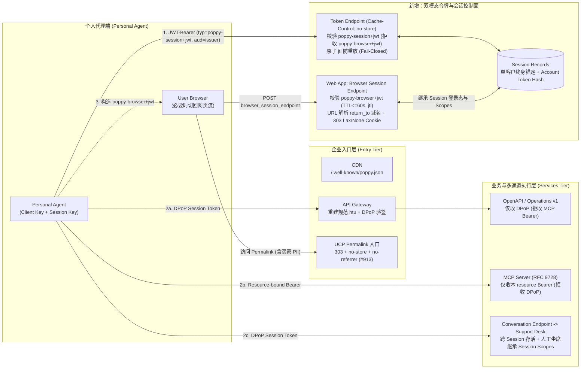

# 2026-10-17 Agentic Commerce 架构与协议每日研究报告（北京时间）

- **验证日期**：2026-10-17（北京时间 `UTC+8`）
- **复用基线**：合并远端 `main`（`e481990`，隐私与治理规范更新）与最新未合并研究分支 `origin/turbo998-agentic-commerce-research-2026-10-16`（PR [#10](https://github.com/turbo998/agentic-commerce-lab/pull/10)，commit `6565e4f`，其线性演进自 `turbo998-agentic-commerce-research-4d8` 基线 `6d57a0a` $\rightarrow$ `032fdcb` $\rightarrow$ `11369b3` $\rightarrow$ `f0c02b4` $\rightarrow$ `87e249d` $\rightarrow$ `6565e4f`），避免重复建设。
- **自动化来源监测**：已运行 `python -m scripts.source_monitor` 生成 [`research/daily/2026-10-17-sources.json`](2026-10-17-sources.json)，共监测 **41 个**官方公开来源（新增 `poppy-company-kit` 基线）：**40 个 `status="ok"`**，**1 个 `status="error"`**（`visa-vic` 仍返回 `HTTP Error 403: Forbidden`，已显式记录失败且不伪造今日复核结论）。

---

## 一、2026-10-17 来源监测与核心变化核验

### 1.1 今日实际协议/规范与工具链增量（3 个官方仓库提交）

| 领域 / 仓库 | 最新提交 / 观察版本 | 提交时间（UTC / 北京时间） | 核心事实与技术变更（基于官方 Diff 核验） | 证据性质 |
|---|---|---|---|---|
| **Sierra / Personal Agent Protocol（Poppy `v0.1`）** [`personal-agent-protocol/personal-agent-protocol`](https://github.com/personal-agent-protocol/personal-agent-protocol/commit/95fcbf22c5991a0090061aed3dbeb68c0ea575e0) | `95fcbf22c599`（PR `#35`，自 10-16 `e910c866` 新增 **1 个大型提交**，变更 146 个文件） | `2026-10-17T00:08:46Z`（北京时间 `2026-10-17 08:08:46`） | **发布企业实现套件（Company Implementation Kit，`implement-personal-agent-protocol` skill）并升级审查套件（`poppy-review` skill）**： 1. **18 份规范级 JSON Schema（Draft 2020-12）**：落地 `kit/company/schemas/*.schema.json`（含 `poppy`、`authorization-server-metadata`、`protected-resource-metadata`、`client-metadata`、`dpop-proof`、`session-assertion`、`browser-assertion`、`token-response`、`oauth-error`、`error`、对话与事件 Schema），显式在 `dpop-proof.schema.json` 中除 `"none"` 外封禁对称签名算法 `"HS256"` / `"HS384"` / `"HS512"` 及私钥字段，并要求断言 `jti` 最小长度 22 字符（$\ge 128$-bit 熵）。 2. **10 篇企业架构集成模式（`kit/company/patterns/*.md`）与改造前后架构对照图（`components/kit-architecture.tsx`）**：给出在既有 Web 三层/四层企业栈上增量改造 CDN、Web App（`+ Browser session endpoint`）、IdP、Token endpoint + Session records（三种部署拓扑）、API Gateway（`+ Session Tokens, DPoP`）、MCP Server（RFC 9728 Protected Resource Metadata）与 Conversation endpoint 的完整蓝图。 3. **零依赖 TypeScript 合规验证器（`kit/company/validate/`）**：模拟真实 Personal Agent 对企业端点执行 Milestone 1（`discovery.*`、`metadata.*`、`session.*`、`dpop.*`）与 Milestone 2（`openapi.*`、`mcp.*`、`conversations.*`）黑盒测试，含跨上下文断言混淆拦截（`session.browser-assertion-rejected`）与跨通道令牌隔离检查。 | **官方规范工具链与架构套件新增（非 `v0.1` 协议破坏性变更）** |
| **Universal Commerce Protocol（UCP）** [`Universal-Commerce-Protocol/ucp`](https://github.com/Universal-Commerce-Protocol/ucp/commit/3ab41043b79373df33a6e2c377bc82a806175f78) | `3ab41043b793`（PR `#913`，自 10-16 `5021fa83` 新增 **1 个提交**） | `2026-10-16T17:50:28Z`（北京时间 `2026-10-17 01:50:28`） | **`docs(permalink): show the mandated headers on every 303 example (#913)`**： 1. 补齐 `docs/specification/permalink.md` 中 5 个遗漏强制响应头的 `HTTP/1.1 303 See Other` 示例，与共享 OpenAPI `permalink_redirect` 响应定义对齐：每个 `303 See Other` 必须同时携带 `Location`、`Cache-Control: no-store` 与 `Referrer-Policy: no-referrer`，防止 Permalink URL 中携带的买家 PII（如 `email`、`phone`）泄露进缓存或第三方 `Referer` 头。 2. 揭示官方校验脚本 `validate_examples.py` 的盲区：此前仅扫描 `json` 代码块而整体跳过 `http` 代码块，且剥离了首个空行前的 HTTP 头。 | **官方规范示例修复与安全头完备性对齐** |
| **Stripe AI / Agent Plugins** [`stripe/ai`](https://github.com/stripe/ai/commit/c1f5b0826f3f33d7e1cc7eff5e5e6cd42749808b) | `c1f5b0826f3f`（`sync skills`） | `2026-10-17T00:45:19Z`（北京时间 `2026-10-17 08:45:19`） | 例行同步技能包版本：`agent-plugins` `0.5.20 -> 0.5.21`、Claude `0.11.20 -> 0.11.21`、Cursor/Grok `0.9.20 -> 0.9.21`、Codex `5.8.20 -> 5.8.21`；`upgrade-stripe/SKILL.md` 快照生成日期更新为 `2026-10-17`，兜底 API 版本仍为 `2026-09-30.endive`。 | **工具包版本例行同步（非新产品发布）** |

### 1.2 Stripe MCP 密钥迁移期限核验与文档区域化哈希变化说明

- **Stripe MCP 迁移期限核验（`https://docs.stripe.com/mcp.md`）**：
  - 2026-10-16 官方将弃用期限从 `31 October 2026` 延后至 **`2026-11-30`**。
  - 2026-10-17 抓取 `docs.stripe.com/mcp.md` 时，Stripe 文档边缘节点返回了英式/英联邦英语（UK/Commonwealth English）日期与拼写渲染：
    > `#### Update API key authentication by 30 November 2026`
    > `Migrate by 30 November 2026. Starting in December, Stripe MCP will stop accepting full-access secret keys and restricted API keys without the Agent tag. Replace these keys with newly created agent API keys or reconnect with OAuth. Requests using an unsupported key receive a 401 response with an OAuth discovery challenge.`
  - **事实判定**：迁移截止日期仍为 **`2026-11-30`**（自 2026-10-17 起剩余 **44 个日历日**），自 **2026-12-01**（`Starting in December`）起停止接受全权限 Secret Key（`sk_*`）与未带 `agent` 标签的受限 Key（`rk_*`），违规请求返回 HTTP `401` 与 OAuth 发现质询；具体切换时刻与时区仍未公布。
  - **监测器演进**：首次运行 `scripts/source_monitor.py` 时，由于昨日新增的 `Migrate by ... Starting in ...` 分支仅匹配美式日期 `%B %d, %Y`（`November 30, 2026`），监测器按保守设计输出 `policy_change="unknown"` 并要求人工复核。经人工核对确认英式日期 `30 November 2026` 语义与 `2026-11-30` 完全一致后，我们在 `_parse_reviewed_mcp_notice` 中增加了对经审阅的美式（`%B %d, %Y`）与英式（`%d %B %Y`）日期格式的双向解析与标题/正文/次月（`December`）一致性校验，重跑后准确记录 `change="changed"`（正文字节哈希改变）、`policy_change="unchanged"`（结构化政策事实未变）。
- **其余 11 个 `docs.stripe.com/*.md` 页面哈希变化说明**：
  - 今日 `stripe-commerce-docs`、`stripe-spt`、`stripe-mpp`、`stripe-x402`、`stripe-acp-docs`、`stripe-link-wallet`、`stripe-machine-payments`、`stripe-frameworks`、`stripe-ucp-docs`、`stripe-ucp-handler`、`stripe-agent-keys`、`stripe-suite-retail` 的 SHA-256 均显示 `changed`。
  - 经逐页比对，变化完全源于英式/美式拼写渲染差异（如 `authorise`/`authorize`、`organisation`/`organization`、`behaviour`/`behavior`、`fulfilment`/`fulfillment`、`catalogue`/`catalog`）以及 `stripe-spt` 动态示例时间戳。
  - **所有 API 版本、协议版本、准入状态与地域限制均无变化**：SPT 仍为 `2026-09-30.preview`，MPP 仍为 `2026-07-29.preview`，x402 仍为 `2026-05-27.preview`，ACP 仍指向 `2026-04-17`，UCP Stripe Payments Handler 仍为 `2026-06-25`（UCP 示例版本 `2026-04-08`），Agentic Commerce Suite retail 仍为 `2026-09-30.preview`。**严禁将 CDN 语言区域化渲染引起的哈希变化误判为产品发布或版本升级。**

### 1.3 Visa 与其他标准监测状态

- **Visa**：
  - `visa-vic`（`https://developer.visa.com/capabilities/visa-intelligent-commerce/overview`）今日仍返回 `HTTPError: HTTP Error 403: Forbidden`（301 重定向至 `/docs/visa-intelligent-commerce` 后 403），在 `2026-10-17-sources.json` 中显式记录为 `status="error"`、`change="unknown"`；VIC 生命周期结论维持 2026-10-13 最后一次成功核验记录。
  - `visa-tap`、`visa-tap-specs`、`visa-tap-announcement`、`visa-toolkit`（MCP Server & Acceptance Agent Toolkit，仍为 **pilot**）及 `visa-tap-code`（`visa/trusted-agent-protocol` 头提交仍为 `16d59bdf3f8a`）均为 `status="ok"`、`change="unchanged"`。
- **UCP 官网恢复与 AP2 / MCP / A2A / Sierra $\tau^3$-bench 状态**：
  - `ucp`（`https://ucp.dev/latest/specification/overview/`）昨日因网络超时记录为 `error`，今日恢复 `status="ok"` 且相对 10-14 成功基线为 `change="unchanged"`。
  - `ap2`（`e1ea56db72a6`，tag `v0.2.0`）、`mcp`（`2025-11-25` / `2026-07-28`）、`a2a`（`v1.0.1`）、`sierra-tau2-bench`（`96a3ef92329b`）今日均无新增提交（`unchanged`）。

---

## 二、辩证架构思考：从 Poppy `#35` 企业改造对照图与 UCP `#913` 看 AI-Native 架构对经典 Web 三层架构与云 WAF 的重构

今日 Poppy `#35`（`95fcbf22c599`）在官方仓库 `components/kit-architecture.tsx` 与 `kit/company/patterns/*.md` 中首次给出了一份极具架构参考价值的 **“Before vs After（传统企业四层架构 vs 支持 Personal Agent 的架构）”** 显式对照图：

- **Before（经典 Web App / WAF 架构）**：
  `Clients` $\rightarrow$ `Entry [CDN, API gateway]` $\rightarrow$ `Services [Web app, Identity provider, Backend services, MCP server, Support platform]` $\rightarrow$ `Data [Web session store, User database, Application database]`
- **After（叠加 Personal Agent Protocol 后的架构演进）**：
  - **Entry 层**：`CDN (+ poppy.json)`、`API gateway (+ Session Tokens, DPoP)`
  - **Services 层**：`Web app (+ Browser session endpoint)`、`Identity provider (+ Sign-in for Personal Agents)`、**新增 `Token endpoint`**、`Backend services`、`MCP server`、**新增 `Conversation endpoint`** $\rightarrow$ `Support platform`
  - **Data 层**：`Web session store`、**新增 `Session records`**、`User database`、`Application database`

结合今日 UCP `#913` 对 `303 See Other` 重定向头的强制规范，我们可以从解决方案架构师视角提炼出 **AI-Native 负载区别于经典 Web 三层架构与传统云 WAF 的四项核心设计重构**：

### 2.1 跨上下文 JWT 类型隔离与 Sidecar 令牌交换模式（打破传统 OAuth 单一令牌假设）

- **经典 Web 三层 / WAF 假设**：OAuth 客户端使用同一套客户端凭证向令牌端点换取 Bearer Token，且客户端极少同时签发多种用途的自签名 JWT 断言。
- **Agentic Commerce 的新威胁（跨上下文 JWT 混淆攻击）**：
  在 Poppy `v0.1` 中，同一个 Session 的会话私钥（`cnf.jkt`）既用于签发发往令牌端点的 **Session Assertion**（`typ: "poppy-session+jwt"`，`aud: auth.issuer`），又用于签发交给用户浏览器发往 Web 应用的 **Browser Assertion**（`typ: "poppy-browser+jwt"`，`aud: web.browser_session_endpoint`，内含 `session_id` 与 `return_to`）。如果令牌端点仅验签而不严格校验 `header.typ` 与 `payload.aud`，攻击者从浏览器重定向链路截获的 Browser Assertion 就能被重放到令牌端点续期并盗取 Session Token！
- **架构重构要求（Poppy `#35` `checks/session.ts` & `patterns/token-issuance.md`）**：
  1. **严格类型与受众正交隔离**：令牌端点必须强制 `typ == "poppy-session+jwt"` 且 `aud == auth.issuer`，对任何 `typ == "poppy-browser+jwt"` 断言立即返回 `400 invalid_grant`（合规测试项 `session.browser-assertion-rejected`）；浏览器会话端点必须强制 `typ == "poppy-browser+jwt"` 且 `aud == browser_session_endpoint`。
  2. **三种非侵入式企业令牌签发拓扑（`patterns/token-issuance.md`）**：当企业既有 IdP 不支持 `client_id` URL 发现或 `urn:ietf:params:oauth:grant-type:jwt-bearer` 时，不必推翻既有 IdP，而是采用 **Pattern B（Sidecar Poppy Token Service）**：由独立的 Poppy 令牌服务管理 Session records 与 Account Token 哈希（如同密码哈希一样存储，永不明文落库），并通过 **RFC 8693 Token Exchange**、加密企业凭证或 API 网关边缘验签将请求桥接回既有后端。
  3. **非对称算法硬约束**：`dpop-proof.schema.json` 除禁止 `"none"` 外，显式将对称算法 `"HS256"`、`"HS384"`、`"HS512"` 列入 `not.enum` 黑名单，防止将公开的 `header.jwk` 当作 HMAC 密钥造成伪造签名漏洞。

### 2.2 三类 HTTP `3xx` 重定向在 Agentic Commerce 中的截然不同安全契约（UCP `#933` vs UCP `#913` vs Poppy `#35` Section 5）

经典 Web 架构往往把 `301/302/303` 重定向视为通用的路由跳转机制；但通过对比昨日 UCP `#933`、今日 UCP `#913` 与今日 Poppy `#35`（`patterns/web-browsing.md`），我们看到 AI-Native 商业架构将 HTTP 重定向拆分为**三条严密隔离的控制面规则**：

| 重定向场景 | 规范来源 | 允许的状态码 | 强制安全不变量与原因 |
|---|---|---|---|
| **1. 协议发现与密钥抓取**（Profile / JWKS / CIMD） | UCP `#933`（`5021fa83`） | **禁止所有 `3xx` 重定向**（仅允许条件请求 `304 Not Modified`） | 防止开放重定向将信任根、JWKS 公钥或客户端元数据劫持至非授权域或内网（SSRF）。 |
| **2. 预填商品/结账永久链接解析**（Handled Permalink） | UCP `#913`（`3ab41043`） | **强制 `303 See Other`** | Permalink URL 查询参数可包含买家 PII（邮箱、电话、预填地址）及代理归因信息。重定向响应**必须同时携带** `Location`（HTTPS）、`Cache-Control: no-store`（防 CDN/共享缓存固化含 PII 的跳转）与 `Referrer-Policy: no-referrer`（防跳转后页面加载第三方脚本时通过 `Referer` 头泄露原始 Permalink 中的买家 PII）。 |
| **3. Agent 到用户浏览器的有状态会话交接**（Browser Session Handoff） | Poppy `#35`（`95fcbf22`，Section 5 & `patterns/web-browsing.md`） | **强制 `303 See Other`**（失败一律返回 `400` 且不写 Cookie） | 1. 校验 `typ: "poppy-browser+jwt"`、`0 < exp - iat <= 60`、`len(jti) >= 22` 且与令牌端点共享 `jti` 防重放缓存。 2. **URL 解析校验 `return_to` 主机名**：必须将 `return_to` 解析为 URL 并比对 hostname 与 `organization.domain` 一致，**严禁使用字符串前缀匹配**（防止 `https://company.com.evil.test` 绕过）。 3. **Cookie `SameSite` 陷阱**：必须设置 `Secure; HttpOnly; SameSite=Lax`（或 `None`），**严禁设置 `SameSite=Strict`**（因为从外部 Personal Agent 发起的跨站导航在首次重定向落地时会丢弃 `Strict` Cookie，导致用户落地即掉线）。 4. **权限降维继承**：浏览器会话必须继承该 Poppy Session 的实时登录状态、绑定账户与 **Session Scopes**（若 Session 仅有 `poppy:read`，则打开的浏览器会话同样不能执行写操作）。 |

### 2.3 权限正交性（Scope Orthogonality）与人工坐席接管后的权限延续（Poppy `#35` `patterns/scopes.md`）

- **经典 Web / RBAC 假设**：`write` 权限默认包含 `read` 权限（层级包含关系）；且一旦对话转接给企业人工客服（Human Handoff），人工坐席工作台使用内部高权限全量接口处理。
- **Poppy `#35` 的反直觉确定性约束**：
  1. **`poppy:read` 与 `poppy:write` 完全正交独立**：`poppy:write` **不包含** `poppy:read`！只读接口仅检查 `poppy:read`，写接口仅检查 `poppy:write`，读写复合接口必须同时检查两者；且企业自定义 scope 严禁使用保留前缀 `poppy:`。
  2. **人工客服接管（Handoff，Section 7.9）不等于权限越权升级**：`patterns/scopes.md` 明确规定，当会话从自动客服转接给真人客服（live agent）后，**真人客服在该会话中代表用户执行操作时，同样受限于该 Poppy Session 已授予的 Scopes**（*"Live agents who take over a conversation after handoff are held to the same scopes"*）。这从根本上堵住了“攻击者通过受限 Session 诱导转人工、再利用人工坐席后台越权修改账户”的社会工程学通道。

### 2.4 对话适配器状态机（Section 7 `conversations.*`）、多租户托管平台隔离与准入时刻授权冻结

除上述三点外，深入核验 Poppy `#35` 的 Milestone 2 验证器（`kit/company/validate/checks/conversations.ts` 与 `patterns/conversations.md`）以及社区最新演进提案（**注意区分已合入规范与未合并草案 PR**），还可提炼出三项面向企业客服与结账落地的确定性控制面规则：

1. **Poppy Section 7 对话适配器状态机与 Direct Conversation 隐私隔离（已合入 `#35` `95fcbf22c599`）**：
   - 在既有企业客服平台（Support Platform / Live-Agent Desk）前架设 Poppy Conversation Adapter 时，适配器不能透传平台历史，而必须自行维护带稳定游标的有序事件日志（`GET /conversations/{id}/events` 即使为空也必须返回 `events`、`cursor`、`has_more`、`status`、`responder`）。
   - **按用户作用域的 Message ID 幂等与冲突检测**：`message.id`（1–256 位 URL-safe base64 字符）按 `(client_id, user_id)` 持久记录内容哈希；重试相同首条消息返回原 `conversation_id`（`201`）且不重复追加事件（`conversations.retry-same-id`、`conversations.retry-not-duplicated`），复用同一 ID 但内容变化立即返回 `409 message_id_conflict`。
   - **枚举防护与幂等关闭锁**：未知或跨用户会话统一返回 `404 conversation_not_found`；首次 `POST /close` 返回 `200` 并写入一条 `status: "closed"` 状态事件，重复关闭仍返回 `200` 且不再追加事件（`conversations.close-again`），关闭后发消息或转人工一律返回 `409 conversation_closed`。
   - **Direct Conversations（Section 7.10）单向隔离与父会话锁定**：客户（必须 `sender: "human"`）与企业 Agent 开启直连子会话时，企业 Agent 可读取父会话上下文，但**直连子会话中的客户消息绝不回传给 Personal Agent 的父会话 `GET /events` 流**（父会话仅记录 `direct_opened` / `direct_closed` 事件）。只要直连子会话处于打开状态，父会话上的 `POST /messages` 与 `POST /handoff` 一律返回 `409 direct_conversation_open` 并附带直连会话 `conversation_id`；关闭父会话会级联关闭其直连子会话；且根据 Section 7.11，一旦某会话关联了用户账户，同一用户的未登录令牌（`signed_in=False`）访问该会话将收到 `401 sign_in_required`。
2. **Milestone 3 登录流、Account Token 哈希生命周期与 Section 8.2 敏感凭证脱敏（已合入 `#35` `kit/company/milestones/sign-in.md`、`patterns/session-records.md`、`validate/redact.ts`）**：
   - **三类登录方式（Direct / Device / Mediated）的 Scope 上界与防账户枚举**：Direct Sign-In（4.5）强制 PKCE `S256` 及 RFC 9207 重定向 `iss == auth.issuer` 校验；Mediated Sign-In（4.7）要求对未知账户与错误密码统一返回 HTTP `200 {"status": "failed"}`（严禁通过状态码或错误消息区分账户是否存在），并在二步验证 `code_required` 阶段仅允许发起该登录的同一 Session 提交 `{"code": "..."}`（禁止再次携带 `credentials`，其他 Session 访问返回 `404 sign_in_not_found`，且一旦进入 `failed` / `expired` 终态，重复提交验证码保持原终态）。
   - **Account Token 哈希存储、单向缩权与 RFC 7009 级联登出（4.8–4.9）**：长期 Account Token（`refresh_token`）在企业侧 `Session records` 中**必须仅存储 SHA-256 哈希**，绑定 `(client_id, user_id, account_id)`；刷新时 `scope` 仅可收窄（Narrowing）不可扩权（Widening），每次使用**不延长** Account Token 自身过期时间；当不带 DPoP 证明且指定 `resource` 时签发 MCP 单服务端绑定的 `Bearer` 令牌；通过 RFC 7009 `revocation_endpoint` 吊销 Account Token 会立即将该令牌关联的所有活跃 Session 置为 `signed_in=False`（但永久保留 `bound_account_id` 单账户防串号锁）。
   - **日志与模型上下文的确定性脱敏（Section 8.2 & `kit/company/validate/redact.ts`）**：在将 HTTP 请求/响应写入日志、审计或任何模型可见上下文前，必须对 12 个敏感 JSON/表单字段（`access_token`、`refresh_token`、`id_token`、`device_code`、`assertion`、`client_assertion`、`code`、`code_verifier`、`token`、`password`、`credentials`、`client_secret`）、5 个敏感请求头（`Authorization`、`DPoP`、`Cookie`、`Set-Cookie`、`Proxy-Authorization`）、URL 查询参数及正文中内嵌的 `eyJ...` JWT 执行前缀保留式脱敏（如 `eyJhbGci…(redacted)`）。
3. **UCP Permalink（`dev.ucp.shopping.permalink`）不可信 GET 输入的五步校验与紧凑路径权威性（已合入 UCP `docs/specification/permalink.md` & `#913`）**：
   - 经典 Web 购物车常允许 URL 查询参数自由覆盖商品数量或跳转地址；而 UCP `permalink.md` 规定 Permalink GET 请求完全属于**不可信输入（Untrusted Input）**：
     1. **`continue_to` 五步防开放重定向与防 CRLF 注入**：单次百分号解码 $\rightarrow$ 必须以单个 `/` 开头（禁止 `//`、scheme、`\`、空白或控制字符 `\r\n\t`）$\rightarrow$ 路径点段（dot-segment）规范化 $\rightarrow$ 同源相对路径校验 $\rightarrow$ 失败时静默回退至默认结账页而非反射未校验输入。
     2. **Item ID Token 编码与紧凑路径权威性**：商品 ID 仅允许 `^[A-Za-z0-9._-]+$` 原始字符或 `"~" + base64url_no_padding(utf8)`（严禁在路径段中使用 `%2F` 等百分号编码）；且紧凑路径（`{item_id_token}:{quantity}`）对商品 ID 与数量具有最高权威，查询参数（如 `line_items/0/quantity=99`）不得篡改路径商品数量（仅允许补充 `line_items/0/selling_plan` 等扩展字段）。
     3. **规范化 JSON Pointer 冲突拒绝与服务端字段保护**：`buyer/email` 与 `/buyer/email` 均规范化为 `/buyer/email`，同时出现时必须作为歧义冲突显式拒绝（而非按参数顺序覆盖）；严禁通过 URL 设置 `totals`、`presentment_currency`、`status`、`id`、`order` 等服务端拥有字段，且严禁在 Permalink URL 中携带支付凭证、SPT、AP2 Mandate 或令牌。
4. **多租户托管商业平台的企业身份边界与 RFC 8414 §3.1 路径发现（已合入规范 §3.2/§4.2 + 开放 PR 对照）**：
   - **Poppy 路径级 `auth.issuer` 隔离**：当 SaaS/托管电商平台承载多个独立商户时（如 `https://auth.platform.example/outfitters` 与 `https://auth.platform.example/books`），企业边界由**完整 `auth.issuer` URL（含路径）**定义，而非平台主机名。根据 **RFC 8414 Section 3.1**，带路径 issuer 的元数据 URL 必须将 `/.well-known/oauth-authorization-server` 插入主机名与路径之间（即 `https://auth.platform.example/.well-known/oauth-authorization-server/outfitters`）。Personal Agent 必须按完整 `auth.issuer` 分配不同匿名 `user_id`，且平台必须拦截跨 issuer 的令牌复用。（注：Poppy 仓库未合并开放 PR [`#1`](https://github.com/personal-agent-protocol/personal-agent-protocol/pull/1) 进一步讨论了托管门店场景，但其中关于“门店 `poppy.json` 重定向至平台不改变 `organization.domain`”的表述与已合入的 `#37` 规范正文“匹配重定向后最终服务主机名”存在张力，工程实现应严格以已合入的 `#37` 规范正文为准。）
   - **UCP RFC 9728 多条目 `authorization_servers` 顺序求值（RFC 9728 / RFC 8414 §3.3；开放讨论见 UCP PR [`#891`](https://github.com/Universal-Commerce-Protocol/ucp/pull/891)）**：当商户在 `/.well-known/oauth-protected-resource` 的 `authorization_servers` 数组中同时列出自定义品牌域名（如 `https://account.merchant.example.com`，其元数据 `issuer` 实际返回底层平台路径 URI，导致 RFC 8414 §3.3 字节级精确匹配失败）与规范平台 issuer（`https://auth.provider.example/authentication/12345`）时，调用方应丢弃校验失败的候选条目并继续按数组顺序评估后续条目，仅在无任何有效条目且平台无可用客户端身份时才判定发现失败。
5. **准入时刻（Admission-Time）授权存活判定 vs 异步结算窗口（本仓库 `lab/checkout.py` 与 UCP `#512` / 开放草案 PR [`#540`](https://github.com/Universal-Commerce-Protocol/ucp/pull/540) 互证）**：
   - 在异步支付与长尾结算（UCP `complete_in_progress`）中，若在结算中途因授权 Mandate TTL 到期而中止或报错 `mandate_expired`，将导致资金已扣但订单被取消的分布式不一致。
   - 正如本仓库 `lab/checkout.py`（`test_restart_and_retry_after_expiry_preserve_outcome`）所确立的不变量，UCP 社区在开放草案 PR `#540`（`com.merchantstamp.mandate-evaluation`，尚未合入主分支）中也收敛到同一原则：**Mandate 有效期仅在 Complete Checkout 准入时刻校验一次（`evaluated_at <= mandate_exp`）**——准入时已过期则拒绝进入 `complete_in_progress` 并返回 `mandate_expired`；准入时有效则冻结授权并推进至终态，后续时钟越过 `mandate_exp` 绝不中断结算。

### 2.5 从 UCP `#913` 校验盲区与 Poppy `#35` `pnpm kit` 看契约测试工程化

今日两个社区的提交形成鲜明互证：
- 在 UCP `#913` 中，规范正文早已要求 Permalink `303` 重定向携带 `Cache-Control: no-store` 与 `Referrer-Policy`，但文档中 6 个 HTTP 示例有 5 个漏写了这两个头，原因是 `validate_examples.py` 只校验 `json` 代码块并丢弃了 HTTP 状态行与响应头。
- 而在 Poppy `#35` 中，官方不仅提供了 18 个 JSON Schema，还构建了 `scripts/kit.ts`（`pnpm kit`）：在构建期自动提取规范 Markdown 中的所有 JSON 示例校验 Schema 合规性，并强制验证 `kit/company/validate/checks/*.ts` 中引用的每一条 `quote` 必须逐字出现在规范正文中。
- **架构启示**：Agentic Commerce 的协议合规测试绝不能停留在 JSON Payload Schema 校验，必须将 **HTTP 信封层（状态码、RFC 9421 签名覆盖集、`Cache-Control: no-store`、`Referrer-Policy: no-referrer`、`WWW-Authenticate` 质询头、Cookie `SameSite` 属性）** 纳入确定性预检与 CI 门禁。

---

## 三、今日增量开发的技术资产与测试验证

基于今日核验的官方一手证据，我们在不引入真实资金、凭证或外部网络依赖的前提下，对仓库内的监测器与三个离线验证资产进行了增量开发：

1. **`scripts/source_monitor.py` 与 [`tests/test_mcp_policy_facts.py`](../../tests/test_mcp_policy_facts.py)**：
   - 经人工核验 2026-10-17 `docs.stripe.com/mcp.md` 的英式日期格式通告（`30 November 2026`）后，更新 `_parse_reviewed_mcp_notice` 支持经审阅的美式（`%B %d, %Y`）与英式（`%d %B %Y`）日期语法，同时严格要求标题与正文日期字符串完全一致且次日为次月 1 日（`Starting in December`）。
   - 在 `research/sources.json` 中新增 `poppy-company-kit`（`https://personalagentprotocol.org/kit/company`）并更新今日核验版本与 commit SHA，重跑生成 [`research/daily/2026-10-17-sources.json`](2026-10-17-sources.json)。
2. **`lab/poppy_guard.py` 与 [`tests/test_poppy_guard.py`](../../tests/test_poppy_guard.py)**（对应 Poppy `#35` `95fcbf22c599` 及多租户隔离规则）：
   - 新增 `verify_poppy_session_assertion`：实现令牌端点对 `SessionAssertionClaims` 的确定性校验，强制 `typ == "poppy-session+jwt"`（对混淆传入的 `typ == "poppy-browser+jwt"` 返回 `400 invalid_grant`，对应官方验证器 `session.browser-assertion-rejected`）、校验 `aud == auth.issuer`、`len(jti) >= 22`、原子 `jti` 防重放缓存（`session.assertion-replay`）及未知 `session_id` 拦截（`400 invalid_session`，对应 `session.unknown-session`）。
   - 新增 `verify_poppy_browser_session_exchange`：实现 `web.browser_session_endpoint`（Section 5 & `patterns/web-browsing.md`）校验，强制 `typ == "poppy-browser+jwt"`、`aud == browser_session_endpoint`、`0 < exp - iat <= 60`、`len(jti) >= 22` 且防重放、校验活跃 Session 归属同一 `(client_id, user_id)`、通过 `urlsplit` 解析 `return_to` 主机名精确匹配 `organization.domain`（拦截 `https://manzanitasupply.example.evil.test` 前缀欺骗），并在成功时返回 `303 See Other` 及 `Secure; HttpOnly; SameSite=Lax|None` Cookie 属性（显式拒绝会导致跨站跳转掉线的 `SameSite=Strict`）。
   - 强化 `verify_poppy_request_token` 与新增 `verify_poppy_mcp_protected_resource`：按 `dpop-proof.schema.json` 封禁对称算法 `HS256`/`HS384`/`HS512`，按 `patterns/scopes.md` 拦截未定义的 `poppy:*` 保留前缀 scope，并校验 MCP 服务端 `401` `WWW-Authenticate` `resource_metadata` 质询与 RFC 9728 Protected Resource Metadata（`resource == mcp_server_url` 且 `auth.issuer in authorization_servers`）。
   - 新增 `build_rfc8414_metadata_url` 与 `verify_hosted_company_isolation`：实现 RFC 8414 §3.1 路径级 `auth.issuer` 元数据 URL 构造（在主机名与路径间插入 `/.well-known/oauth-authorization-server`）以及多租户托管平台下按完整 `auth.issuer` 隔离令牌与匿名 `user_id`。
   - 新增 `PoppyConversationGuard`：完整实现 `#35` Milestone 2 的 19 项 `conversations.*` 对话适配器不变量（URL-safe base64 ID、非空消息校验、按用户作用域的 `message.id` 幂等与 `409 message_id_conflict`、跨用户 `404 conversation_not_found`、事件流游标与整数 `wait` 校验、幂等关闭与关闭后 `409 conversation_closed`），以及 Section 7.9–7.11（`202` Handoff、Direct Conversation 打开期间锁定父会话返回 `409 direct_conversation_open`、父会话关闭级联关闭直连子会话、账户关联会话对未登录令牌返回 `401 sign_in_required`）。
   - 新增 `PoppySignInAndAccountTokenGuard` 与 `redact_poppy_*` 系列函数：实现 `#35` Milestone 3（Sections 4.4–4.9 Direct/Device/Mediated Sign-In Scope 上界、PKCE `S256`、RFC 9207 `iss`、Mediated 统一 `{"status": "failed"}` 防枚举与同 Session 二步验证码校验、Account Token SHA-256 哈希存储/单向缩权/不续期/MCP `Bearer` 签发、RFC 7009 级联登出与永久单账户绑定）以及 Section 8.2 / `kit/company/validate/redact.ts` 对请求头、JSON/表单正文、URL 查询参数与内联 JWT 的确定性脱敏。
3. **`lab/ucp_preflight.py` 与 [`tests/test_ucp_preflight.py`](../../tests/test_ucp_preflight.py)**（对应 UCP `#913` `3ab41043b793`、`permalink.md` 及身份/准入校验）：
   - 新增 `verify_ucp_permalink_redirect`、`validate_ucp_permalink_request`、`validate_ucp_continue_to`、`encode_ucp_item_id_token`、`decode_ucp_item_id_token`：验证 UCP Permalink 解析响应必须为 HTTP `303 See Other` 并同时携带 HTTPS `Location`、`Cache-Control: no-store` 与 `Referrer-Policy: no-referrer`（`#913`），同时实现 `docs/specification/permalink.md` 的不可信 GET 输入校验（`continue_to` 五步防开放重定向/防 CRLF、`~`-base64url 商品 ID 令牌解码与禁百分号编码、紧凑路径数量权威性、JSON Pointer 规范化冲突拒绝、服务端拥有字段拦截及 URL 禁带支付凭证/SPT/Mandate 检查）。
   - 新增 `select_ucp_identity_authorization_server` 与 `evaluate_ucp_mandate_admission`：验证 RFC 9728 多条目 `authorization_servers` 在自定义域名 `issuer` 不匹配时的容错顺延选择（RFC 8414 §3.3 / UCP `#891`），以及 Complete Checkout 准入时刻单次 Mandate TTL 评估与异步结算窗口冻结（UCP `#512`/`#540` 草案对照）。
4. **`lab/mcp_migration.py` 与 [`tests/test_mcp_migration.py`](../../tests/test_mcp_migration.py)**：
   - 更新 `POLICY_CHECKED_ON = date(2026, 10, 17)`，保持 `DEADLINE = date(2026, 11, 30)` 与 `ENFORCEMENT_STARTS = date(2026, 12, 1)`。

### 测试执行结果

运行全量单元测试套件 `python -m unittest discover -s tests -v`：
- **70 个单元测试全部通过（OK）**，覆盖 `test_checkout.py`、`test_mcp_migration.py`、`test_mcp_policy_facts.py`、`test_poppy_guard.py`、`test_ucp_preflight.py`。

---

## 四、未解决问题与明日跟踪重点

1. **Visa VIC 开发者文档访问受限（HTTP 403）**：`developer.visa.com/capabilities/visa-intelligent-commerce/overview` 连续在 10-14、10-16、10-17 返回 HTTP 403，需继续观察其公开可访问性变化，期间不夸大或伪造今日对 VIC 细节的复核。
2. **Stripe MCP `2026-11-30` 截止日期的精确切流时刻与时区**：目前官方英式与美式通告均仅声明 `Migrate by 30 November 2026. Starting in December...`，未公布具体 UTC 切流时刻，需持续通过 `scripts/source_monitor.py` 跟踪。
3. **Poppy `v0.1` Open Topics（Payments / Push notifications / Attachments）**：今日更新的 `content/path-to-1.mdx` 仍将 Payments、Push notifications、Attachments 列为尚未定义的 Open Topics，后续需重点跟踪 Poppy 与 UCP/ACP/SPT 的支付扩展草案何时进入规范仓库。
