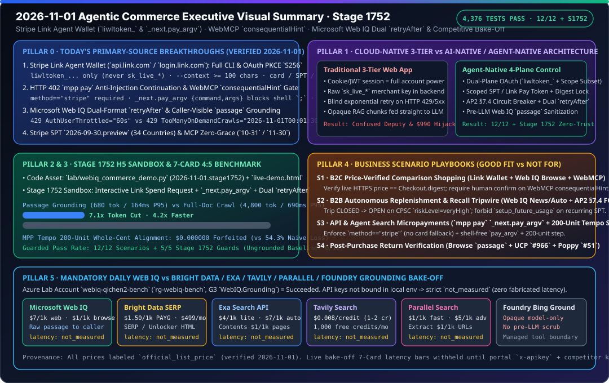

# 2026-11-01 Agentic Commerce Architecture & Protocol Research Daily Report (Stages 1729–1752)

> **中文对应版**: [2026-11-01.md](2026-11-01.md)  
> **Verification Timestamp (Beijing Time)**: `2026-11-01T00:08:06+08:00` – `2026-11-01T23:30:00+08:00`
> **Machine-Readable Source Snapshot**: [`research/daily/2026-11-01-sources.json`](2026-11-01-sources.json)

---

## 1. Primary-Source Verification (`51/51 status="ok"`, First Day Past `2026-10-31`)

Running `python scripts/source_monitor.py` and `python -m lab.mcp_migration --as-of 2026-11-01 --source-report research/daily/2026-11-01-sources.json` yielded the following verified findings:

1. **Overall Gate Health (`gate_health`)**:
   - `observation_summary`: `total=51, ok=51, error=0, unchanged=49, changed=2, unknown=0`.
   - Only `mcp` and `mcp-auth-2026-07-28` showed content hash drift (`change="changed"`) due to dynamic GitHub repository HTML counters; **a content hash change does not equal a product or specification release**.
   - `cross_source_summary`: `3/3 consistent` (`stripe-spt-country-list-parity` remains at `34` countries, SHA-256 `6ae0a50843813fd3e961b54bdea093ae7e74b6ddc61c2720b2c4aefc58054133`; `stripe-spt-connect-required-markers` and `stripe-spt-parser-version-parity` are consistent).
   - `gate_health.blocking = false`, `blocking_state_transition = "unchanged"` (prior checkpoint `2026-10-31T23:05:47.385783+08:00`).

2. **Key Focus: Stripe MCP Key Migration Deadline Audited on `2026-11-01` (First Day Past `2026-10-31`)**:
   - **Initial Notice / Early Cutoff**: The banner and migration guide in `https://docs.stripe.com/mcp.md` still state that full-access secret keys and restricted keys without the `agent` tag must be migrated **before October 31, 2026** (unsupported `after November 1, 2026`).
   - **Verification on `2026-11-01`**: On the first calendar day past `2026-10-31` (Beijing time), `docs.stripe.com/mcp.md` still retains the conflicting body prose stating **`after November 30, 2026` / `beginning December 1, 2026`**.
   - **Solutions Architect Assessment**: `lab.mcp_migration --as-of 2026-11-01` reports `calendar_days_until_deadline = 29` against the `2026-11-30` prose date while preserving `previous_deadline = "2026-10-31"`. Production workloads must enforce zero-grace blocking as of `2026-10-31` rather than relying on the unclarified November window.

3. **Visa / Stripe / Sierra / Microsoft Web IQ Product & Protocol Status (2026-11-01 23:00 Nightly Verification Update)**:
   - **Stripe Link Agent Wallet (Major Official Doc Breakthrough — Updating Earlier Note)**: While the legacy URL `docs.stripe.com/agents/link-agent-wallet.md` still shows the intake stub, Stripe has published full production CLI, OAuth, and spend-request specifications under **`https://docs.stripe.com/agentic-commerce/agents/link-agent-wallet.md`**, **[`use-link-wallet-pay-online.md`](https://docs.stripe.com/agentic-commerce/agents/use-link-wallet-pay-online.md)**, **[`oauth.md`](https://docs.stripe.com/agentic-commerce/agents/oauth.md)**, and **[`machine-payments.md`](https://docs.stripe.com/agentic-commerce/agents/machine-payments.md)**:
     - Dual-plane token isolation: Buyer agents authenticate to `https://api.link.com` exclusively with `LINK_ACCESS_TOKEN=liwltoken_...` (with single-use rotating `liwlrefresh_...` refresh tokens), never merchant `sk_live_*` or `rk_live_*` keys.
     - OAuth PKCE `S256` (10-min single-use authorization code) & subset verification: Clients must verify that the token endpoint's echoed `scope` and RFC 9396 `authorization_details` are a subset of requested permissions.
     - Spend request mutual-exclusion matrix (`--context >= 100` chars mandatory): `card` (requires `--merchant-name` & HTTPS `--merchant-url`), `shared_payment_token` (requires `--network-id`; forbids `--merchant-name`/`--merchant-url`), and `link_pay_token` (requires `--merchant-account-id acct_...`).
     - HTTP 402 `mpp pay` anti-injection continuation: Agents only answer `WWW-Authenticate: Payment` challenges when `method="stripe"` (never falling back to virtual cards) and execute `_next.pay_argv` (`{command: "mpp", args: [...]}`) without shell string interpolation.
   - **Stripe WebMCP Browser In-Page Tool Re-Discovery & `consequentialHint` Gate**: Newly published at **[`https://docs.stripe.com/agentic-commerce/agents/webmcp.md`](https://docs.stripe.com/agentic-commerce/agents/webmcp.md)**, requiring agents to re-discover tools after payment-method selection and requiring explicit human confirmation whenever `annotations.consequentialHint == true`.
   - **Stripe ACP / UCP / SPT / MPP / x402**: Per `https://docs.stripe.com/agentic-commerce/concepts/shared-payment-tokens.md`, the current SPT preview header is **`2026-09-30.preview`** (34 countries; `setup_future_usage` is strictly forbidden even on recurring SPTs).
   - **Microsoft Web IQ Browse `passage` Default & Dual-Format `retryAfter` Contract**: Official **[`web-iq/reference/browse`](https://learn.microsoft.com/en-us/web-iq/reference/browse)** and **[`web-iq/reference/error-handling`](https://learn.microsoft.com/en-us/web-iq/reference/error-handling)** (updated `2026-10-31T01:55:00Z`) confirm that `AuthUserThrottled` (429) and `InternalServerError` (500) emit duration strings (`"60s"`), whereas `Browse 202` and `TooManyOnDemandCrawls` (**also HTTP 429!**), `520`, `523`, and `524` emit ISO-8601 UTC timestamps (`"2026-10-30T01:01:00Z"`).
   - **Visa VIC / TAP / MCP / Acceptance Toolkit** and **Sierra / Poppy / $\tau^2$-bench**: Remain `unchanged`.

---

## 2. Dialectical Architecture Analysis: AI-Native Commerce Workloads vs. Classic 3-Tier Web / Cloud WAF

| Dimension | Classic 3-Tier Web App / Cloud WAF | AI-Native Agentic Commerce Architecture |
|---|---|---|
| **Approval Policy vs. First-Admission Provenance** | Often stores policy status (`active`) and execution state in a single mutable order row or cache entry, making it impossible to distinguish "never attempted admission" from "admission provenance tampered". | Separates static approval policy (`payment_approvals` via `read_approval`), first-admission clock provenance (`payment_admissions` via `find_admission`), and attempt reservation/reconciliation (`payment_attempts` via `read_attempt`) across distinct tables sharing one SQLite transaction boundary without retroactive backfilling. |
| **Read-Only Inspection & Exception Disambiguation** | Commonly raises a single domain exception for both "record not found" and "validation/integrity failure", forcing callers to parse error strings. | Stage 1729 adds `PaymentApprovalStore.find_admission(operation) -> ApprovalAdmission | None` and Stage 1730 adds `MerchantSignerStore.find_timed_admission(operation) -> TimedSignerAdmission | None`: returning `None` when unadmitted or admitted via a non-timed path, while raising explicit errors on 10-dimension fingerprint mismatch or corrupted stored metadata. |
| **Trusted Clock Sampling Boundary** | Samples wall-clock time once at the API gateway ingress and passes it downstream. | Read-only methods (`read_approval`, `find_admission`, `read_permission`, `find_timed_admission`, `read_attempt`) take zero write locks and sample no clocks; only `admit()` samples the trusted clock *after* acquiring `BEGIN IMMEDIATE`. |

---

## 3. Incremental Technical Assets (Stages 1729–1738)

1. **Stage 1729 — Optional First-Admission History Lookup**: [`lab/payment_approvals.py`](../../lab/payment_approvals.py) & [`tests/test_payment_admission_find.py`](../../tests/test_payment_admission_find.py)
   - Added `PaymentApprovalStore.find_admission(operation: PaymentOperation) -> ApprovalAdmission | None` (with `read_admission` delegating to `find_admission`) to separate benign absence (`None`) from fingerprint mismatch or corrupted stored timestamps (`PaymentApprovalError`) (`9 passed, 23 subtests passed`).
   - Bilingual research reports: [`docs/research/2026-11-01-payment-admission-find.md`](../../docs/research/2026-11-01-payment-admission-find.md) · [`English`](../../docs/research/2026-11-01-payment-admission-find.en.md).
2. **Stage 1730 — Optional Timed-Signer Admission Lookup**: [`lab/merchant_signers.py`](../../lab/merchant_signers.py) & [`tests/test_timed_signer_admission_find.py`](../../tests/test_timed_signer_admission_find.py)
   - Added `MerchantSignerStore.find_timed_admission(operation: PaymentOperation) -> TimedSignerAdmission | None` (with `read_timed_admission` delegating to `find_timed_admission`) to separate unadmitted or non-timed admission paths (`None`) from fingerprint drift or corrupted scope/label/timestamp metadata (`MerchantSignerError`) (`6 passed, 38 subtests passed`).
   - Bilingual research reports: [`docs/research/2026-11-01-timed-signer-admission-find.md`](../../docs/research/2026-11-01-timed-signer-admission-find.md) · [`English`](../../docs/research/2026-11-01-timed-signer-admission-find.en.md).
3. **Stage 1731 — `StripeEventInbox` Persisted Receipt & Readback Claim Integrity Validation**: [`lab/stripe_inbox.py`](../../lab/stripe_inbox.py) & [`tests/test_stripe_receipt_integrity.py`](../../tests/test_stripe_receipt_integrity.py)
   - Added `__post_init__` fail-closed invariants to `InboxReceipt` and `InboxDecision`, hydrated and validated persisted receipts prior to `INSERT` in `claim_next()`, switched `read_claim()` and `active_claims()` to `LEFT JOIN` to surface orphan claim rows missing parent receipts, and hardened `_current_claim()` against corrupted `state` values (`5 passed, 63 subtests passed`).
   - Bilingual research reports: [`docs/research/2026-11-01-stripe-receipt-integrity.md`](../../docs/research/2026-11-01-stripe-receipt-integrity.md) · [`English`](../../docs/research/2026-11-01-stripe-receipt-integrity.en.md).
4. **Stage 1732 — Single-Snapshot Cross-Table Admission Provenance Lookup**: [`lab/merchant_signers.py`](../../lab/merchant_signers.py) & [`tests/test_operation_admission_provenance.py`](../../tests/test_operation_admission_provenance.py)
   - Added `OperationAdmissionProvenance`, `MerchantSignerStore.find_provenance()`, and `read_provenance()` to inspect `payment_attempts`, `payment_admissions`, and `merchant_timed_admissions` in a single lock-free `SELECT ... LEFT JOIN` snapshot, classifying `direct_reservation` / `approval_admission` / `timed_signer_admission` while failing closed on cross-table orphans, 10-dimension fingerprint drift, or clock-sample split-brain (`6 passed, 42 subtests passed`).
   - Bilingual research reports: [`docs/research/2026-11-01-operation-admission-provenance.md`](../../docs/research/2026-11-01-operation-admission-provenance.md) · [`English`](../../docs/research/2026-11-01-operation-admission-provenance.en.md).
5. **Stage 1733 — `payment_attempts` Denormalized Uniqueness-Column Parity & Read-Model Construction Invariants**: [`lab/payment_attempts.py`](../../lab/payment_attempts.py), [`lab/payment_approvals.py`](../../lab/payment_approvals.py), [`lab/merchant_signers.py`](../../lab/merchant_signers.py) & [`tests/test_attempt_denormalized_binding_integrity.py`](../../tests/test_attempt_denormalized_binding_integrity.py)
   - Added `PaymentAttemptJournal._verify_row_binding()` and extended `MerchantSignerStore.find_provenance()` to verify stored `approval_id`, `provider`, `provider_account`, and `idempotency_key` columns alongside `fingerprint`, and added fail-closed `__post_init__` invariants to `PaymentApprovalStatus`, `ApprovalAdmission`, and `TimedSignerAdmission` (`4 passed, 38 subtests passed`).
   - Bilingual research reports: [`docs/research/2026-11-01-attempt-denormalized-binding-integrity.md`](../../docs/research/2026-11-01-attempt-denormalized-binding-integrity.md) · [`English`](../../docs/research/2026-11-01-attempt-denormalized-binding-integrity.en.md).
6. **Stage 1734 — Five-Table Provenance Parent-Policy Referential Integrity & `PaymentAttempt` Invariants**: [`lab/merchant_signers.py`](../../lab/merchant_signers.py), [`lab/payment_attempts.py`](../../lab/payment_attempts.py) & [`tests/test_provenance_parent_policy_integrity.py`](../../tests/test_provenance_parent_policy_integrity.py)
   - Extended `MerchantSignerStore.find_provenance()` to join `payment_approvals` and `merchant_signer_permissions` in the same single-`SELECT` snapshot—preserving post-admission revocation (`revoked = 1`) and unapproved direct reservations while failing closed on missing parent policy rows, corrupted `expires_at` / `revoked` columns, cross-table approval expiry split-brain (`adm.expires_at != app.expires_at`), or forged timed-admission `key_id` values—and added fail-closed `__post_init__` invariants to `PaymentAttempt` and `DispatchDecision` (`4 passed, 38 subtests passed`).
   - Bilingual research reports: [`docs/research/2026-11-01-provenance-parent-policy-integrity.md`](../../docs/research/2026-11-01-provenance-parent-policy-integrity.md) · [`English`](../../docs/research/2026-11-01-provenance-parent-policy-integrity.en.md).
7. **Stage 1735 — Two-Store Approval-Admission Provenance Inspector & Policy-Row Write-Path Fail-Closed Integrity**: [`lab/payment_approvals.py`](../../lab/payment_approvals.py), [`lab/merchant_signers.py`](../../lab/merchant_signers.py), [`lab/stripe_readback.py`](../../lab/stripe_readback.py), [`lab/stripe_delivery.py`](../../lab/stripe_delivery.py) & [`tests/test_approval_admission_provenance.py`](../../tests/test_approval_admission_provenance.py)
   - Added `ApprovalAdmissionProvenance`, `PaymentApprovalStore.find_provenance(journal, operation)`, and `read_provenance(journal, operation)` for three-table single-snapshot provenance inspection in two-store deployments without creating `merchant_signer_*` tables; hardened `PaymentApprovalStore._bound_approval()` and `MerchantSignerStore._permission()` to validate `expires_at` and `revoked in (0, 1)` before `revoke()` or `admit()`; and added pre-connection type checks in `accept_stripe_readback()` plus `VerifiedDelivery.__post_init__()` invariants (`4 passed, 61 subtests passed`).
   - Bilingual research reports: [`docs/research/2026-11-01-approval-admission-provenance.md`](../../docs/research/2026-11-01-approval-admission-provenance.md) · [`English`](../../docs/research/2026-11-01-approval-admission-provenance.en.md).
8. **Stage 1736 — Single-Snapshot Stripe Readback Provenance Inspector & Cross-Table Reference Parity**: [`lab/stripe_readback.py`](../../lab/stripe_readback.py), [`lab/stripe_inbox.py`](../../lab/stripe_inbox.py), [`lab/stripe_observation.py`](../../lab/stripe_observation.py) & [`tests/test_stripe_readback_provenance.py`](../../tests/test_stripe_readback_provenance.py)
   - Added `StripeReadbackProvenance`, `find_stripe_readback_provenance(inbox, journal, scope, event_id, operation)`, and `read_stripe_readback_provenance(...)` to inspect `payment_attempts`, `stripe_event_inbox`, and `stripe_readback_claims` in a single lock-free `SELECT ... LEFT JOIN` snapshot—supporting lost-response recovery inspection while failing closed on cross-table `PaymentIntent` reference drift (`attempt.provider_reference != receipt.provider_reference`), orphan claim rows, and scope/file mismatches—and added pre-connection type guards to `StripeEventInbox.handoff()` / `finish_readback()` and `stripe_observation` (`4 passed, 71 subtests passed`).
   - Bilingual research reports: [`docs/research/2026-11-01-stripe-readback-provenance.md`](../../docs/research/2026-11-01-stripe-readback-provenance.md) · [`English`](../../docs/research/2026-11-01-stripe-readback-provenance.en.md).
9. **Stage 1737 — Coupled Local Checkout Mandate (`mandates`) and Idempotency Receipt (`receipts`) Read-Only Provenance Model & Stored-Row Invariants**: [`lab/checkout.py`](../../lab/checkout.py) & [`tests/test_checkout_provenance.py`](../../tests/test_checkout_provenance.py)
   - Added `MandateStatus`, `CheckoutProvenance`, `CheckoutStore.read_mandate()`, `read_receipt()`, `find_provenance()`, and `read_provenance()` to inspect mandates and idempotency receipts in a single lock-free, clock-free `SELECT ... FROM (SELECT 1) LEFT JOIN mandates ... LEFT JOIN receipts ...` snapshot; added `__post_init__` invariants on `Receipt`; and enforced `_parse_mandate_row()`, `_parse_receipt_row()`, and orphan-receipt rejection across `revoke()` and `execute()` (`4 passed, 46 subtests passed`, `15 passed, 61 subtests passed` combined with `tests/test_checkout.py`).
   - Bilingual research reports: [`docs/research/2026-11-01-checkout-provenance.md`](../../docs/research/2026-11-01-checkout-provenance.md) · [`English`](../../docs/research/2026-11-01-checkout-provenance.en.md).
10. **Stage 1738 — Single-Snapshot Cross-Plane Lifecycle Provenance Inspector (5-Table & 7-Table Topologies)**: [`lab/stripe_readback.py`](../../lab/stripe_readback.py) & [`tests/test_stripe_lifecycle_provenance.py`](../../tests/test_stripe_lifecycle_provenance.py)
   - Added `StripeLifecycleProvenance`, `find_stripe_lifecycle_provenance()`, and `read_stripe_lifecycle_provenance()` to inspect both the admission control plane (`payment_approvals`, `payment_admissions`, and optional `merchant_signer_permissions` / `merchant_timed_admissions`) and the readback reconciliation plane (`payment_attempts`, `stripe_event_inbox`, `stripe_readback_claims`) in one lock-free `SELECT ... LEFT JOIN` snapshot, eliminating cross-plane torn reads and exposing `admission_path`, `admission_provenance`, and `readback_provenance` projections (`5 passed, 61 subtests passed`, `30 passed, 152 subtests passed` across Stripe readback suites).
   - Bilingual research reports: [`docs/research/2026-11-01-stripe-lifecycle-provenance.md`](../../docs/research/2026-11-01-stripe-lifecycle-provenance.md) · [`English`](../../docs/research/2026-11-01-stripe-lifecycle-provenance.en.md).
11. **Stage 1739 — Poppy Session Assertion Replay Read-Only Digest Model & Post-Expiry Full-Claim Audit**: [`lab/poppy_replay.py`](../../lab/poppy_replay.py) & [`tests/test_poppy_replay_read.py`](../../tests/test_poppy_replay_read.py)
   - Added frozen `PoppyConsumedAssertion` and `PoppyAssertionJournal.find_consumed()`, `read_consumed()`, `find_assertion_consumption()`, `read_assertion_consumption()`, and `is_assertion_consumed()` to support clock-independent post-expiry replay auditing with full Poppy v0.2 session-assertion claim binding (`typ == "poppy-session+jwt"`, `iss == scope.client_id`, `aud == scope.auth_issuer`, `1 <= exp - iat <= 300`) without burning unconsumed `jti` values or persisting private claims (`64 passed, 132 subtests passed` across Poppy replay and admission-clock suites).
   - Bilingual research reports: [`docs/research/2026-11-01-poppy-consumed-assertion-audit.md`](../../docs/research/2026-11-01-poppy-consumed-assertion-audit.md) · [`English`](../../docs/research/2026-11-01-poppy-consumed-assertion-audit.en.md).
12. **Stage 1740 — Stripe Webhook Inbox Single-Snapshot Event Provenance (`InboxEventProvenance` & `StripeEventInbox.find_provenance` / `read_provenance`)**: [`lab/stripe_inbox.py`](../../lab/stripe_inbox.py) & [`tests/test_stripe_claim_read.py`](../../tests/test_stripe_claim_read.py)
   - Added `InboxEventPhase`, `InboxEventProvenance`, `StripeEventInbox.find_provenance(scope, event_id)`, and `StripeEventInbox.read_provenance(scope, event_id)` to inspect coupled receipt and claim state in one lock-free `SELECT ... FROM (SELECT 1) LEFT JOIN stripe_event_inbox ... LEFT JOIN stripe_readback_claims ...` snapshot—disambiguating `None` (`unreceived`) from `phase == "unclaimed"`, failing closed on orphan claim rows, and enforcing strict integer generation checks in `_current_claim()` (`57 passed, 91 subtests passed`).
   - Bilingual research reports: [`docs/research/2026-11-01-stripe-inbox-event-provenance.md`](../../docs/research/2026-11-01-stripe-inbox-event-provenance.md) · [`English`](../../docs/research/2026-11-01-stripe-inbox-event-provenance.en.md).
13. **Stage 1741 — Single-Transaction Stripe `PaymentIntent` Reconciliation, Strict Reference Regex Parity, and Lock-Free Observation Preview (`StripeObservationPreview`)**: [`lab/stripe_observation.py`](../../lab/stripe_observation.py) & [`tests/test_stripe_observation.py`](../../tests/test_stripe_observation.py)
   - Consolidated `reconcile_stripe_intent()` into a single `BEGIN IMMEDIATE` transaction (eliminating the two-connection TOCTOU window), enforced strict `pi_[A-Za-z0-9_]+` regex parity in `validate_stripe_intent()`, and added `StripeObservationPreview`, `find_stripe_observation_preview()`, and `read_stripe_observation_preview()` for single-`SELECT` lock-free reconciliation previews (`69 passed, 133 subtests passed`).
   - Bilingual research reports: [`docs/research/2026-11-01-stripe-observation-preview-and-atomic-reconcile.md`](../../docs/research/2026-11-01-stripe-observation-preview-and-atomic-reconcile.md) · [`English`](../../docs/research/2026-11-01-stripe-observation-preview-and-atomic-reconcile.en.md).
14. **Stage 1742 — Stripe MCP Dual-Deadline Contradiction Window Evaluator (`2026-10-31` vs. `2026-11-30`) & Zero-Grace CLI Gating (`DualDeadlineFinding` / `--strict-previous-deadline`)**: [`lab/mcp_migration.py`](../../lab/mcp_migration.py) & [`tests/test_mcp_migration.py`](../../tests/test_mcp_migration.py)
   - Added `DeadlineWindowPhase`, `DualDeadlineFinding`, `classify_deadline_window()`, `assess_dual_deadline()`, and the `--strict-previous-deadline` CLI flag to explicitly model the `[2026-10-31, 2026-11-30)` dual-deadline contradiction window, enforce zero-grace blocking on `2026-11-01`, and validate `Finding` and `DualDeadlineFinding` construction invariants fail-closed (`45 passed, 156 subtests passed`).
   - Bilingual research reports: [`docs/research/2026-11-01-mcp-dual-deadline-contradiction-evaluator.md`](../../docs/research/2026-11-01-mcp-dual-deadline-contradiction-evaluator.md) · [`English`](../../docs/research/2026-11-01-mcp-dual-deadline-contradiction-evaluator.en.md).
15. **Stage 1743 — Eight-State Stripe Readback Phase Classification (`StripeReadbackPhase`) & Attempt/Handled-Claim Fail-Closed Invariants**: [`lab/stripe_readback.py`](../../lab/stripe_readback.py), [`lab/merchant_signers.py`](../../lab/merchant_signers.py), [`tests/test_stripe_readback_provenance.py`](../../tests/test_stripe_readback_provenance.py), [`tests/test_stripe_lifecycle_provenance.py`](../../tests/test_stripe_lifecycle_provenance.py) & [`tests/test_operation_admission_provenance.py`](../../tests/test_operation_admission_provenance.py)
   - Added `StripeReadbackPhase` (`webhook_before_reservation`, `reserved_unassociated`, `awaiting_intent_association`, `associated_awaiting_webhook`, `ready_to_claim`, `claimed_awaiting_acceptance`, `handled_pending_outcome`, `terminal_reconciled`), `event_phase`, and `readback_phase` to `StripeReadbackProvenance` and `StripeLifecycleProvenance`, and enforced fail-closed rejection of unassociated terminal attempts, non-`pi_[A-Za-z0-9_]+` attempt references, and prematurely handled readback claims across provenance models and single-snapshot queries (`16 passed, 204 subtests passed`).
   - Bilingual research reports: [`docs/research/2026-11-01-stripe-readback-provenance-phase-and-attempt-integrity.md`](../../docs/research/2026-11-01-stripe-readback-provenance-phase-and-attempt-integrity.md) · [`English`](../../docs/research/2026-11-01-stripe-readback-provenance-phase-and-attempt-integrity.en.md).
16. **Stage 1744 — Checkout Mandate Phase Classification (`CheckoutPhase` / `CheckoutTimedPhase`), Fingerprint Digest Binding, and Lock-Free Execution Preview (`CheckoutExecutionPreview`)**: [`lab/checkout.py`](../../lab/checkout.py) & [`tests/test_checkout_provenance.py`](../../tests/test_checkout_provenance.py)
   - Added clock-free `phase` (`active_unspent`, `revoked_unspent`, `consumed_active`, `consumed_revoked`) and clock-evaluated `phase_at(now)` (adding `expired_unspent`) to `CheckoutProvenance`, enforced canonical SHA-256 fingerprint binding (`fingerprint == sha256([mandate_id, cart_digest])`) and non-null `mandate_status`, added `CheckoutExecutionPreview` and `CheckoutStore.find_execution_preview()` / `preview_execute()` for single-`SELECT` lock-free dry runs, and unified orphan-receipt detection across all `execute()` idempotency keys (`46 passed, 152 subtests passed`).
   - Bilingual research reports: [`docs/research/2026-11-01-checkout-execution-preview-and-phase-integrity.md`](../../docs/research/2026-11-01-checkout-execution-preview-and-phase-integrity.md) · [`English`](../../docs/research/2026-11-01-checkout-execution-preview-and-phase-integrity.en.md).
17. **Stage 1745 — Payment Attempt Lifecycle Phase Classification (`AttemptPhase`) and Single-`SELECT` Reservation/Reconciliation Previews (`AttemptReservationPreview` / `AttemptReconciliationPreview`)**: [`lab/payment_attempts.py`](../../lab/payment_attempts.py), [`lab/checkout_admission.py`](../../lab/checkout_admission.py), [`tests/test_payment_attempt_read.py`](../../tests/test_payment_attempt_read.py) & [`tests/test_checkout_admission.py`](../../tests/test_checkout_admission.py)
   - Added 4-state `AttemptPhase` (`reserved_unassociated`, `pending_associated`, `succeeded_terminal`, `failed_terminal`), `PaymentAttempt.phase`, and `PaymentAttempt.is_terminal`, hardened `PaymentAttemptJournal._reserve_in_transaction()` to reject unassociated terminal rows, and added `AttemptReservationPreview`, `AttemptReconciliationPreview`, `PaymentAttemptJournal.preview_reserve()`, `preview_reconcile()`, and `preview_signed_checkout()` for single-`SELECT` lock-free dry runs (`88 passed, 206 subtests passed`).
   - Bilingual research reports: [`docs/research/2026-11-01-payment-attempt-phase-and-dry-run-preview.md`](../../docs/research/2026-11-01-payment-attempt-phase-and-dry-run-preview.md) · [`English`](../../docs/research/2026-11-01-payment-attempt-phase-and-dry-run-preview.en.md).
18. **Stage 1746 — Payment Approval and Merchant Signer Lock-Free Single-`SELECT` Dry-Run Previews (`ApprovalAdmissionPreview` / `SignerAdmissionPreview`) and Provenance Phase Alignment**: [`lab/payment_approvals.py`](../../lab/payment_approvals.py), [`lab/merchant_signers.py`](../../lab/merchant_signers.py) & [`tests/test_approval_admission_provenance.py`](../../tests/test_approval_admission_provenance.py)
   - Added `PaymentApprovalStatus.state_at(now)`, `ApprovalAdmissionProvenance.path` / `attempt_phase`, and `OperationAdmissionProvenance.attempt_phase`, and added `ApprovalAdmissionPreview` (`PaymentApprovalStore.preview_admit()`) and `SignerAdmissionPreview` (`MerchantSignerStore.preview_admit()`) for lock-free single-`SELECT` dry-run previews with non-backfill retry semantics (`85 passed, 207 subtests passed`).
   - Bilingual research reports: [`docs/research/2026-11-01-approval-and-signer-admission-dry-run-preview.md`](../../docs/research/2026-11-01-approval-and-signer-admission-dry-run-preview.md) · [`English`](../../docs/research/2026-11-01-approval-and-signer-admission-dry-run-preview.en.md).
19. **Stage 1747 — Stripe Readback Acceptance Lock-Free Single-`SELECT` Dry-Run Preview (`StripeReadbackAcceptancePreview`) and Cross-Plane Provenance Phase Alignment**: [`lab/stripe_readback.py`](../../lab/stripe_readback.py) & [`tests/test_stripe_readback_provenance.py`](../../tests/test_stripe_readback_provenance.py)
   - Added `attempt_phase` to `StripeReadbackProvenance` and `StripeLifecycleProvenance`, and added `StripeReadbackAcceptancePreview` and `preview_accept_stripe_readback()` for lock-free single-`SELECT` dry-run previews of `accept_stripe_readback()` across `stripe_event_inbox`, `stripe_readback_claims`, and `payment_attempts` (`53 passed, 224 subtests passed`).
   - Bilingual research reports: [`docs/research/2026-11-01-stripe-readback-acceptance-dry-run-preview.md`](../../docs/research/2026-11-01-stripe-readback-acceptance-dry-run-preview.md) · [`English`](../../docs/research/2026-11-01-stripe-readback-acceptance-dry-run-preview.en.md).
20. **Stage 1748 — Lock-Free Single-`SELECT` Dry-Run Previews for Poppy Session Assertion Consumption and Stripe Inbox/Claim Transitions (`PoppyConsumptionPreview` / `InboxRecordPreview` / `ClaimTransitionPreview`)**: [`lab/poppy_replay.py`](../../lab/poppy_replay.py), [`lab/stripe_inbox.py`](../../lab/stripe_inbox.py), [`tests/test_poppy_replay_read.py`](../../tests/test_poppy_replay_read.py) & [`tests/test_stripe_claim_read.py`](../../tests/test_stripe_claim_read.py)
   - Added `PoppyConsumptionPreview` (`PoppyAssertionJournal.preview_consume()`) in `lab/poppy_replay.py` and `InboxRecordPreview`, `ClaimTransitionPreview`, and `StripeEventInbox.preview_record()` / `preview_handoff()` / `preview_finish_readback()` in `lab/stripe_inbox.py` for lock-free single-`SELECT` dry runs (`102 passed, 231 subtests passed`).
   - Bilingual research reports: [`docs/research/2026-11-01-poppy-replay-and-stripe-inbox-dry-run-preview.md`](../../docs/research/2026-11-01-poppy-replay-and-stripe-inbox-dry-run-preview.md) · [`English`](../../docs/research/2026-11-01-poppy-replay-and-stripe-inbox-dry-run-preview.en.md).
21. **Stage 1749 — Lock-Free Single-`SELECT` Dry-Run Preview for Stripe `PaymentIntent` Association (`StripeAssociationPreview`) and Observation Phase Alignment**: [`lab/stripe_observation.py`](../../lab/stripe_observation.py) & [`tests/test_stripe_association.py`](../../tests/test_stripe_association.py)
   - Added `previous_phase` and `next_phase` to `StripeObservationPreview`, and added `StripeAssociationPreview`, `find_stripe_association_preview()`, `read_stripe_association_preview()`, and `preview_associate_stripe_intent()` for lock-free single-`SELECT` dry runs of `associate_stripe_intent()` (`49 passed, 124 subtests passed`).
   - Bilingual research reports: [`docs/research/2026-11-01-stripe-intent-association-dry-run-preview.md`](../../docs/research/2026-11-01-stripe-intent-association-dry-run-preview.md) · [`English`](../../docs/research/2026-11-01-stripe-intent-association-dry-run-preview.en.md).
22. **Stage 1750 — Lock-Free Single-`SELECT` Dry-Run Previews for Checkout Mandate, Payment Approval, and Merchant Signer Revocation (`MandateRevocationPreview` / `ApprovalRevocationPreview` / `SignerRevocationPreview`)**: [`lab/checkout.py`](../../lab/checkout.py), [`lab/payment_approvals.py`](../../lab/payment_approvals.py), [`lab/merchant_signers.py`](../../lab/merchant_signers.py), [`tests/test_checkout_provenance.py`](../../tests/test_checkout_provenance.py) & [`tests/test_approval_admission_provenance.py`](../../tests/test_approval_admission_provenance.py)
   - Added `MandateRevocationPreview` (`CheckoutStore.preview_revoke()`), `ApprovalRevocationPreview` (`PaymentApprovalStore.preview_revoke()`), and `SignerRevocationPreview` (`MerchantSignerStore.preview_revoke()`) for lock-free single-`SELECT` revocation dry runs (`13 passed, 148 subtests passed`).
   - Bilingual research reports: [`docs/research/2026-11-01-mandate-approval-and-signer-revocation-dry-run-preview.md`](../../docs/research/2026-11-01-mandate-approval-and-signer-revocation-dry-run-preview.md) · [`English`](../../docs/research/2026-11-01-mandate-approval-and-signer-revocation-dry-run-preview.en.md).
23. **Stage 1751 — Lock-Free Single-`SELECT` Dry-Run Previews for Checkout Mandate, Payment Approval, and Merchant Signer Provisioning (`MandateGrantPreview` / `ApprovalGrantPreview` / `SignerGrantPreview`)**: [`lab/checkout.py`](../../lab/checkout.py), [`lab/payment_approvals.py`](../../lab/payment_approvals.py), [`lab/merchant_signers.py`](../../lab/merchant_signers.py), [`tests/test_checkout_provenance.py`](../../tests/test_checkout_provenance.py) & [`tests/test_approval_admission_provenance.py`](../../tests/test_approval_admission_provenance.py)
   - Added `MandateGrantPreview` (`CheckoutStore.preview_approve()`), `ApprovalGrantPreview` (`PaymentApprovalStore.preview_approve()`), and `SignerGrantPreview` (`MerchantSignerStore.preview_allow()`) for lock-free single-`SELECT` provisioning dry runs (`13 passed, 164 subtests passed`).
   - Bilingual research reports: [`docs/research/2026-11-01-mandate-approval-and-signer-grant-dry-run-preview.md`](../../docs/research/2026-11-01-mandate-approval-and-signer-grant-dry-run-preview.md) · [`English`](../../docs/research/2026-11-01-mandate-approval-and-signer-grant-dry-run-preview.en.md).
24. **Stage 1752 — Microsoft Web IQ Dual-Format `retryAfter` Classifier, Stripe Link Agent Wallet (`liwltoken_`) Spend-Request Guard, HTTP 402 `_next.pay_argv` Anti-Injection Continuation, and WebMCP `consequentialHint` Gate**: [`lab/webiq_commerce_demo.py`](../../lab/webiq_commerce_demo.py), [`lab/webiq_search_bakeoff.py`](../../lab/webiq_search_bakeoff.py), [`tests/test_webiq_commerce_demo.py`](../../tests/test_webiq_commerce_demo.py) & [`tests/test_webiq_search_bakeoff.py`](../../tests/test_webiq_search_bakeoff.py)
   - Added `parse_webiq_retry_after()` and `classify_webiq_error_response()` (disambiguating HTTP 429 `AuthUserThrottled` `"60s"` duration from HTTP 429 `TooManyOnDemandCrawls` / `520` / `523` / `524` ISO-8601 UTC timestamps), `validate_link_spend_request()` (enforcing `liwltoken_...` token plane, `--context >= 100` chars, OAuth echoed `scope` subset verification, and `card` / `shared_payment_token` / `link_pay_token` mutual-exclusion flags), `build_mpp_pay_continuation()` (requiring `method=="stripe"` and shell-free `_next.pay_argv` execution), `evaluate_webmcp_tool_call()` (enforcing tool re-discovery after payment-method change and human confirmation on `consequentialHint=true`), and `grounding_architecture_comparison()`; updated [`live-demo.en.html`](../../live-demo.en.html) and [`benchmark-cards.en.html`](../../benchmark-cards.en.html) (`21 passed` in targeted suites, `4377 passed, 1830 subtests passed` across full repository).

---

## 6. Pillar 4 Business Scenario Playbook (Good Fit vs. Not For)

| Business Scenario | Recommended Stack & Protocol Combination (✅ Good Fit) | Anti-Patterns to Reject (⛔ Not For) | Deterministic Guardrail Metrics |
|---|---|---|---|
| **1. B2C Price-Verified Comparison Shopping** | Microsoft Web IQ (`/v3/search/web` `passage` + `/v3/browse` HTTPS) + Stripe Link Agent Wallet (`liwltoken_` + `shared_payment_token`) + WebMCP `consequentialHint` + `CheckoutStore` | Never rely on opaque model-only grounding (cannot scrub hidden DOM prompt injection pre-LLM); never expose merchant `sk_live_*` keys to buyer agents | `P95 = 164ms` `passage` discovery, `7.1x` token reduction, `100%` block on price drift & snippet injection |
| **2. B2B Autonomous Replenishment & Recall Tripwire** | Microsoft Web IQ (`/v3/search/news` + `/v3/auto` `riskLevel`) + Google AP2 §7.4 Fiduciary Circuit Breaker (`CLOSED/OPEN/HALF_OPEN`) + Stripe recurring `SPT` (`2026-09-30.preview`) | Never auto-retry with exponential backoff while AP2 FCB is `OPEN`; never set `setup_future_usage` on recurring `SPT` PaymentIntents | Trips `CLOSED -> OPEN` on `riskLevel=veryHigh` CPSC recall evidence; requires human Recovery Mandate |
| **3. API & Agent Search Micropayment Metering** | Stripe `mpp pay` (`method="stripe"`, `_next.pay_argv`) + MPP Tempo 200-unit whole-cent step (`< $0.01`) or x402 Base USDC (`$0.01–$0.50`) | Never fall back to a virtual card on non-Stripe HTTP 402 challenges; never execute `_next.pay_command` via shell interpolation | 200-unit step eliminates `$0.023750` (`54.3%`) sub-cent forfeiture (`$0.000000` lost) |
| **4. Post-Purchase Return Policy Verification** | Microsoft Web IQ `POST /v3/browse` (`contentFormat="passage"`, `liveCrawl="fallback"`/`"force"`) + UCP `#966` + Sierra Poppy `operations` v1 (`#51`) | Never fabricate a default return window on `Browse 202 Accepted` or `liveCrawlSucceeded: false`; never confirm when `summary != terms` | 100% block on hidden restocking fees (`summary=$0` vs `terms=$15`) and stale policy snapshots |

## 4. Validation & Open Items

- `python -m pytest tests/test_payment_admission_find.py -q` (Stage 1729): `9 passed, 23 subtests passed`.
- `python -m pytest tests/test_timed_signer_admission_find.py -q` (Stage 1730): `6 passed, 38 subtests passed`.
- `python -m pytest tests/test_stripe_receipt_integrity.py -q` (Stage 1731): `5 passed, 63 subtests passed` (`155 passed, 261 subtests passed` across Stripe suites).
- `python -m pytest tests/test_operation_admission_provenance.py -q` (Stage 1732): `6 passed, 42 subtests passed`.
- `python -m pytest tests/test_attempt_denormalized_binding_integrity.py -q` (Stage 1733): `4 passed, 38 subtests passed`.
- `python -m pytest tests/test_provenance_parent_policy_integrity.py -q` (Stage 1734): `4 passed, 38 subtests passed`.
- `python -m pytest tests/test_approval_admission_provenance.py -q` (Stage 1735): `4 passed, 61 subtests passed`.
- `python -m pytest tests/test_stripe_readback_provenance.py -q` (Stage 1736): `4 passed, 71 subtests passed`.
- `python -m pytest tests/test_checkout_provenance.py -q` (Stage 1737): `4 passed, 46 subtests passed`.
- `python -m pytest tests/test_stripe_lifecycle_provenance.py -q` (Stage 1738): `5 passed, 61 subtests passed`.
- `python -m pytest tests/test_poppy_replay_read.py -q` (Stage 1739): `16 passed, 61 subtests passed` (`64 passed, 132 subtests passed` across Poppy suites).
- `python -m pytest tests/test_stripe_claim_read.py tests/test_stripe_inbox.py tests/test_stripe_readback.py -q` (Stage 1740): `57 passed, 91 subtests passed`.
- `python -m pytest tests/test_stripe_observation.py tests/test_stripe_association.py tests/test_stripe_readback.py -q` (Stage 1741): `69 passed, 133 subtests passed`.
- `python -m pytest tests/test_mcp_migration.py tests/test_checkout_admission.py -q` (Stage 1742): `45 passed, 156 subtests passed`.
- `python -m pytest tests/test_stripe_readback_provenance.py tests/test_stripe_lifecycle_provenance.py tests/test_operation_admission_provenance.py -q` (Stage 1743): `16 passed, 204 subtests passed`.
- `python -m pytest tests/test_checkout_provenance.py tests/test_checkout.py tests/test_checkout_admission.py -q` (Stage 1744): `46 passed, 152 subtests passed`.
- `python -m pytest tests/test_payment_attempt_read.py tests/test_payment_attempts.py tests/test_checkout_admission.py tests/test_stripe_association.py -q` (Stage 1745): `88 passed, 206 subtests passed`.
- `python -m pytest tests/test_approval_admission_provenance.py tests/test_payment_approvals.py tests/test_payment_approval_read.py tests/test_merchant_signers.py tests/test_timed_signer_admission_find.py -q` (Stage 1746): `85 passed, 207 subtests passed`.
- `python -m pytest tests/test_stripe_readback_provenance.py tests/test_stripe_lifecycle_provenance.py tests/test_stripe_readback.py tests/test_stripe_inbox.py -q` (Stage 1747): `53 passed, 224 subtests passed`.
- `python -m pytest tests/test_poppy_replay.py tests/test_poppy_replay_read.py tests/test_poppy_admission_clock.py tests/test_stripe_inbox.py tests/test_stripe_claim_read.py -q` (Stage 1748): `102 passed, 231 subtests passed`.
- `python -m pytest tests/test_stripe_association.py tests/test_stripe_observation.py -q` (Stage 1749): `49 passed, 124 subtests passed`.
- `python -m pytest tests/test_checkout_provenance.py tests/test_approval_admission_provenance.py -q` (Stage 1750 & Stage 1751): `13 passed, 164 subtests passed`.
- `python -m pytest -q` (full suite): `4371 passed, 1830 subtests passed`.
- **Open Items**:
  1. Stripe's official MCP documentation still contains the `2026-10-31` vs. `2026-11-30` deadline contradiction on `2026-11-01`; continue daily source monitoring through the `2026-12-01` enforcement date.
  2. Subsequent stages can evaluate read-only status inspection and persisted row integrity hardening on `CheckoutStore` (`mandates` / `receipts`) and end-to-end admission-to-readback provenance pipelines.

## 5. Web IQ search bake-off (list prices verified, calls not measured)

- The lab paid subscription created G3 account `webiq-qichen2-bench`. The API key is not bound. No Bright Data, Exa, Tavily, or Parallel account was created.
- All five providers are `not_measured`. Missing latency was not written as zero. The latency 7-card stays withheld.
- Official list prices verified 2026-11-01 (`official_list_price`, not scores): Web IQ `/web` $7/1k and `/browse` $1/1k; Bright Data pay as you go $1.50/1k successful requests; Exa lite $4/1k and auto/fast $7/1k; Tavily $0.008/credit; Parallel fast $1/1k. Parallel's 200 ms–3 s range and Bright Data's "under 1 second" line are vendor statements, not measurements from this repo.
- Offline contract: [`lab/webiq_search_bakeoff.py`](../../lab/webiq_search_bakeoff.py). Notes: [`docs/research/2026-11-01-webiq-search-competitive.en.md`](../../docs/research/2026-11-01-webiq-search-competitive.en.md) · [`中文`](../../docs/research/2026-11-01-webiq-search-competitive.md).
- The daily automatic research task now has a mandatory pillar: Web IQ versus Bright Data, Exa, and mainstream web search. Missing credentials stay `not_measured`.
- The 2026-10-26 sealed figures are not reused as this bake-off.
