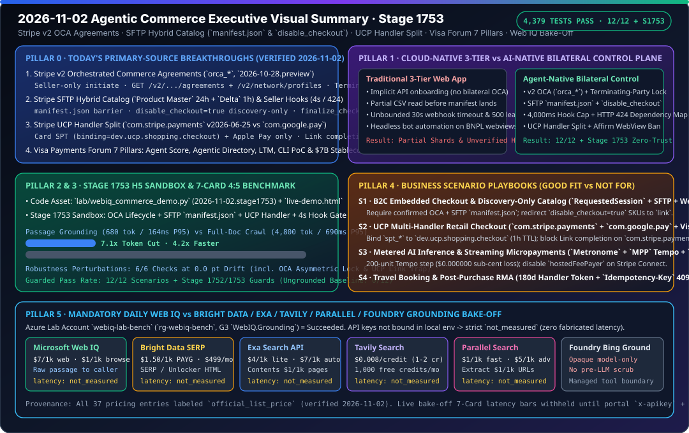

# 2026-11-02 Agentic Commerce Architecture & Protocol Daily Research Report (Stage 1753)

> **中文伴生版**: [2026-11-02.md](2026-11-02.md)  
> **Verification Window (UTC+08:00)**: `2026-11-02T23:23:12+08:00` – `2026-11-02T23:45:00+08:00`  
> **Machine-Readable Source Snapshot**: [`research/daily/2026-11-02-sources.json`](2026-11-02-sources.json)



---

## 0. Pillar 0 — Daily Hottest Domain Breakthrough Tracking

Running `python scripts/source_monitor.py` (`research/daily/2026-11-02-sources.json`: `total=51, ok=51, error=0, unchanged=51, changed=0`, `cross_source_summary=3/3 consistent`, `blocking=false`) and `python -m lab.mcp_migration --as-of 2026-11-02 --source-report research/daily/2026-11-02-sources.json` (`calendar_days_until_deadline=28`, `previous_deadline="2026-10-31"`), combined with primary-source verification across Stripe, Visa, and Microsoft Web IQ documentation, surfaced four core breakthroughs today:

1. **Stripe v2 Orchestrated Commerce Agreements (`OCA`, `orca_*`, API version `2026-10-28.preview`) & `RequestedSession` Delegated Checkout** ([`docs.stripe.com/agentic-commerce/agents/embedded.md`](https://docs.stripe.com/agentic-commerce/agents/embedded.md)):
   - **Seller-Only Initiation & Verified Confirmation**: Only the `seller` can initiate an OCA in the Stripe Dashboard (`created -> partially_confirmed`). Upon receiving the `v2.orchestrated_commerce.agreement.partially_confirmed` Thin Event, the `agent` platform must first fetch `GET /v2/orchestrated_commerce/agreements/{id}` and verify the merchant via `GET /v2/network/profiles/{seller_profile_id}` before calling `POST /v2/orchestrated_commerce/agreements/{id}/confirm` to reach `confirmed`.
   - **Asymmetric Termination Re-Initiation Lock**: Either party may call `/terminate` at any time; however, **once terminated, only the party that terminated the OCA (`actor == terminated_by`) can call `/reinitiate`**.
   - **Affirm WebView Anti-Automation Rule**: Agents must never programmatically interact with an Affirm checkout webview and must only launch redirects on a buyer-controlled device session.

2. **Stripe SFTP Hybrid Catalog Ingestion (`Product Master` 24h + `Delta` 1h) & Seller Checkout Hooks (`4,000 ms` Hard Timeout / `HTTP 424`)** ([`sftp-catalog-ingestion.md`](https://docs.stripe.com/agentic-commerce/concepts/catalog-feed/sftp-catalog-ingestion.md), [`checkout/hooks.md`](https://docs.stripe.com/agentic-commerce/sellers/use-cases/retail/checkout/hooks.md)):
   - **Hybrid Dual-Feed & `manifest.json` Atomic Barrier**: Merchants upload a full `Product Master` feed every 24 hours (1–1,000 shards) and an incremental `Delta` feed every 1 hour. Each batch must write `manifest.json` last (referencing shards via `relative_path` or `absolute_path`, never bare `name` alone), and only strictly monotonic `batch_timestamp > stored_batch_timestamp` batches are ingested.
   - **Column-Level Isolation & Discovery-Only Gate**: Rows with `delete=true` ignore all columns except `id` and `delete`. Items marked `disable_checkout=true` are indexed for discovery only and **must be blocked from `RequestedSession` in-agent checkout** (redirecting buyers to the external `link` URL).
   - **Seller Checkout Hook Enforcement**: `v1.delegated_checkout.finalize_checkout` enforces a **4,000 ms hard timeout**; any non-`2xx` seller response maps to **`HTTP 424 Failed Dependency`** for the agent; `delegated_commerce.product_price_availability` requires `response.merchant_id == request.context.merchant_id` and omits `availability`/`price` for deleted products.

3. **Stripe UCP Payment Handler Split (`com.stripe.payments` v`2026-06-25` vs `com.google.pay` v`2026-01-23`) & the Link Completion Trap** ([`ucp/stripe-payments-handler.md`](https://docs.stripe.com/agentic-commerce/protocols/ucp/stripe-payments-handler.md), [`sellers/use-cases/retail/ucp.md`](https://docs.stripe.com/agentic-commerce/sellers/use-cases/retail/ucp.md)):
   - **Handler Split**: `com.stripe.payments` completes payments **only for `card` (`stripe_payment_token` `spt_*`) and `apple_pay` (`pk_payment_token`)**. Google Pay requires the separate **`com.google.pay`** handler (`handler_id="stripe-handler"`, `credential.type="PAYMENT_GATEWAY"`).
   - **Link Completion Trap**: Even though `link` may appear in `com.stripe.payments` `available_instruments` for checkout acceleration, **`com.stripe.payments` does not support Link payment completion**.
   - **1-Hour Scoped SPT Binding**: Tokens minted via `POST /api/ucp/tokenize` must bind `binding.type == "dev.ucp.shopping.checkout"`, `binding.id == checkout_id`, and `identity.access_token == seller_business_profile`, with a default **1-hour (`3,600s`)** expiry.

4. **Visa Payments Forum 2026 (7 Announcements: 4 AI Agent Pillars + 3 Programmable Money Pillars) & Stripe MPP / Metronome Evolution**:
   - **4 Front-End AI Pillars**: ① **Visa Agent Score** (built with **New Generation** to score agent purchase intent and trust in real time); ② **Visa Agentic Directory** (discoverable merchant directory built with Infosys and ecosystem partners); ③ **OpenAI Partnership** (scaling instant agent checkout across merchants); ④ **Large Transaction Model (LTM)** (foundation model trained on payment telemetry for fraud and authorization scoring), alongside a **CLI terminal card payment PoC** and lifecycle **Token Assurance Signal**.
   - **3 Back-End Programmable Money Pillars**: ① **Tokenized Deposits** (with Citi, BNY, FIS, U.S. Bank); ② **Stablecoin Settlement** (**`~$7B` annualized settlement run rate** across 7-day settlement windows); ③ **Stablecoin-Linked Cards** (**`160+`** card programs globally).
   - **Stripe MPP Tempo Streaming Sessions & Metronome LLM Token Billing**: Tempo `session` vouchers meter at 6 decimals (`1e-6 USD`) while channel-close refunds round down to whole cents (`1e-2 USD`, forfeiting sub-cent remainders unless aligned to 200-unit steps), and `hostedFeePayer: true` is forbidden on Stripe Connect; Metronome natively meters LLM `input_tokens` and `output_tokens` by model tier.

---

## 1. Pillar 1 — Architecture Design: Traditional 3-Tier Web App WAF vs. Agentic Commerce AI-Native Bilateral Control Plane

| Architectural Dimension | Traditional Cloud-Native 3-Tier Web App (WAF) | Agentic Commerce AI-Native Bilateral Control Plane (Stage 1753) |
|---|---|---|
| **Merchant Onboarding & Bilateral Trust** | Static merchant table or one-way API key configuration without cryptographic agreement state machines. | **Stripe v2 OCA (`orca_*`) Bilateral Handshake**: Seller-only initiation, agent verification of `GET /v2/network/profiles/{id}` before `/confirm`, and **asymmetric termination re-initiation lock** (`actor == terminated_by`). |
| **Catalog Sync & Checkout Eligibility** | Cron jobs read partial CSV uploads before all shards arrive, or allow discovery-only items into checkout sessions. | **SFTP Hybrid Dual-Feed (24h Master + 1h Delta) + `manifest.json` Barrier**: Enforces `ed25519` ($\le 365$d) + `/stripe-verification.txt`, waits for `manifest.json` with monotonic `batch_timestamp`, and blocks `RequestedSession` on `disable_checkout=true`. |
| **Multi-Handler UCP Credential Routing** | Single payment adapter accepts `card`, `google_pay`, and `link` indistinctly, failing late at settlement. | **Explicit UCP Handler Split**: Routes `card` (`spt_*` bound to `dev.ucp.shopping.checkout`, 1h TTL) and `apple_pay` to `com.stripe.payments` (`2026-06-25`), routes Google Pay to `com.google.pay` (`2026-01-23`), and blocks Link completion on `com.stripe.payments`. |
| **Checkout Finalization & Bot Boundaries** | Webhooks tolerate 15–30s timeouts, leak raw 500 errors, or permit headless browser automation on BNPL flows. | **4,000 ms Hard Timeout + `HTTP 424` Mapping + Affirm WebView Ban**: `v1.delegated_checkout.finalize_checkout` declines above `4,000 ms`, maps non-`2xx` to `HTTP 424` (retryable only if idempotent), and forbids programmatic Affirm WebView interaction. |

```mermaid
sequenceDiagram
    autonumber
    participant S as Seller (SFTP + Hooks)
    participant O as Stripe v2 OCA / Catalog
    participant W as Microsoft Web IQ (v3)
    participant A as Buyer Agent (Stage 1753 Guard)
    participant U as UCP / RequestedSession

    S->>O: 1. Initiate OCA (`orca_*`) -> `partially_confirmed`
    A->>O: 2. GET `/v2/.../agreements/{id}` + `/v2/network/profiles/{id}`
    A->>O: 3. POST `/confirm` -> `confirmed` (Terminating-party lock armed)
    S->>O: 4. Upload SFTP shards + final `manifest.json` (`batch_timestamp` monotonic)
    W->>A: 5. `/v3/search/web` + `/v3/browse` passage (<=3000 chars, pre-LLM scrubbed)
    A->>A: 6. Check `disable_checkout`: if true -> redirect to `link`; if false -> proceed
    A->>U: 7. `POST /api/ucp/tokenize` -> `spt_*` (`dev.ucp.shopping.checkout`, TTL<=3600s)
    U->>S: 8. `v1.delegated_checkout.finalize_checkout` (Hard timeout <= 4,000 ms)
    S-->>U: 9. 2xx Approved (or non-2xx mapped to HTTP 424 Failed Dependency)
```

---

## 2. Pillar 2 & Pillar 3 — Interactive H5 Sandbox Demo & Reproducible 7-Card 4:5 Benchmark

1. **Incremental Code Assets (Stage 1753, `2026-11-02.stage1753`)**:
   - [`lab/webiq_commerce_demo.py`](../../lab/webiq_commerce_demo.py): Added `OCAAgreementDecision` / `evaluate_oca_agreement_transition()`, `SFTPCatalogIngestionAudit` / `validate_sftp_catalog_batch()`, `UCPPaymentCompletionDecision` / `validate_ucp_payment_completion()`, and `evaluate_delegated_checkout_hook()`, wired into `stage_1753_guards` and perturbation check #6 in `run_webiq_commerce_benchmark_suite()`.
   - [`tests/test_webiq_commerce_demo.py`](../../tests/test_webiq_commerce_demo.py): Added `test_stage_1753_oca_sftp_ucp_and_hook_guards()` verifying all four Stage 1753 contract families.
2. **Self-Contained Interactive H5 Live Demo ([`live-demo.en.html`](../../live-demo.en.html) / [`live-demo.html`](../../live-demo.html))**:
   - Added the **Stage 1753 Interactive Sandbox (`#stage1753-sandbox`)** allowing live browser testing of:
     - ① OCA state transitions (seller initiation, agent confirmation, asymmetric termination re-initiation lock);
     - ② SFTP hybrid catalog ingestion (`manifest.json` barrier, bare-filename rejection, `disable_checkout=true` checkout block);
     - ③ UCP payment handler routing (`com.stripe.payments` Card SPT & `com.google.pay` pass vs `com.stripe.payments` Link completion trap blocked);
     - ④ Seller Checkout Hooks (`420 ms` pass vs `4,100 ms` 4s timeout decline vs `HTTP 503 -> 424` mapping vs Affirm WebView automation block).
3. **7-Card 4:5 Visual Benchmark Deck ([`benchmark-cards.en.html`](../../benchmark-cards.en.html) / [`benchmark-cards.html`](../../benchmark-cards.html))**:
   - Self-contained (`Content-Security-Policy: default-src 'none'; style-src 'unsafe-inline'`) with zero fabricated coordinates, generated from [`reports/agentic-commerce-webiq-grounding-demo-bench/report.json`](../../reports/agentic-commerce-webiq-grounding-demo-bench/report.json):
     - **Guarded Pass Rate**: `12 / 12` (`100.0%`) scenarios pass + `100%` Stage 1752 & Stage 1753 contract guards pass (`0 / 12` ungrounded baseline).
     - **Grounding Efficiency**: Web IQ `passage` mode averages `680 tokens` / `P95 = 164 ms` vs `4,800 tokens` / `P95 = 690 ms` full-document crawl (**`7.1x` token reduction & `4.2x` speedup**).
     - **Perturbation Robustness**: `6 / 6` perturbation checks maintain **`0.0 pt` drift**.

---

## 3. Pillar 4 — Business Scenario & Solution Playbook (Good Fit vs. Not For)

| Business Scenario | Recommended Stack & Protocol Combo (✅ Good Fit) | Anti-Patterns to Avoid (⛔ Not For) | Deterministic Guardrail Metric |
|---|---|---|---|
| **1. B2C Embedded Checkout & Long-Tail Discovery** | Stripe `RequestedSession` + v2 `OCA` (`orca_*` confirmed) + SFTP Hybrid Feed (`manifest.json`) + Microsoft Web IQ (`passage` + `/v3/browse`) | Initiating in-agent checkout without confirmed OCA or on `disable_checkout=true` SKUs; automating Affirm WebViews | `100%` block on non-terminating OCA re-initiation; `disable_checkout=true` redirected to `link`; hook `<= 4,000 ms` |
| **2. UCP Multi-Handler Retail Checkout & Agent Trust** | Google/Shopify `UCP` + Stripe `com.stripe.payments` (Card `spt_*` / Apple Pay) + `com.google.pay` + Visa `Agent Score` / `Token Assurance Signal` | Submitting `link` completion credentials to `com.stripe.payments`; omitting `buyer.email` or reusing `spt_*` across checkouts | `spt_*` bound to `dev.ucp.shopping.checkout` (`3,600s` default TTL); `100%` cross-handler isolation |
| **3. Metered AI Inference & Streaming Micropayments** | Stripe `Metronome` (`input_tokens` / `output_tokens`) + `MPP` Tempo streaming vouchers (200-unit step) + `x402` Base/Solana USDC | Enabling `hostedFeePayer: true` on Stripe Connect; closing Tempo channels on odd token counts (forfeiting sub-cent remainders) | 200-unit step achieves **`$0.000000` sub-cent forfeiture** (vs `54.3%` loss); shell-free `_next.pay_argv` |
| **4. Travel Booking & Post-Purchase Recall / RMA** | Stripe Booking (`180-day` handler token + `Idempotency-Key` 409 guard) + Web IQ `/v3/search/news` & `/v3/browse` + AP2 `§7.4` breaker | Using short-lived one-time tokens for delayed travel capture; using undated `/v3/search/web` snippets for same-day recall checks | `180-day` booking token lifecycle; `100%` `CLOSED -> OPEN` circuit trip on CPSC `veryHigh` recall news |

---

## 4. Pillar 5 — Web IQ Competitive Benchmark (Web IQ vs. Bright Data / Exa / Tavily / Parallel / Foundry Grounding)

- **Bilingual Reports & Status SVG**:
  - English Report: [`docs/research/2026-11-02-webiq-search-competitive.en.md`](../../docs/research/2026-11-02-webiq-search-competitive.en.md)
  - 中文报告: [`docs/research/2026-11-02-webiq-search-competitive.md`](../../docs/research/2026-11-02-webiq-search-competitive.md)
  - Status SVG: [`docs/research/webiq-search-competitive-2026-11-02.svg`](../../docs/research/webiq-search-competitive-2026-11-02.svg)
  - Offline Contract: [`lab/webiq_search_bakeoff.py`](../../lab/webiq_search_bakeoff.py) (`VERIFIED_ON = "2026-11-02"`, 37 verified pricing/parameter entries)
- **Measurement & Pricing Discipline**:
  1. **Live measurement stays strictly `not_measured`**: G3 account `webiq-qichen2-bench` (`rg-webiq-bench`) is provisioned in the lab subscription, but no automation-eligible `WEBIQ_API_KEY` or competitor key (`BRIGHTDATA_API_KEY`, `EXA_API_KEY`, `TAVILY_API_KEY`, `PARALLEL_API_KEY`) is bound in the local environment (`credential="absent"`). All five providers remain `call="not_called"` and `latency="not_measured"`, with zero fabricated latency bars (`seven_card="withheld_until_measured_latency_exists"`).
  2. **Official List Prices (`official_list_price`, verified `2026-11-02`)**: Web IQ `/web`, `/news`, `/images`, `/video` `$7/1k`, `/browse` `$1/1k`; Bright Data SERP / Web Unlocker `$1.50/1k` PAYG (Scale `$499/mo` includes `380,000` / `383,000`); Exa `lite/instant` `$4/1k`, `auto/fast` `$7/1k`, `/contents` `$1/1k` pages; Tavily `$0.008/credit` (`basic/fast/ultra-fast` 1 credit, `advanced` 2 credits); Parallel Search `turbo/fast` `$1/1k`, default `advanced` `$5/1k`, Extract `$1/1k` URLs.
  3. **Three-Tier Commerce Grounding Synergy**: Couples Web IQ open-web `passage` discovery/extraction (T-0) with Stripe SFTP 1-hour `Delta` catalog feeds (T-1) and `delegated_commerce.product_price_availability` / `finalize_checkout` 4-second hooks (T-2).

---

## 5. Verification Summary

- `python -m pytest -q tests/test_webiq_commerce_demo.py tests/test_webiq_search_bakeoff.py`: `23 passed`.
- `python -m pytest -q` (full repository test suite): **`4,379 passed, 1,830 subtests passed`** (100% green).
