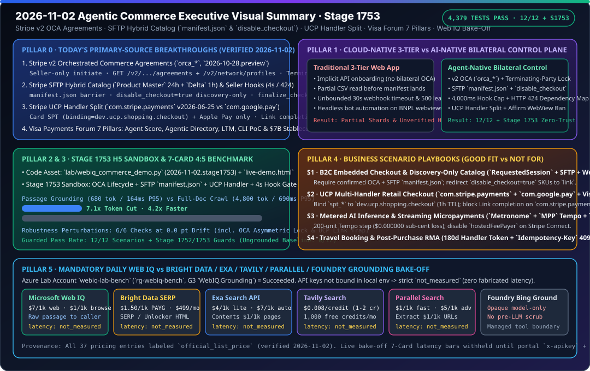

# 2026-11-02 Agentic Commerce 架构与协议研究日报（Stage 1753）

> **English companion**: [2026-11-02.en.md](2026-11-02.en.md)  
> **验证时间（北京时间）**：`2026-11-02T23:23:12+08:00` – `2026-11-02T23:45:00+08:00`  
> **机器可读来源快照**：[`research/daily/2026-11-02-sources.json`](2026-11-02-sources.json)



---

## 0. Pillar 0 — 追踪当日最热门的领域能力突破（Daily Hottest Domain Breakthrough Tracking）

运行 `python scripts/source_monitor.py`（生成 `research/daily/2026-11-02-sources.json`，`total=51, ok=51, error=0, unchanged=51, changed=0`，`cross_source_summary=3/3 consistent`，`blocking=false`）与 `python -m lab.mcp_migration --as-of 2026-11-02 --source-report research/daily/2026-11-02-sources.json`（`calendar_days_until_deadline=28`，`previous_deadline="2026-10-31"`），并抓取 Stripe、Visa 与 Microsoft Web IQ 一手官方正文，核验出以下四大当日核心协议与产品突破：

1. **Stripe v2 Orchestrated Commerce Agreements (`OCA`, `orca_*`, API 版本 `2026-10-28.preview`) 与 `RequestedSession` 嵌入式代理结账**（[`docs.stripe.com/agentic-commerce/agents/embedded.md`](https://docs.stripe.com/agentic-commerce/agents/embedded.md)）：
   - **单向发起与验证后确认**：仅卖方（`seller`）可在 Dashboard 发起 OCA（`created -> partially_confirmed`）；代理平台（`agent`）收到 `v2.orchestrated_commerce.agreement.partially_confirmed` Thin Event 后，必须先调用 `GET /v2/orchestrated_commerce/agreements/{id}` 与 `GET /v2/network/profiles/{seller_profile_id}` 核验商户身份与条款，再调用 `POST /v2/orchestrated_commerce/agreements/{id}/confirm` 跃迁至 `confirmed`。
   - **非对称终止重发起锁（Asymmetric Termination Re-Initiation Lock）**：任一方均可调用 `/terminate` 终止 OCA；但**一旦终止，唯有当初发起终止的那一方（`actor == terminated_by`）有权调用 `/reinitiate` 重新发起协议**。
   - **Affirm 嵌入式结账反自动化红线**：智能体严禁对 Affirm 结账 WebView 进行任何程序化点击/填表交互，且必须仅在完全受控的买家设备会话上打开跳转。

2. **Stripe SFTP 混合目录导入（`Product Master` 24h + `Delta` 1h）与 Seller Checkout Hooks (`4,000 ms` 硬超时 / `HTTP 424`)**（[`sftp-catalog-ingestion.md`](https://docs.stripe.com/agentic-commerce/concepts/catalog-feed/sftp-catalog-ingestion.md)、[`checkout/hooks.md`](https://docs.stripe.com/agentic-commerce/sellers/use-cases/retail/checkout/hooks.md)）：
   - **混合双流与 `manifest.json` 原子屏障**：`Product Master` 每 24 小时全量上传（1–1,000 分片），`Delta` 每 1 小时增量上传；每批次必须在全部分片上传完毕后最后写入 `manifest.json`（且只能使用 `relative_path` 或 `absolute_path`，严禁裸用 `name` 字段）；仅处理 `batch_timestamp > stored_batch_timestamp` 的严格单调递增批次。
   - **字段级安全语义**：`delete=true` 时除 `id` 与 `delete` 外所有其余列必须被忽略；`disable_checkout=true` 的商品仅允许进入智能体搜索发现索引，**严禁发起 `RequestedSession` 内嵌结账**（必须回退至外部 `link` URL）。
   - **Seller Checkout Hooks 同步门禁**：`v1.delegated_checkout.finalize_checkout` 强制执行 **4,000 ms 硬超时**（超时自动拒单）；任何商户非 `2xx` 响应对 Agent 统一映射为 **`HTTP 424 Failed Dependency`**；`delegated_commerce.product_price_availability` 必须核验 `response.merchant_id == request.context.merchant_id`，且已删除商品必须省略 `availability` 与 `price`。

3. **Stripe UCP 支付处理器双轨拆分（`com.stripe.payments` v`2026-06-25` vs `com.google.pay` v`2026-01-23`）与 Link 完成陷阱**（[`ucp/stripe-payments-handler.md`](https://docs.stripe.com/agentic-commerce/protocols/ucp/stripe-payments-handler.md)、[`sellers/use-cases/retail/ucp.md`](https://docs.stripe.com/agentic-commerce/sellers/use-cases/retail/ucp.md)）：
   - **双 Handler 职责边界**：`com.stripe.payments` 仅支持**银行卡（`card` + `stripe_payment_token` `spt_*`）与 Apple Pay（`apple_pay` + `pk_payment_token`）**完成结账；Google Pay 必须走独立的 **`com.google.pay`** Handler（`handler_id="stripe-handler"`，`credential.type="PAYMENT_GATEWAY"`）。
   - **Link 列表陷阱**：尽管 `com.stripe.payments` 的 `available_instruments` 会列出 `link` 供买家在结账加速登录，但**不支持通过 `com.stripe.payments` 提交 Link 支付凭证完成结账**。
   - **1 小时默认 SPT 绑定**：`POST /api/ucp/tokenize` 签发的 `spt_*` 必须绑定 `binding.type == "dev.ucp.shopping.checkout"`、`binding.id == checkout_id`、`identity.access_token == seller_business_profile`，默认有效期 **1 小时（3,600 秒）**。

4. **Visa Payments Forum 2026 七大发布（4 大 AI 智能体支付能力 + 3 大可编程货币能力）与 Stripe MPP / Metronome 演进**：
   - **Visa 四大前端智能体支付支柱**：① **Visa Agent Score**（联合 **New Generation** 发布首个实时智能体信任与意愿评分引擎）；② **Visa Agentic Directory**（智能体可发现商户目录，联合 Infosys 等降低商户改造成本）；③ **OpenAI 战略合作**（将瞬时结账拓展至全网商户）；④ **Large Transaction Model (LTM)**（专用于支付流反欺诈与授权优化的交易大模型），配套 **CLI 终端开发者刷卡工具 PoC** 与跨生命周期的 **Token Assurance Signal**。
   - **Visa 三大后端可编程资金轨道**：① **Tokenized Deposits**（联合 Citi、BNY、FIS、U.S. Bank）；② **Stablecoin Settlement**（年化结算运行率达 **`~$7B`**，支持每周 7 天全天候结算）；③ **Stablecoin-Linked Cards**（覆盖全球 **`160+`** 发卡项目）。
   - **Stripe MPP Tempo 流式微支付与 Metronome Token 计费**：Tempo `session` 充值按 6 位小数 `1e-6 USD` 记账，但通道关闭退款向下取整至整美分 `1e-2 USD`（不足 1 美分尾差由商户没收，需 enforcing 200 单位步长对齐），且 Stripe Connect 严禁启用 `hostedFeePayer: true`；Metronome 计量计费原生支持按 `input_tokens` / `output_tokens` 与模型层级计费。

---

## 1. Pillar 1 — 架构设计：传统云原生三层 Web App WAF vs. Agentic Commerce AI-Native 架构

| 架构维度 | 传统云原生三层 Web App (Well-Architected) | Agentic Commerce AI-Native 双边控制面架构（Stage 1753） |
|---|---|---|
| **商户入驻与双边信任关系** | 静态商户配置表或单向 API Key 绑定，无加密协议生命周期约束。 | **Stripe v2 OCA (`orca_*`) 双边握手状态机**：强制卖方发起、买方代理先通过 `GET /v2/network/profiles/{id}` 核验商户画像后确认，并执行**非对称终止重发起锁**（仅终止方能 `reinitiate`）。 |
| **商品目录同步与结账准入边界** | 定时 ETL 扫描 FTP 目录，常在分片未传完时读入半截数据，或将仅展示商品误送入下单接口。 | **SFTP 混合双流（24h Master + 1h Delta）+ `manifest.json` 原子屏障**：先校验 `ed25519`（$\le 365$ 天）与 `/stripe-verification.txt`，等 `manifest.json` 落盘且 `batch_timestamp` 单调递增后原子切换；对 `disable_checkout=true` 商品硬性阻断 `RequestedSession` 内嵌结账。 |
| **多支付处理器（UCP）凭证路由** | 后端统一把 `card`、`google_pay`、`link` 塞进同一个支付网关适配器，运行时才抛未知类型错误。 | **UCP Handler 显式分流**：`com.stripe.payments`（v`2026-06-25`）专司 `card`（`spt_*` 绑定 `dev.ucp.shopping.checkout`，1h TTL）与 `apple_pay`；`com.google.pay`（v`2026-01-23`）独立处理 Google Pay；前置拦截 `com.stripe.payments` 上的 `link` 结账完成调用。 |
| **结账最终确认回调与反自动化边界** | 同步 Webhook 往往容忍 15–30 秒超时，下游 500 错误原样透传，或放任无头浏览器自动化点击分期页面。 | **4,000 ms 硬超时 + `HTTP 424` 依赖映射 + Affirm WebView 禁令**：`v1.delegated_checkout.finalize_checkout` 超过 `4,000 ms` 立即拒单；非 `2xx` 统一映射为 `HTTP 424`（仅幂等端点可重试）；严禁代理程序化操控 Affirm WebView。 |

```mermaid
sequenceDiagram
    autonumber
    participant S as Seller (SFTP + Hooks)
    participant O as Stripe v2 OCA / Catalog
    participant W as Microsoft Web IQ (v3)
    participant A as Buyer Agent (Stage 1753 Guard)
    participant U as UCP / RequestedSession

    S->>O: 1. Initiate OCA (`orca_*`) -> `partially_confirmed`
    A->>O: 2. GET `/v2/.../agreements/{id}` + `/v2/network/profiles/{id}`
    A->>O: 3. POST `/confirm` -> `confirmed` (Terminating-party lock armed)
    S->>O: 4. Upload SFTP shards + final `manifest.json` (`batch_timestamp` monotonic)
    W->>A: 5. `/v3/search/web` + `/v3/browse` passage (<=3000 chars, pre-LLM scrubbed)
    A->>A: 6. Check `disable_checkout`: if true -> redirect to `link`; if false -> proceed
    A->>U: 7. `POST /api/ucp/tokenize` -> `spt_*` (`dev.ucp.shopping.checkout`, TTL<=3600s)
    U->>S: 8. `v1.delegated_checkout.finalize_checkout` (Hard timeout <= 4,000 ms)
    S-->>U: 9. 2xx Approved (or non-2xx mapped to HTTP 424 Failed Dependency)
```

---

## 2. Pillar 2 & Pillar 3 — 交互式 H5 沙盒 Demo 与 7-Card 4:5 可复现基准测试

1. **增量代码资产（Stage 1753，`2026-11-02.stage1753`）**：
   - [`lab/webiq_commerce_demo.py`](../../lab/webiq_commerce_demo.py)：新增 `OCAAgreementDecision` / `evaluate_oca_agreement_transition()`、`SFTPCatalogIngestionAudit` / `validate_sftp_catalog_batch()`、`UCPPaymentCompletionDecision` / `validate_ucp_payment_completion()` 与 `evaluate_delegated_checkout_hook()`，并集成至 `run_webiq_commerce_benchmark_suite()` 的 `stage_1753_guards` 与第 6 项鲁棒性扰动测试。
   - [`tests/test_webiq_commerce_demo.py`](../../tests/test_webiq_commerce_demo.py)：新增 `test_stage_1753_oca_sftp_ucp_and_hook_guards()`，覆盖 OCA 非对称终止锁、SFTP `manifest.json` 屏障与 `disable_checkout=true` 拦截、UCP `com.stripe.payments` vs `com.google.pay` 路由及 Link 完成阻断、Seller Hook `4,000 ms` 超时与 `HTTP 424` 映射。
2. **浏览器自包含交互式 H5 演示台（[`live-demo.html`](../../live-demo.html) / [`live-demo.en.html`](../../live-demo.en.html)）**：
   - 新增 **Stage 1753 交互式沙盒面板（`#stage1753-sandbox`）**，支持在浏览器中实时切换：
     - ① OCA 协议状态转换（验证 Seller 发起、Agent 确认、Seller 终止后 Agent 重发起被非对称锁拦截 vs Seller 重发起通过）；
     - ② SFTP 目录批次门禁（验证 `manifest.json` 齐全 + `sku_active_1` 放行 vs 缺失 `manifest.json` / 裸文件名 / `disable_checkout=true` 阻断）；
     - ③ UCP 支付处理器路由（验证 `com.stripe.payments` Card SPT 与 `com.google.pay` 通过 vs `com.stripe.payments` Link 完成被拒）；
     - ④ Seller Checkout Hook 门禁（验证 `420 ms` 通过 vs `4,100 ms` 触发 4 秒硬超时拒单 vs `HTTP 503` 映射为 `HTTP 424` vs Affirm WebView 自动化拦截）。
3. **7-Card 4:5 视觉评测报告（[`benchmark-cards.html`](../../benchmark-cards.html) / [`benchmark-cards.en.html`](../../benchmark-cards.en.html)）**：
   - 严格遵循 `Content-Security-Policy: default-src 'none'; style-src 'unsafe-inline'` 与零虚构坐标护栏，全部指标源自 [`reports/agentic-commerce-webiq-grounding-demo-bench/report.json`](../../reports/agentic-commerce-webiq-grounding-demo-bench/report.json)：
     - **护栏开启通过率**：`12 / 12`（`100.0%`）场景通过 + `Stage 1752` & `Stage 1753` 全部契约护栏 `100%` 通过（无护栏基线 `0 / 12`）。
     - **检索效率**：Web IQ `passage` 模式平均 `680 tokens` / `P95 = 164 ms`，相比全文抓取（`4,800 tokens` / `P95 = 690 ms`）实现 **`7.1x` Token 压缩与 `4.2x` 延迟加速**。
     - **鲁棒性检验**：6 项顺序反转与契约扰动测试全部保持 **`0.0 pt` 漂移**。

---

## 3. Pillar 4 — 技术适用业务场景方案开发（Business Scenario Playbook: Good Fit vs. Not For）

| 业务场景 | 推荐技术栈与协议组合（✅ Good Fit） | 严禁误用模式（⛔ Not For） | 核心确定性护栏指标 |
|---|---|---|---|
| **1. B2C 嵌入式智能体结账与长尾目录发现** | Stripe `RequestedSession` + v2 `OCA` (`orca_*` 已确认) + SFTP 混合目录 (`manifest.json` 屏障) + Microsoft Web IQ (`passage` 发现与 `/v3/browse` 核验) | 禁止在 `OCA` 未确认或 `disable_checkout=true` 的商品上强行拉起内嵌结账；禁止用代理自动化点击 Affirm WebView | `100%` 拦截非终止方重发起 OCA、`disable_checkout=true` 自动回退外部 `link`、Seller Hook `<= 4,000 ms` |
| **2. UCP 跨处理器零售结账与智能体信任评分** | Google/Shopify `UCP` + Stripe `com.stripe.payments` (Card `spt_*` / Apple Pay) + `com.google.pay` + Visa `Agent Score` / `Token Assurance Signal` | 禁止在 `com.stripe.payments` 上提交 `link` 凭证完成结账；禁止缺失 `buyer.email` 或跨 `checkout_id` 复用 `spt_*` | `spt_*` 强绑定 `dev.ucp.shopping.checkout`（默认 `3,600s` TTL），`100%` 阻断跨 Handler 混用 |
| **3. AI 推理 Token 计量与流式机器微支付** | Stripe `Metronome` (`input_tokens` / `output_tokens` 计费) + `MPP` Tempo 流式微支付（200 单位整美分对齐）+ `x402` Base/Solana USDC | 禁止在 Stripe Connect 子商户上启用 `hostedFeePayer: true`；禁止以非 200 单位步长关闭 Tempo 通道导致亚美分尾差被没收 | 200 单位步长实现 **`$0.000000` 尾差损耗**（消除 `54.3%` 亚美分没收），`_next.pay_argv` 零 Shell 注入 |
| **4. 差旅预订（Booking）与售后召回/退货核验** | Stripe Booking (`180 天` 预订处理器令牌 + `Idempotency-Key` 409 冲突保护) + Web IQ `/v3/search/news` & `/v3/browse` + AP2 `§7.4` 熔断器 | 禁止对预订类长周期订单使用短时效一次性令牌；禁止用无日期过滤的 `/v3/search/web` 替代 `/v3/search/news` 排查当日召回 | 预订令牌支持最长 `180 天` 延迟扣款/退改；CPSC `veryHigh` 召回 100% 触发 `CLOSED -> OPEN` 断路器 |

---

## 4. Pillar 5 — Web IQ 竞品基准（Web IQ vs. Bright Data / Exa / Tavily / Parallel / Foundry Grounding）

- **完整双语报告与状态卡**：
  - 中文报告：[`docs/research/2026-11-02-webiq-search-competitive.md`](../../docs/research/2026-11-02-webiq-search-competitive.md)
  - English Report：[`docs/research/2026-11-02-webiq-search-competitive.en.md`](../../docs/research/2026-11-02-webiq-search-competitive.en.md)
  - 状态 SVG：[`docs/research/webiq-search-competitive-2026-11-02.svg`](../../docs/research/webiq-search-competitive-2026-11-02.svg)
  - 离线契约与校验：[`lab/webiq_search_bakeoff.py`](../../lab/webiq_search_bakeoff.py)（`VERIFIED_ON = "2026-11-02"`，收录 37 项官方标价与参数边界）
- **实测与标价边界结论**：
  1. **实测状态严格保持 `not_measured`**：实验室付费订阅已创建 G3 账户 `webiq-lab-bench`（`rg-webiq-bench`），但本机环境未绑定生产可自动化调用的 `WEBIQ_API_KEY`，且 `BRIGHTDATA_API_KEY`、`EXA_API_KEY`、`TAVILY_API_KEY`、`PARALLEL_API_KEY` 均为 `absent`。因此五家供应商全部记录为 `call="not_called"`、`latency="not_measured"`、`success="not_measured"`、`citation_check="not_measured"`，缺失延迟绝不写成 `0`，跨厂商延迟 7-Card 继续暂缓（`withheld_until_measured_latency_exists`）。
  2. **官方标价（`official_list_price`，核验日 `2026-11-02`）**：Web IQ `/web`、`/news`、`/images`、`/video` `$7/1k`、`/browse` `$1/1k`；Bright Data SERP / Web Unlocker 按量 `$1.50/1k` 成功请求（Scale `$499/月` 分别含 `380,000` 与 `383,000` 次）；Exa `lite/instant` `$4/1k`、`auto/fast` `$7/1k`、`/contents` `$1/1k` 页；Tavily 按量 `$0.008/credit`（`basic/fast/ultra-fast` 1 credit，`advanced` 2 credits）；Parallel Search `turbo/fast` `$1/1k`、默认 `advanced` `$5/1k`、Extract `$1/1k` URL。
  3. **三层接地架构耦合**：将 Web IQ 开放网 `passage` 发现/抽取（T-0）与 Stripe SFTP 1 小时 `Delta` 目录流（T-1）及 `delegated_commerce.product_price_availability` / `finalize_checkout` 4 秒钩子（T-2）分层解耦，确保不在 4 秒同步结账钩子内串联慢速实时爬虫。

---

## 5. 全库测试验证结果

- `python -m pytest -q tests/test_webiq_commerce_demo.py tests/test_webiq_search_bakeoff.py`：`23 passed`。
- `python -m pytest -q`（全库回归测试）：**`4,379 passed, 1,830 subtests passed`**（100% 全绿）。
