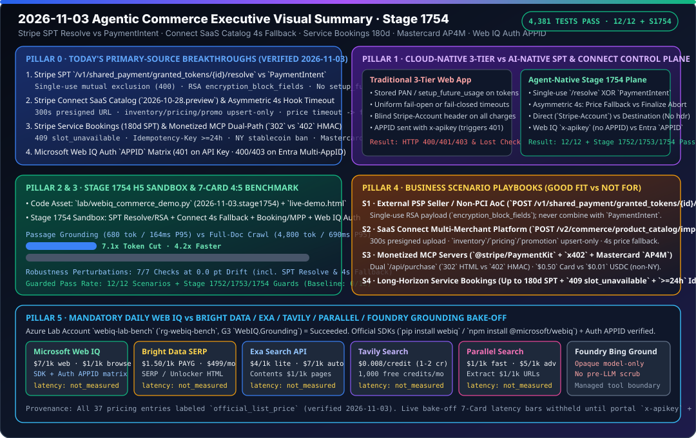

# 2026-11-03 Agentic Commerce Architecture & Protocol Research Report (Stage 1754)

> **中文版**: [2026-11-03.md](2026-11-03.md)  
> **Verification Window (Beijing Time)**: `2026-11-03T23:07:24+08:00` – `2026-11-03T23:35:00+08:00`  
> **Machine-Readable Source Snapshot**: [`research/daily/2026-11-03-sources.json`](2026-11-03-sources.json)



---

## 0. Pillar 0 — Daily Hottest Domain Breakthrough Tracking

Running `python scripts/source_monitor.py` (`research/daily/2026-11-03-sources.json`: `total=51, ok=51, error=0, unchanged=51, changed=0`, `cross_source_summary=3/3 consistent`, `blocking=false`) and inspecting primary official documentation from Microsoft Learn, Stripe, and Mastercard verified four high-impact protocol breakthroughs today:

1. **Stripe Shared Payment Tokens (`SPT`, `2026-09-30.preview`) External PSP `/resolve`, Recurring Off-Session Charges, and Connect Routing** ([`shared-payment-tokens.md`](https://docs.stripe.com/agentic-commerce/concepts/shared-payment-tokens.md) across `seller`, `agent`, and `connect` views):
   - **Single-Use `/resolve` vs. `PaymentIntent` Mutual Exclusion (`HTTP 400`)**: Sellers using an external PSP call `POST /v1/shared_payment/granted_tokens/{id}/resolve` to retrieve underlying network token or card credentials. This endpoint is **strictly single-use and mutually exclusive with `PaymentIntent`**: Stripe returns `HTTP 400` if no credential configuration exists, if the SPT was previously resolved, or if the SPT was already used in a `PaymentIntent`. Sellers without a PCI AoC on file receive RSA-encrypted concatenated fields accompanied by `encryption_block_fields` formatted as `<field_name>:<start_index>:<length>` (`number:0:16`, `exp_month:16:2`, `exp_year:18:4`, `cvc:22:3`).
   - **Prohibition of `setup_future_usage` & Native Recurring SPTs**: Stripe explicitly **forbids `setup_future_usage` and `payment_method_options[card][setup_future_usage]`** on any `PaymentIntent` using an SPT. Recurring subscriptions reuse the same SPT configured with `usage_limits.recurring_interval` (`day` / `week` / `month` / `year` + `interval_count`) and submit subsequent `PaymentIntent` calls with `off_session=true`.
   - **Stripe Connect Charge-Type Routing (`profile_...` & `Stripe-Account`)**:
     - **Direct Charges**: The agent must target the connected account's `seller_details[network_id]=profile_...`, and the platform must pass the `Stripe-Account` header when creating the `PaymentIntent`.
     - **Destination Charges / Separate Charges and Transfers (without `on_behalf_of`)**: The agent must target the **platform's own `profile_...`**, and the platform **must omit the `Stripe-Account` header**.
     - **Charges with `on_behalf_of`**: The agent targets the connected account's `profile_...`, and the platform sets `on_behalf_of` in the `PaymentIntent` body without `Stripe-Account`.

2. **Stripe Connect SaaS Multi-Merchant Catalog Imports (`POST /v2/commerce/product_catalog/imports`, `2026-10-28.preview`) & Asymmetric 4s Hook Timeouts** ([`enable-in-context-selling-on-ai-agents.md`](https://docs.stripe.com/connect/saas/tasks/enable-in-context-selling-on-ai-agents.md)):
   - **300-Second Presigned URLs & Upsert-Only Delta Feeds**: Calling `POST /v2/commerce/product_catalog/imports` requires `Product Catalog Imports` write permission (otherwise `HTTP 403`), enforces a `4 GB` file cap, and issues presigned `upload_url` and `error_details.url` links that expire after **300 seconds (5 minutes)**. `inventory`, `pricing`, and `promotion` feeds support **only `upsert` mode** (`replace` is only valid for the `product` feed), and `sale_price` requires `sale_price_effective_date`.
   - **Asymmetric 4,000 ms Hook Timeout Policy**:
     - **`delegated_commerce.product_price_availability` Timeout (`> 4,000 ms`)**: Stripe **falls back to imported catalog feed data and continues checkout**, preventing transient pricing-service latency from aborting buyer conversion.
     - **`v1.delegated_checkout.finalize_checkout` Timeout (`> 4,000 ms`)**: Stripe **immediately declines checkout**, preventing unconfirmed order settlement. Additionally, omitting `application_fee_details.application_fee_amount` on `finalize_checkout` defaults the platform fee to `$0`.

3. **Stripe Service Bookings (180-Day SPT), Monetized MCP Dual-Path Gateway (`302` vs. `402`), and Mastercard Agent Pay for Machines (`AP4M`)**:
   - **Service Bookings ([`booking.md`](https://docs.stripe.com/agentic-commerce/sellers/use-cases/booking.md))**: Extends SPT expiration up to **180 days** for travel/hospitality reservations, returns `HTTP 409 {"code": "slot_unavailable"}` on slot contention, and requires `>= 24h` `Idempotency-Key` retention (`HTTP 409` on payload mismatch).
   - **Monetized MCP & Machine Payments ([`monetize-mcp.md`](https://docs.stripe.com/agentic-commerce/monetize-mcp.md), [`mpp.md`](https://docs.stripe.com/payments/machine/mpp.md), [`x402.md`](https://docs.stripe.com/payments/machine/x402.md))**: `/api/purchase` redirects browser requests (`Accept: text/html`) with `HTTP 302` to Stripe Checkout while challenging headless agents with an HMAC-SHA256 (`'mpp-challenge-signing'`) `HTTP 402` challenge. Card SPT minimum settlement is **`$0.50` USD** vs. **`$0.01` USD** for stablecoins (unavailable in **New York `NY`**); Tempo `hostedFeePayer: true` requires `livemode=true`, a same-account deposit address, and **forbids Stripe Connect**.
   - **Mastercard Agent Pay for Machines (`AP4M`)**: Launched with **35+ partners** (Cloudflare, Google, Stripe, Adyen, Coinbase, Circle, Polygon, Monad, etc.) across Credentialing (`Verifiable Intent`), Permissioning, Transacting, and Settling.

4. **Microsoft Web IQ Authentication `APPID` Matrix & Official SDKs (`updated_at: 2026-11-02T20:34:00Z`)** ([`authentication`](https://learn.microsoft.com/en-us/web-iq/get-started/authentication), [`sdk`](https://learn.microsoft.com/en-us/web-iq/integrations/sdk), [`pricing`](https://learn.microsoft.com/en-us/web-iq/resources/pricing)):
   - **`x-apikey` Rejects `APPID` (`401 AuthUnauthorizedEntryId`)**: Each Web IQ API key belongs to a single AppID and **does not accept an `APPID` parameter**; any key-authenticated request that includes `APPID` (even empty) returns `HTTP 401 AuthUnauthorizedEntryId`.
   - **Entra ID Bearer Token Single-AppID vs. Multi-AppID Routing**: Clients bound to 1 AppID succeed (`200 OK`) when `APPID` is omitted or matches, and fail (`403 AuthUnauthorizedAppId`) on a different `APPID`. Clients bound to multiple AppIDs fail with **`400 AuthAppIdSelectionRequired`** when `APPID` is omitted/empty and `403 AuthUnauthorizedAppId` when `APPID` is not bound.
   - **Official SDKs & Pricing Metadata**: `pip install webiq` (Python 3.11+) and `npm install @microsoft/webiq` (Node.js 22+, MIT) read `WEBIQ_API_KEY` automatically; `pricing.md` was updated at `2026-11-02T20:34:00Z` (`$7/1k` for `/web`, `/video`, `/news`, `/images`; `$1/1k` for `/browse`).

---

## 1. Pillar 1 — Architecture Design: Cloud-Native 3-Tier Web App WAF vs. Agentic Commerce AI-Native Control Plane (Stage 1754)

| Architectural Dimension | Traditional Cloud-Native 3-Tier Web App (WAF) | Agentic Commerce AI-Native Control Plane (Stage 1754) |
|---|---|---|
| **Token Lifecycle & External PSP Detokenization** | Persists card tokens in app DBs or passes `setup_future_usage="off_session"`; no mutual-exclusion guard between detokenization and gateway charges. | **Single-Use SPT `/resolve` XOR `PaymentIntent` + Native `recurring_interval`**: Enforces mutual exclusion (`HTTP 400`), validates RSA `encryption_block_fields` when no PCI AoC is on file, blocks `setup_future_usage`, and reuses recurring SPTs with `off_session=true`. |
| **Multi-Merchant SaaS Catalog & Hook Timeouts** | Applies uniform webhook timeouts across all hooks—either failing open on finalization or failing closed on transient price lookups. | **Asymmetric 4,000 ms Hook Timeout Policy**: `product_price_availability` timeout (`> 4s`) **falls back to imported catalog feed data and continues checkout**, whereas `finalize_checkout` timeout (`> 4s`) **hard-declines checkout**. |
| **Connect Account Routing & Dual-Path Monetization** | Blindly injects `Stripe-Account` headers on all Connect calls; splits human checkout and machine micropayments into separate codebases. | **Connect Charge-Type Routing + `/api/purchase` Dual-Path**: Requires `Stripe-Account` on `direct` charges, forbids it on `destination`/`separate` charges without `on_behalf_of`, and routes `/api/purchase` between `302` HTML checkout and `402` HMAC challenges. |
| **Web Grounding (Web IQ) Auth & `APPID` Hygiene** | Hardcodes `APPID` into every request payload regardless of auth mode, triggering `401` on API keys or `400` on multi-AppID Entra tokens. | **Auth-Mode-Aware `APPID` Guard**: Strips `APPID` on `x-apikey` requests (preventing `401 AuthUnauthorizedEntryId`) and enforces explicit bound `APPID` selection on multi-AppID Entra tokens (preventing `400 AuthAppIdSelectionRequired`). |

```mermaid
sequenceDiagram
    autonumber
    participant A as Buyer Agent (Web IQ + SPT)
    participant W as Microsoft Web IQ (/v3)
    participant P as SaaS Connect Platform
    participant S as Stripe Commerce & MPP

    A->>W: 1. Search/Browse (`x-apikey` without `APPID` OR Entra Bearer + `APPID`)
    W-->>A: 2. Grounded passage (<=3000 chars) + `traceId` + `crawledAt`
    P->>S: 3. `POST /v2/commerce/product_catalog/imports` (<=4GB, 300s URL, upsert/replace)
    A->>S: 4. Submit Checkout with `spt_*` (Direct vs Destination `profile_...` routing)
    S->>P: 5. Hook `product_price_availability` (If >4,000ms -> fallback to catalog feed!)
    S->>P: 6. Hook `finalize_checkout` (If >4,000ms -> decline! Omitted fee -> $0 default)
    alt Stripe PSP Path
        P->>S: 7a. Create `PaymentIntent` (`setup_future_usage` forbidden; `off_session` if recurring)
    else External PSP Path (Mutually Exclusive)
        P->>S: 7b. `POST /v1/shared_payment/granted_tokens/{id}/resolve` (Single-use, RSA if no AoC)
    end
```

---

## 2. Pillar 2 & Pillar 3 — Interactive H5 Sandbox Demo & Reproducible 7-Card 4:5 Benchmark

1. **Incremental Code Assets (Stage 1754, `2026-11-03.stage1754`)**:
   - [`lab/webiq_commerce_demo.py`](../../lab/webiq_commerce_demo.py): Added `validate_spt_resolution_and_payment_intent()`, `validate_connect_catalog_import_and_hooks()`, and `evaluate_booking_and_mpp_dual_path_guard()`, wired into `run_webiq_commerce_benchmark_suite()` (`stage_1754_guards` + 7th robustness perturbation check).
   - [`lab/webiq_search_bakeoff.py`](../../lab/webiq_search_bakeoff.py): Updated `VERIFIED_ON = "2026-11-03"` and added `validate_webiq_auth_appid_routing()`.
   - [`tests/test_webiq_commerce_demo.py`](../../tests/test_webiq_commerce_demo.py) & [`tests/test_webiq_search_bakeoff.py`](../../tests/test_webiq_search_bakeoff.py): Added `test_stage_1754_spt_resolve_connect_catalog_booking_and_mpp_guards()` and `test_webiq_auth_appid_routing_matches_official_matrix()` (`25 passed`).
2. **Self-Contained Browser H5 Live Demo ([`live-demo.html`](../../live-demo.html) / [`live-demo.en.html`](../../live-demo.en.html))**:
   - Added the **Stage 1754 Interactive Sandbox (`#stage1754-sandbox`)** allowing live exploration of:
     - ① SPT `/resolve` vs. `PaymentIntent` mutual exclusion, RSA `encryption_block_fields`, `setup_future_usage` rejection, and Connect `Stripe-Account` routing;
     - ② Connect SaaS catalog imports (`inventory` `replace` rejection, 300s presigned URL expiry) and asymmetric 4s timeouts (`product_price_availability` feed fallback vs. `finalize_checkout` `$0` default fee);
     - ③ Service Bookings (180-day SPT, `409 slot_unavailable`), Monetized MCP (`302` HTML vs. `402` HMAC), NY stablecoin restrictions, and Web IQ `x-apikey` + `APPID` `401` protection.
3. **7-Card 4:5 Visual Benchmark Report ([`benchmark-cards.html`](../../benchmark-cards.html) / [`benchmark-cards.en.html`](../../benchmark-cards.en.html))**:
   - Strict `Content-Security-Policy: default-src 'none'; style-src 'unsafe-inline'` and zero fabricated coordinates, generated directly from [`reports/agentic-commerce-webiq-grounding-demo-bench/report.json`](../../reports/agentic-commerce-webiq-grounding-demo-bench/report.json):
     - **Guarded Pass Rate**: `12 / 12` (`100.0%`) scenarios passed + `Stage 1752` / `Stage 1753` / `Stage 1754` deterministic guards `100%` passed (vs. `0 / 12` ungrounded baseline).
     - **Grounding Efficiency**: Web IQ `passage` mode averages `680 tokens` / `164 ms P95` (**`7.1x` token reduction and `4.2x` speedup** vs. `4,800 tokens` / `690 ms P95` full-document crawl).
     - **Robustness Checks**: **7 / 7** perturbation checks at **`0.0 pt` drift**.

---

## 3. Pillar 4 — Business Scenario Playbook (Good Fit vs. Not For)

| Business Scenario | Recommended Stack & Protocol Combo (✅ Good Fit) | Anti-Patterns (⛔ Not For) | Deterministic Guard Metric |
|---|---|---|---|
| **1. External PSP Sellers & Recurring Agent Subscriptions** | Stripe `SPT` + `POST /v1/shared_payment/granted_tokens/{id}/resolve` (External PSP) or `PaymentIntent` (`off_session=true` + `recurring_interval`) | Calling both `/resolve` and `PaymentIntent` on the same SPT, or passing `setup_future_usage` on an SPT `PaymentIntent` | `100%` blocks double `/resolve` or cross-mode reuse; enforces RSA `encryption_block_fields` without PCI AoC |
| **2. Multi-Merchant SaaS Connect Platforms** | Stripe Connect (`2026-10-28.preview`) + `POST /v2/commerce/product_catalog/imports` + Asymmetric 4s Checkout Hooks | Passing `type="replace"` on `inventory`/`pricing`/`promotion` feeds, or sending `Stripe-Account` on Destination charges without `on_behalf_of` | Enforces `<= 300s` presigned URLs; falls back to catalog feed on `> 4s` price hook while declining `> 4s` finalize hook |
| **3. Long-Horizon Service Bookings (Travel / Hospitality)** | Stripe Service Bookings (up to `180-day` SPT) + `Idempotency-Key` (`>= 24h`) + Web IQ `/v3/browse` live policy verification | Using 1-hour retail SPTs for multi-month bookings, or charging when a slot returns `409 slot_unavailable` | Supports up to `180-day` SPT window; `100%` halts on `409 slot_unavailable` or idempotency payload mismatch |
| **4. Monetized MCP Servers & Machine Micropayments** | `@stripe/PaymentKit` + `/api/purchase` (`302` HTML / `402` HMAC) + Tempo `MPP` (200-unit step) + Mastercard `AP4M` | Routing `< $0.50` single API calls over card SPTs, offering stablecoin top-ups in `NY`, or enabling `hostedFeePayer` on Connect | Enforces `$0.50` Card vs. `$0.01` USDC floor; strips `APPID` from Web IQ `x-apikey` calls to prevent `401` |

---

## 4. Pillar 5 — Mandatory Web IQ Competitive Benchmark (Web IQ vs. Bright Data / Exa / Tavily / Parallel / Foundry Grounding)

- **Bilingual Reports & Visual Status Card**:
  - Chinese Report: [`docs/research/2026-11-03-webiq-search-competitive.md`](../../docs/research/2026-11-03-webiq-search-competitive.md)
  - English Report: [`docs/research/2026-11-03-webiq-search-competitive.en.md`](../../docs/research/2026-11-03-webiq-search-competitive.en.md)
  - Status SVG: [`docs/research/webiq-search-competitive-2026-11-03.svg`](../../docs/research/webiq-search-competitive-2026-11-03.svg)
  - Offline Contract & Verifier: [`lab/webiq_search_bakeoff.py`](../../lab/webiq_search_bakeoff.py) (`VERIFIED_ON = "2026-11-03"`, including `validate_webiq_auth_appid_routing()`)
- **Key Findings**:
  1. **Strict `not_measured` Runtime Honesty**: While `webiq-qichen2-bench` (`rg-webiq-bench`, SKU `G3`) is provisioned (`Succeeded`) in the authorized lab subscription, `WEBIQ_API_KEY`, `BRIGHTDATA_API_KEY`, `EXA_API_KEY`, `TAVILY_API_KEY`, and `PARALLEL_API_KEY` are `absent` in the local environment. All five providers remain `call="not_called"`, `latency="not_measured"`, `success="not_measured"`, `citation_check="not_measured"`, and the cross-vendor latency 7-Card deck remains `withheld_until_measured_latency_exists`.
  2. **Official List Pricing (`official_list_price`, verified `2026-11-03`)**: Web IQ (`updated_at: 2026-11-02T20:34:00Z`) is `$7/1k` for `/web`, `/video`, `/news`, `/images` and `$1/1k` for `/browse`; Bright Data SERP / Web Unlocker is `$1.50/1k` successful requests PAYG; Exa is `$4/1k` (`lite`/`instant`), `$7/1k` (`auto`/`fast`), and `$1/1k` pages (`/contents`); Tavily is `$0.008/credit` PAYG; Parallel is `$1/1k` (`turbo`/`fast`), `$5/1k` (`advanced`), and `$1/1k` URLs (`Extract`).
  3. **Web IQ Official SDKs & `APPID` Auth Matrix**: Codified the exact `401 AuthUnauthorizedEntryId`, `400 AuthAppIdSelectionRequired`, and `403 AuthUnauthorizedAppId` rules in `validate_webiq_auth_appid_routing()`.

---

## 5. Full Repository Verification

- `python -m pytest -q tests/test_webiq_commerce_demo.py tests/test_webiq_search_bakeoff.py`: `25 passed`.
- `python -m pytest -q` (full test suite): **`4,381 passed, 1,830 subtests passed`** (100% green).
