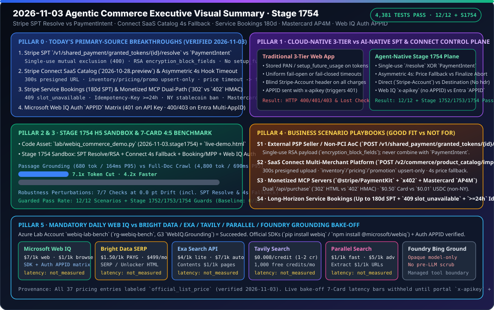

# 2026-11-03 Agentic Commerce 架构与协议研究日报（Stage 1754）

> **English companion**: [2026-11-03.en.md](2026-11-03.en.md)  
> **验证时间（北京时间）**：`2026-11-03T23:07:24+08:00` – `2026-11-03T23:35:00+08:00`  
> **机器可读来源快照**：[`research/daily/2026-11-03-sources.json`](2026-11-03-sources.json)



---

## 0. Pillar 0 — 追踪当日最热门的领域能力突破（Daily Hottest Domain Breakthrough Tracking）

运行 `python scripts/source_monitor.py`（生成 `research/daily/2026-11-03-sources.json`，`total=51, ok=51, error=0, unchanged=51, changed=0`，`cross_source_summary=3/3 consistent`，`blocking=false`），并核验 Microsoft Learn、Stripe 与 Mastercard 官方一手文档正文，提炼出今日四大核心协议与能力突破：

1. **Stripe Shared Payment Tokens (`SPT`, `2026-09-30.preview`) 外部 PSP 原始凭证解析（`resolve`）、周期扣款（`recurring_interval`）与 Connect 三模式路由**（[`shared-payment-tokens.md`](https://docs.stripe.com/agentic-commerce/concepts/shared-payment-tokens.md)，覆盖 `seller`、`agent`、`connect` 三视图）：
   - **单次 `/resolve` 与 `PaymentIntent` 互斥（HTTP 400）**：面向使用外部 PSP 的商户，Stripe 提供 `POST /v1/shared_payment/granted_tokens/{id}/resolve` 暴露原始网络令牌或卡凭证。该端点**严格限制单次调用且与 `PaymentIntent` 互斥**：若未配置外部凭证解析权限、该 SPT 已被 `resolve` 过、或该 SPT 已用于创建 `PaymentIntent`，均返回 `HTTP 400`。若商户未向 Stripe 存档 PCI AoC，则返回经商户 RSA 公钥加密的拼接块及 `<field_name>:<start_index>:<length>` 格式的 `encryption_block_fields`（如 `number:0:16`、`exp_month:16:2`、`exp_year:18:4`、`cvc:22:3`）。
   - **禁止 `setup_future_usage` 与原生周期性 SPT**：在任何使用 SPT 的 `PaymentIntent` 上，Stripe **显式禁止传入 `setup_future_usage` 与 `payment_method_options[card][setup_future_usage]`**；周期订阅扣款无需保存卡信息，而是直接复用带有 `usage_limits.recurring_interval`（`day` / `week` / `month` / `year` + `interval_count`）的同一个 SPT，并以 `off_session=true` 发起后续 `PaymentIntent`。
   - **Stripe Connect 三种收单模式的 `profile_...` 与 `Stripe-Account` 头规则**：
     - **Direct Charges（直接收单）**：买方 Agent 必须指定子商户 `seller_details[network_id]=profile_...`，且平台创建 `PaymentIntent` 时必须携带 `Stripe-Account` 请求头。
     - **Destination Charges / Separate Charges and Transfers（未设置 `on_behalf_of`）**：买方 Agent 必须指定**平台自身的 `profile_...`**，且创建 `PaymentIntent` 时**严禁携带 `Stripe-Account` 请求头**。
     - **带 `on_behalf_of` 的收单**：买方 Agent 必须指定子商户 `profile_...`，平台在请求体设置 `on_behalf_of` 且不带 `Stripe-Account` 头。

2. **Stripe Connect SaaS 多商户平台目录导入 API（`POST /v2/commerce/product_catalog/imports`, `2026-10-28.preview`）与非对称 4 秒 Hook 超时语义**（[`enable-in-context-selling-on-ai-agents.md`](https://docs.stripe.com/connect/saas/tasks/enable-in-context-selling-on-ai-agents.md)）：
   - **300 秒预签名 URL 与 Feed 写入模式门禁**：调用 `POST /v2/commerce/product_catalog/imports` 需具備 `Product Catalog Imports` 写权限（否则返回 `HTTP 403`），单文件上限 `4 GB`，返回的预签名上传地址 `upload_url` 与错误报告地址 `error_details.url` 均在 **300 秒（5 分钟）** 后过期。`inventory`、`pricing`、`promotion` 三类增量流**仅支持 `upsert` 模式**（仅 `product` 主流支持 `replace` 全量替换）；且填写 `sale_price` 时必须同时提供 `sale_price_effective_date`。
   - **非对称 4,000 ms Hook 超时策略（Asymmetric 4s Timeout）**：
     - **`delegated_commerce.product_price_availability` 超时（`> 4,000 ms`）**：Stripe **自动回退至已导入的目录快照数据（Catalog Feed Data）并继续推进结账**，避免瞬时询价抖动中断购买。
     - **`v1.delegated_checkout.finalize_checkout` 超时（`> 4,000 ms`）**：Stripe **立即拒单并终止结账（Declines Checkout）**，防止在未获平台与商户最终确认的情况下扣款。此外，若平台在 `finalize_checkout` 响应中省略 `application_fee_details.application_fee_amount`，平台抽成默认记为 `$0`。

3. **Stripe 服务预订（Service Bookings 180 天 SPT）、Monetized MCP 双路径网关（`302` vs `402`）与 Mastercard Agent Pay for Machines (`AP4M`)**：
   - **Service Bookings（[`booking.md`](https://docs.stripe.com/agentic-commerce/sellers/use-cases/booking.md)）**：针对酒店/航班等远期履约场景，SPT 有效期上限扩展至 **180 天**（区别于零售 UCP 默认的 1 小时）；档期被抢占时返回 `HTTP 409 {"code": "slot_unavailable"}`；结账与取消接口强制要求保留 `Idempotency-Key` 至少 **24 小时**（相同 Key 但请求体不同返回 `HTTP 409`）。
   - **Monetized MCP 与机器支付（[`monetize-mcp.md`](https://docs.stripe.com/agentic-commerce/monetize-mcp.md)、[`mpp.md`](https://docs.stripe.com/payments/machine/mpp.md)、[`x402.md`](https://docs.stripe.com/payments/machine/x402.md)）**：`/api/purchase` 端点对携带 `Accept: text/html` 的浏览器请求返回 `HTTP 302` 跳转至 Stripe Checkout，对无头智能体返回经 HMAC-SHA256（领域分隔符 `'mpp-challenge-signing'`）签名的 `HTTP 402` 质询；SPT 卡轨最低结算额为 **`$0.50` USD**，稳定币（USDC）最低结算额为 **`$0.01` USD**（**纽约州 NY 不可用**）；Tempo `hostedFeePayer: true` 仅限 `livemode=true`、要求 `deposit` 地址归属同一商户账户，且**严禁在 Stripe Connect 集成中启用**。
   - **Mastercard Agent Pay for Machines (`AP4M`)**：2026-04-28 正式发布，联合 Cloudflare、Google、Stripe、Adyen、Coinbase、Circle、Polygon、Monad 等 **35+ 首发合作伙伴**，贯通 Credentialing（基于 `Verifiable Intent` 开放标准）、Permissioning、Transacting 与 Settling（横跨卡轨、账户轨与受监管稳定币）。

4. **Microsoft Web IQ 认证 `APPID` 路由矩阵与官方 SDK（`updated_at: 2026-11-02T20:34:00Z`）**（[`authentication`](https://learn.microsoft.com/en-us/web-iq/get-started/authentication)、[`sdk`](https://learn.microsoft.com/en-us/web-iq/integrations/sdk)、[`pricing`](https://learn.microsoft.com/en-us/web-iq/resources/pricing)）：
   - **`x-apikey` 与 `APPID` 互斥（`401 AuthUnauthorizedEntryId`）**：每个 Web IQ API Key 唯一归属单个 AppID，**任何使用 `x-apikey` 认证且携带 `APPID` 参数（含空值）的请求均返回 `HTTP 401 AuthUnauthorizedEntryId`**。
   - **Entra ID 持有者令牌（Bearer Token）单 AppID vs 多 AppID 路由**：当客户端绑定 1 个 AppID 时，省略或传入匹配 `APPID` 均返回 `200 OK`，传入其他 `APPID` 返回 `403 AuthUnauthorizedAppId`；当客户端绑定多个 AppID 时，省略或传空 `APPID` 返回 **`400 AuthAppIdSelectionRequired`**，传入未绑定 `APPID` 返回 `403 AuthUnauthorizedAppId`。
   - **官方 SDK 与定价页元数据**：Python SDK（`pip install webiq`，Python 3.11+）与 Node.js SDK（`npm install @microsoft/webiq`，Node.js 22+，MIT）支持 `WebIQClient()` 自动从 `WEBIQ_API_KEY` 读取凭证；`pricing.md` 头部 `updated_at` 更新至 `2026-11-02T20:34:00Z`（价格维持 `/web`、`/video`、`/news`、`/images` `$7/1k`，`/browse` `$1/1k`）。

---

## 1. Pillar 1 — 架构设计：传统云原生三层 Web App WAF vs. Agentic Commerce AI-Native 架构（Stage 1754）

| 架构维度 | 传统云原生三层 Web App (Well-Architected) | Agentic Commerce AI-Native 控制面架构（Stage 1754） |
|---|---|---|
| **支付令牌生命周期与外部 PSP 解析** | 在业务库持久化 Token 或习惯性附加 `setup_future_usage="off_session"`；缺乏单次解析与网关扣款的互斥状态机。 | **SPT `/resolve` 单次互斥 + 原生 `recurring_interval`**：`POST /v1/shared_payment/granted_tokens/{id}/resolve` 与 `PaymentIntent` 严格单次互斥（违者 `400`），无 PCI AoC 时强制 RSA 分块加密；禁止 `setup_future_usage`，周期扣款直接复用带 `recurring_interval` 的 SPT。 |
| **多商户 SaaS 平台目录与同步回调超时** | 所有回调一刀切采用相同的超时策略（要么全部失败回滚导致转化率暴跌，要么全部放行导致超卖或资损）。 | **非对称 4,000 ms Hook 超时控制**：询价钩子 `product_price_availability` 超时（`> 4s`）**自动降级回退至 `2026-10-28.preview` 目录快照继续结账**；终审钩子 `finalize_checkout` 超时（`> 4s`）**硬性拒单阻断扣款**。 |
| **Connect 跨账户资金路由与微支付网关** | 平台服务统一注入 `Stripe-Account` 头；微支付与浏览器结账拆成两套割裂路由。 | **Connect 三模式精准路由 + `/api/purchase` 双路径网关**：Direct 收单强制带 `Stripe-Account`，无 `on_behalf_of` 的 Destination/Separate 收单严禁带 `Stripe-Account`；`/api/purchase` 按 `Accept: text/html` 自动分流 `302` 浏览器结账与 `402` HMAC 智能体质询。 |
| **外部实时接地（Web IQ）身份与参数边界** | 无论使用 API Key 还是 OAuth Token 均在请求体固定拼接 `APPID`，导致生产环境频繁遭遇莫名 `401`/`400`。 | **Web IQ 认证感知参数注入器**：`x-apikey` 模式严禁注入 `APPID`（防 `401 AuthUnauthorizedEntryId`）；Entra ID 多 AppID 模式强制显式注入目标 `APPID`（防 `400 AuthAppIdSelectionRequired`）。 |

```mermaid
sequenceDiagram
    autonumber
    participant A as Buyer Agent (Web IQ + SPT)
    participant W as Microsoft Web IQ (/v3)
    participant P as SaaS Connect Platform
    participant S as Stripe Commerce & MPP

    A->>W: 1. Search/Browse (`x-apikey` without `APPID` OR Entra Bearer + `APPID`)
    W-->>A: 2. Grounded passage (<=3000 chars) + `traceId` + `crawledAt`
    P->>S: 3. `POST /v2/commerce/product_catalog/imports` (<=4GB, 300s URL, upsert/replace)
    A->>S: 4. Submit Checkout with `spt_*` (Direct vs Destination `profile_...` routing)
    S->>P: 5. Hook `product_price_availability` (If >4,000ms -> fallback to catalog feed!)
    S->>P: 6. Hook `finalize_checkout` (If >4,000ms -> decline! Omitted fee -> $0 default)
    alt Stripe PSP Path
        P->>S: 7a. Create `PaymentIntent` (`setup_future_usage` forbidden; `off_session` if recurring)
    else External PSP Path (Mutually Exclusive)
        P->>S: 7b. `POST /v1/shared_payment/granted_tokens/{id}/resolve` (Single-use, RSA if no AoC)
    end
```

---

## 2. Pillar 2 & Pillar 3 — 交互式 H5 沙盒 Demo 与 7-Card 4:5 可复现基准测试

1. **增量代码资产（Stage 1754，`2026-11-03.stage1754`）**：
   - [`lab/webiq_commerce_demo.py`](../../lab/webiq_commerce_demo.py)：新增 `SPTResolutionAndPaymentIntentDecision` / `validate_spt_resolution_and_payment_intent()`、`ConnectCatalogAndHookDecision` / `validate_connect_catalog_import_and_hooks()` 与 `BookingAndMPPDualPathDecision` / `evaluate_booking_and_mpp_dual_path_guard()`，并集成至 `run_webiq_commerce_benchmark_suite()` 的 `stage_1754_guards` 与第 7 项鲁棒性扰动测试。
   - [`lab/webiq_search_bakeoff.py`](../../lab/webiq_search_bakeoff.py)：更新 `VERIFIED_ON = "2026-11-03"`，新增 `WebIQAuthAppIdDecision` / `validate_webiq_auth_appid_routing()`，精确建模 `x-apikey` vs Entra ID（单 AppID / 多 AppID）的 `200` / `400` / `401` / `403` 状态机。
   - [`tests/test_webiq_commerce_demo.py`](../../tests/test_webiq_commerce_demo.py) 与 [`tests/test_webiq_search_bakeoff.py`](../../tests/test_webiq_search_bakeoff.py)：新增 `test_stage_1754_spt_resolve_connect_catalog_booking_and_mpp_guards()` 与 `test_webiq_auth_appid_routing_matches_official_matrix()`（共 `25 passed`）。
2. **浏览器自包含交互式 H5 演示台（[`live-demo.html`](../../live-demo.html) / [`live-demo.en.html`](../../live-demo.en.html)）**：
   - 新增 **Stage 1754 交互式沙盒面板（`#stage1754-sandbox`）**，支持在浏览器中一键切换演练：
     - ① SPT `/resolve` vs `PaymentIntent` 互斥、无 PCI AoC 的 RSA 加密块（`number:0:16` 等）、`setup_future_usage` 拦截与 Connect `Stripe-Account` 头门禁；
     - ② Connect 目录导入（`inventory` `replace` 违规拦截、300 秒预签名 URL 过期拦截）与非对称 4 秒超时（询价超时自动回退目录快照 vs 终审缺省 `$0` 平台费）；
     - ③ Service Bookings（180 天 SPT、`409 slot_unavailable`）、Monetized MCP（浏览器 `302` vs 智能体 `402` HMAC）、纽约州稳定币限制与 Web IQ `x-apikey` 携带 `APPID` 触发 `401 AuthUnauthorizedEntryId` 拦截。
3. **7-Card 4:5 视觉评测报告（[`benchmark-cards.html`](../../benchmark-cards.html) / [`benchmark-cards.en.html`](../../benchmark-cards.en.html)）**：
   - 严格遵循 `Content-Security-Policy: default-src 'none'; style-src 'unsafe-inline'` 与零虚构坐标护栏，全部坐标源自 [`reports/agentic-commerce-webiq-grounding-demo-bench/report.json`](../../reports/agentic-commerce-webiq-grounding-demo-bench/report.json)：
     - **护栏开启通过率**：`12 / 12`（`100.0%`）场景通过 + `Stage 1752` / `Stage 1753` / `Stage 1754` 全部确定性契约护栏 `100%` 通过（无护栏基线 `0 / 12`）。
     - **检索效率与 Token 节省**：Web IQ `passage` 模式平均 `680 tokens` / `P95 = 164 ms`（相比全文抓取 `4,800 tokens` / `P95 = 690 ms` 实现 **`7.1x` Token 压缩与 `4.2x` 延迟加速**）。
     - **鲁棒性检验**：**7 / 7** 项顺序反转与契约扰动测试全部保持 **`0.0 pt` 漂移**。

---

## 3. Pillar 4 — 技术适用业务场景方案开发（Business Scenario Playbook: Good Fit vs. Not For）

| 业务场景 | 推荐技术栈与协议组合（✅ Good Fit） | 严禁误用模式（⛔ Not For） | 核心确定性护栏指标 |
|---|---|---|---|
| **1. 外部 PSP 商户接入与周期性智能体代购** | Stripe `SPT` + `POST /v1/shared_payment/granted_tokens/{id}/resolve`（外部 PSP）或 `PaymentIntent` (`off_session=true` + `recurring_interval`) | 禁止对同一个 SPT 同时调用 `/resolve` 与 `PaymentIntent`；禁止在 SPT `PaymentIntent` 上传 `setup_future_usage` | `100%` 阻断 `/resolve` 二次调用或跨模式混用；无 PCI AoC 时强制验证 RSA `encryption_block_fields` |
| **2. SaaS 多商户平台（Connect）智能体分销** | Stripe Connect (`2026-10-28.preview`) + `POST /v2/commerce/product_catalog/imports` + 非对称 4s Checkout Hooks | 禁止对 `inventory`/`pricing`/`promotion` 传 `type="replace"`；禁止在无 `on_behalf_of` 的 Destination 收单中传 `Stripe-Account` 头 | 预签名 URL 严格限制 `<= 300s`；询价超时 `> 4s` 自动回退目录流，终审超时 `> 4s` 100% 拒单 |
| **3. 差旅/医疗远期服务预订（Service Bookings）** | Stripe Service Bookings（最长 `180 天` SPT）+ `Idempotency-Key`（`>= 24h`）+ Web IQ `/v3/browse` 退改政策实时核验 | 禁止将零售默认的 1 小时 SPT 用于跨月酒店/机票预订；禁止在 `409 slot_unavailable` 时继续发起扣款 | 支持 `180 天` 延迟结算窗口；档期冲突或幂等键负载冲突 `100%` 触发 `HTTP 409` 无损中止 |
| **4. 商业化 MCP Server 与高频机器微支付** | `@stripe/PaymentKit` + `/api/purchase`（`302` HTML / `402` HMAC）+ Tempo `MPP`（200 单位步长）+ Mastercard `AP4M` | 禁止对 `< $0.50` 的高频单次调用走卡轨 SPT；禁止向纽约州（`NY`）买家提供稳定币充值或在 Connect 上启用 `hostedFeePayer` | 卡轨最低 `$0.50` vs USDC 最低 `$0.01` 自动分流；Web IQ `x-apikey` 100% 剥离 `APPID` 参数防 `401` |

---

## 4. Pillar 5 — Web IQ 竞品基准（Web IQ vs. Bright Data / Exa / Tavily / Parallel / Foundry Grounding）

- **完整双语报告与状态卡**：
  - 中文报告：[`docs/research/2026-11-03-webiq-search-competitive.md`](../../docs/research/2026-11-03-webiq-search-competitive.md)
  - English Report：[`docs/research/2026-11-03-webiq-search-competitive.en.md`](../../docs/research/2026-11-03-webiq-search-competitive.en.md)
  - 状态 SVG：[`docs/research/webiq-search-competitive-2026-11-03.svg`](../../docs/research/webiq-search-competitive-2026-11-03.svg)
  - 离线契约与校验：[`lab/webiq_search_bakeoff.py`](../../lab/webiq_search_bakeoff.py)（`VERIFIED_ON = "2026-11-03"`，新增 `validate_webiq_auth_appid_routing()`）
- **实测与标价边界结论**：
  1. **实测状态严格保持 `not_measured`**：实验室付费订阅已创建 G3 账户 `webiq-lab-bench`（`rg-webiq-bench`），但本机环境未设置 `WEBIQ_API_KEY`，且 `BRIGHTDATA_API_KEY`、`EXA_API_KEY`、`TAVILY_API_KEY`、`PARALLEL_API_KEY` 均为 `absent`。五家供应商全部记录为 `call="not_called"`、`latency="not_measured"`、`success="not_measured"`、`citation_check="not_measured"`，缺失延迟绝不写成 `0`，跨厂商延迟 7-Card 继续暂缓（`withheld_until_measured_latency_exists`）。
  2. **官方标价（`official_list_price`，核验日 `2026-11-03`）**：Web IQ `pricing.md`（`updated_at: 2026-11-02T20:34:00Z`）维持 `/web`、`/news`、`/images`、`/video` `$7/1k`、`/browse` `$1/1k`；Bright Data SERP / Web Unlocker 按量 `$1.50/1k` 成功请求；Exa `lite/instant` `$4/1k`、`auto/fast` `$7/1k`、`/contents` `$1/1k` 页；Tavily 按量 `$0.008/credit`；Parallel Search `turbo/fast` `$1/1k`、`advanced` `$5/1k`、Extract `$1/1k` URL。
  3. **Web IQ 官方 SDK 与认证 `APPID` 矩阵**：核验 `pip install webiq`（Python 3.11+）与 `npm install @microsoft/webiq`（Node.js 22+）合约，并在 `lab/webiq_search_bakeoff.py` 完整固化 `x-apikey`（携带 `APPID` 即抛 `401 AuthUnauthorizedEntryId`）与 Entra ID（多 AppID 省略 `APPID` 即抛 `400 AuthAppIdSelectionRequired`）的确定性预检门禁。

---

## 5. 全库测试验证结果

- `python -m pytest -q tests/test_webiq_commerce_demo.py tests/test_webiq_search_bakeoff.py`：`25 passed`。
- `python -m pytest -q`（全库回归测试）：**`4,381 passed, 1,830 subtests passed`**（100% 全绿）。
