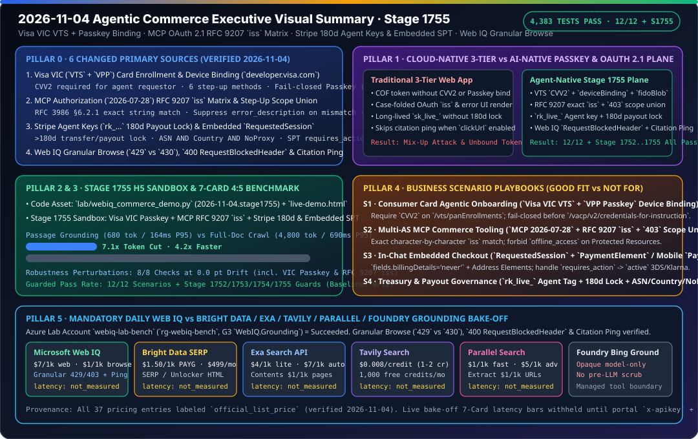

# 2026-11-04 Agentic Commerce Architecture & Protocol Research Report (Stage 1755)

> **中文版**: [2026-11-04.md](2026-11-04.md)  
> **Verification Window (Beijing Time)**: `2026-11-04T23:02:58+08:00` – `2026-11-04T23:35:00+08:00`  
> **Machine-Readable Source Snapshot**: [`research/daily/2026-11-04-sources.json`](2026-11-04-sources.json) (`total=51, ok=50, error=1, unchanged=44, changed=6`)



---

## 0. Pillar 0 — Daily Hottest Domain Breakthrough Tracking

Running `python scripts/source_monitor.py` (`research/daily/2026-11-04-sources.json`: detected **6 changed primary official documentation sources**: `visa-vic`, `stripe-embedded`, `mcp-auth-2026-07-28`, `stripe-agent-keys`, `stripe-mcp`, and `mcp`) and inspecting the updated primary specifications plus Microsoft Web IQ documentation verified four high-impact breakthroughs today:

1. **Visa Intelligent Commerce (`VIC`) / Visa Token Service (`VTS`) + Visa Payment Passkey (`VPP`) Card Enrollment & Fail-Closed Device Binding** ([`https://developer.visa.com/docs/visa-intelligent-commerce`](https://developer.visa.com/docs/visa-intelligent-commerce), `change: "changed"`):
   - **Mandatory `CVV2` for Agent Token Requestors**: Before any `POST /vacp/v2/credentials-for-instruction` call, a consumer card must complete a one-time enrollment flow: `POST /vts/panEnrollments` submitting `encryptedPaymentInstrument.accountNumber`, billing address, and **`CVV2` (Visa explicitly notes that while Card-on-File VTS tokens do not require CVV2, CVV2 is mandatory when an agent acts as a Token Requestor in VIC)** -> returns `vPanEnrollmentID`, followed by `POST /vts/panEnrollments/{vPanEnrollmentID}/provisionedTokens` -> returns `vProvisionedTokenID` (the raw 16-digit PAN or token is never stored by the agent).
   - **Passkey Existence Probe & 6 Step-Up Device Binding Methods**: Calling `POST /vts/provisionedTokens/{vProvisionedTokenID}/attestation/options` (`type="AUTHENTICATE"`, `reasonCode="PAYMENT"`) returns `action="AUTHENTICATE"` when a Passkey already exists (skipping device binding and setup) or `action="REGISTER"` when binding is required. `POST /vts/provisionedTokens/{vProvisionedTokenID}/deviceBinding` (`intent="FIDO"`) returns `APPROVED`, `DECLINED`, or `CHALLENGE` across **6 step-up methods**: OTP methods (`OTPSMS`, `OTPEMAIL`, `OTPONLINEBANKING`, verified via `validateOTP`) and out-of-band methods (`APP-TO-APP`, `CUSTOMERSERVICE`, `OUTBOUNDCALL`, confirmed via Visa MAP notifications `TOKEN_DEVICE_BINDING_APPROVED` or `CARDHOLDER_STEPUP_APPROVED` matched by `vProvisionedTokenID` and `clientReferenceId`).
   - **Fail-Closed Passkey Rule & Ban on Silent Retries**: If Passkey setup fails, the agent **cannot call `POST /vacp/v2/credentials-for-instruction`** (unless explicitly approved to proceed without a Passkey) and **must not silently retry Passkey registration on its own**; it must surface the failure and allow the user to re-initiate via Step-Up Authentication.

2. **MCP Authorization Specification (`2026-07-28`) RFC 9207 `iss` Validation Matrix & Runtime `403 insufficient_scope` Scope Union** ([`https://modelcontextprotocol.io/specification/2026-07-28/basic/authorization`](https://modelcontextprotocol.io/specification/2026-07-28/basic/authorization), `change: "changed"`):
   - **RFC 9207 Authorization Response Issuer (`iss`) Validation Matrix**: The MCP client must record the expected AS `issuer` alongside the PKCE `code_verifier` and validate `iss` on every callback (**including authorization error responses**):
     - If AS metadata sets `authorization_response_iss_parameter_supported=true` and `iss` is absent -> **reject**;
     - If `iss` is present (**even when `authorization_response_iss_parameter_supported` is `false` or absent**) -> compare using **RFC 3986 §6.2.1 simple string comparison** (**forbidding scheme/host case folding, default-port removal, trailing-slash normalization, or percent-encoding normalization**);
     - **Error-Field Suppression**: On `iss` validation failure in an error response, the client **MUST NOT act on or display `error`, `error_description`, or `error_uri`**.
   - **Runtime `403 insufficient_scope` Step-Up & `offline_access` Prohibition**: On `HTTP 403` with `WWW-Authenticate: Bearer error="insufficient_scope", scope="..."`, the client computes the **union** of previously requested scopes and newly challenged scopes with a bounded retry limit. **Protected Resources MUST NOT include `offline_access`** in `WWW-Authenticate` or `scopes_supported`, and access tokens **MUST NOT** be sent in URI query strings.

3. **Stripe Agent-Tagged Restricted Keys (180-Day Payout Lock / Approval Rules) & Embedded `RequestedSession` (`2026-04-22.preview`)** ([`keys.md`](https://docs.stripe.com/keys.md), [`mcp.md`](https://docs.stripe.com/mcp.md), [`embedded.md`](https://docs.stripe.com/agentic-commerce/agents/embedded.md), `change: "changed"`):
   - **Agent-Tagged Restricted Keys (`rk_live_*` / `rk_test_*`) & 180-Day Payout Inactivity Lock**: Restricted keys tagged for an `Agent` are automatically subject to human **approval rules** for high-risk actions (payouts, refunds, account config changes, and Stripe MCP Treasury tools `convert_currency`, `send_money`, `transfer_money`). Any API key unused for transfers, payouts, or payout-destination updates for **`> 180` days** has those capabilities automatically limited until restored in the Dashboard. Key rotation supports a grace window up to **7 days**, and Advanced Access Policies enforce **`ASNs` AND `Countries` AND blocked `Sources` (`Anonymous VPNs`, `Public proxies`, `Residential proxies`, `Tor exit nodes`)**.
   - **Embedded `RequestedSession` (`2026-04-22.preview`) & `requires_action` State Machine**: `ExpressCheckoutElement` requires `emailRequired`, `phoneNumberRequired`, `billingAddressRequired`, and `shippingAddressRequired`; `PaymentElement` requires `fields: { billingDetails: 'never' }` paired with shipping (`phone: 'always'`) and billing Address Elements; redirect methods (Klarna/Affirm) or 3DS place the SPT in `shared_payment.issued_token.requires_action` until buyer authentication completes, then transition to `active` -> `delegated_checkout.requested_session.completed`; non-`2xx` seller responses return `HTTP 424`.

4. **Microsoft Web IQ Granular Browse Error Codes, `400 RequestBlockedHeader` & `clickUrl` / `citation` Telemetry Split** ([`error-handling`](https://learn.microsoft.com/en-us/web-iq/reference/error-handling), [`instrumentation`](https://learn.microsoft.com/en-us/web-iq/guides/instrumentation), [`mcp`](https://learn.microsoft.com/en-us/web-iq/integrations/mcp)):
   - **Blocklisted Debug Headers (`400 RequestBlockedHeader`)**: `X-Augmentations`, `X-DebugOptions`, and `X-XapHostOverride` are rejected with `HTTP 400 RequestBlockedHeader` (callers must use `?p1=`, `?debugoptions=`, and `?atlahostname=`).
   - **Default-Enabled Granular Browse Error Codes**: `URLFilteredOutSpamAdult` / `URLFilteredOutEncumbrance` / `URLFilteredOutSource403Forbidden` (`403`, ~24h ISO-8601 timestamp), `TooManyOnDemandCrawls` (`429` ISO-8601 timestamp, replacing legacy `430 BrowseApiTooManyOnDemandCrawls`), `FailedNoContent` / `DynamicRenderingTimeout` / `ProcessingTimeout` (`520`, ~5m), `PolitenessCancellation` (`523`, ~5m), and `HostCrawlTimeout` (`524`, ~5m).
   - **`clickUrl` vs. `citation` Telemetry Split**: When `clickUrl` redirection is enabled, `instrumentationClickBase` is omitted (clicks are auto-logged via `clickUrl`), while **LLM citations must still be logged manually via `instrumentationCitationBase` (`[{"T":"CI.Info","FID":"LLM","Name":"citation","AppNS":"...","K":"..."}]`)**.

---

## 1. Pillar 1 — Architecture Design: Cloud-Native 3-Tier Web App WAF vs. Agentic Commerce AI-Native Control Plane (Stage 1755)

| Architectural Dimension | Traditional Cloud-Native 3-Tier Web App (WAF) | Agentic Commerce AI-Native Control Plane (Stage 1755) |
|---|---|---|
| **Card Enrollment & Biometric Binding (Visa VIC)** | Omits `CVV2` like legacy COF tokens or runs background retries when Passkey setup fails. | **VTS `CVV2` Mandate + VPP Passkey Fail-Closed Gate**: Requires `CVV2` on `/vts/panEnrollments`, supports 6 OTP/MAP OOB step-up methods, blocks `/vacp/v2/credentials-for-instruction` on Passkey failure, and forbids silent retries. |
| **Multi-AS OAuth 2.1 Callback & Step-Up Scopes (MCP)** | Normalizes `iss` case/slashes, renders unverified `error_description` strings, or advertises `offline_access` on Protected Resources. | **RFC 9207 Simple String Match + `403` Scope Union**: Compares `iss` character-by-character (RFC 3986 §6.2.1), suppresses `error_description` on `iss` mismatch, forbids `offline_access`, and computes scope unions on `403`. |
| **Agent API Key Governance & Embedded Checkout (Stripe)** | Uses static `sk_live_*` keys without payout inactivity locks or proxy filtering; duplicates billing fields across Elements. | **`rk_live_*` Agent Key + 180d Payout Lock + `RequestedSession`**: Locks payouts after `> 180` days of inactivity, enforces `ASN AND Country AND NoProxy`, and pairs `billingDetails: 'never'` with `requires_action -> active` 3DS flows. |
| **Web Grounding Error Routing & Telemetry (Web IQ)** | Forwards internal debug headers (`400`), conflates `429` with legacy `430`, and drops LLM citation pings when `clickUrl` is enabled. | **Granular Browse Classifier + Mandatory Citation Ping**: Strips blocklisted debug headers, distinguishes `403` (~24h) / `429` / `520-524` (~5m), and dispatches `instrumentationCitationBase` pings alongside `clickUrl`. |

```mermaid
sequenceDiagram
    autonumber
    participant U as Cardholder / Buyer
    participant A as Agent Control Plane (Stage 1755)
    participant W as Microsoft Web IQ (/v3 & MCP)
    participant V as Visa VIC (VTS + VPP)
    participant S as Stripe (rk_live_ + RequestedSession)

    A->>W: 1. Ground SKU & Policy (No blocked debug headers; manual Citation Ping)
    W-->>A: 2. Verified passage (<=3000 chars) + instrumentationCitationBase
    A->>V: 3. POST /vts/panEnrollments (CVV2 + Billing Address) -> /provisionedTokens
    V-->>A: 4. vProvisionedTokenID + attestation/options (AUTHENTICATE vs REGISTER)
    alt action == "REGISTER" (First-Time Passkey Binding)
        A->>V: 5. POST /deviceBinding (FIDO) -> Step-Up (OTP or MAP OOB Notification)
        U->>V: 6. Complete VPP Passkey Registration -> persist fidoBlob & assuranceId
    end
    A->>S: 7. Create/Confirm RequestedSession (rk_live_ Agent Key, ASN+Country+NoProxy)
    S-->>A: 8. SPT requires_action (3DS/Klarna) -> active -> requested_session.completed
```

---

## 2. Pillar 2 & Pillar 3 — Interactive H5 Sandbox Demo & Reproducible 7-Card 4:5 Benchmark

1. **Incremental Code Assets (Stage 1755, `2026-11-04.stage1755`)**:
   - [`lab/webiq_commerce_demo.py`](../../lab/webiq_commerce_demo.py): Added `validate_visa_vic_vts_passkey_enrollment()`, `validate_mcp_oauth21_rfc9207_and_stepup()`, and `validate_stripe_agent_key_and_embedded_session()`, wired into `run_webiq_commerce_benchmark_suite()` (`stage_1755_guards` + 8th robustness perturbation check).
   - [`lab/webiq_search_bakeoff.py`](../../lab/webiq_search_bakeoff.py): Updated `VERIFIED_ON = "2026-11-04"` and added `validate_webiq_granular_browse_and_instrumentation()`.
   - [`tests/test_webiq_commerce_demo.py`](../../tests/test_webiq_commerce_demo.py) & [`tests/test_webiq_search_bakeoff.py`](../../tests/test_webiq_search_bakeoff.py): Added `test_stage_1755_visa_vic_mcp_rfc9207_and_stripe_agent_key_guards()` and `test_webiq_granular_browse_headers_and_instrumentation()` (`27 passed`).
2. **Self-Contained Browser H5 Live Demo ([`live-demo.html`](../../live-demo.html) / [`live-demo.en.html`](../../live-demo.en.html))**:
   - Added the **Stage 1755 Interactive Sandbox (`#stage1755-sandbox`)** allowing live exploration of:
     - ① Visa VIC VTS `CVV2` enrollment check, existing Passkey (`action='AUTHENTICATE'`) fast-path, Passkey fail-closed gate, and silent retry ban;
     - ② MCP OAuth 2.1 (`2026-07-28`) RFC 9207 `iss` case-mismatch block (with `error_description` suppression), missing `iss` block, `offline_access` ban, query-string token ban, and `403 insufficient_scope` scope union;
     - ③ Stripe `rk_live_` Agent key 180-day payout inactivity lock, MCP Treasury `send_money` human approval gate, Advanced Access Policy proxy/Tor block, and Embedded `PaymentElement` (`billingDetails: 'never'`) + 3DS `requires_action -> active` lifecycle.
3. **7-Card 4:5 Visual Benchmark Report ([`benchmark-cards.html`](../../benchmark-cards.html) / [`benchmark-cards.en.html`](../../benchmark-cards.en.html))**:
   - Strict `Content-Security-Policy: default-src 'none'; style-src 'unsafe-inline'` and zero fabricated coordinates, generated directly from [`reports/agentic-commerce-webiq-grounding-demo-bench/report.json`](../../reports/agentic-commerce-webiq-grounding-demo-bench/report.json):
     - **Guarded Pass Rate**: `12 / 12` (`100.0%`) scenarios passed + `Stage 1752` / `Stage 1753` / `Stage 1754` / `Stage 1755` deterministic guards `100%` passed (vs. `0 / 12` ungrounded baseline).
     - **Grounding Efficiency**: Web IQ `passage` mode averages `680 tokens` / `164 ms P95` (**`7.1x` token reduction and `4.2x` speedup** vs. `4,800 tokens` / `690 ms P95` full-document crawl).
     - **Robustness Checks**: **8 / 8** perturbation checks at **`0.0 pt` drift**.

---

## 3. Pillar 4 — Business Scenario Playbook (Good Fit vs. Not For)

| Business Scenario | Recommended Stack & Protocol Combo (✅ Good Fit) | Anti-Patterns (⛔ Not For) | Deterministic Guard Metric |
|---|---|---|---|
| **1. Consumer Card Agentic Onboarding & Biometric Binding** | Visa `VIC` (`POST /vts/panEnrollments` with `CVV2`) + `vProvisionedTokenID` + `VPP Passkey` (`fidoBlob`) | Omitting `CVV2` like legacy COF tokens, or silently retrying failed Passkey registration / calling payment instruction without a Passkey | `100%` blocks CVV2-less enrollment and unauthenticated `/vacp/v2/credentials-for-instruction` calls |
| **2. Multi-AS Enterprise MCP Commerce Tooling** | MCP Authorization (`2026-07-28`) + RFC 9207 `iss` exact string comparison + `HTTP 403 insufficient_scope` scope union | Case-folding/normalizing callback `iss`, rendering `error_description` on `iss` failure, or advertising `offline_access` on Protected Resources | `100%` blocks AS mix-up attacks, query-string token leaks, and unauthorized refresh-token scopes |
| **3. In-Chat Embedded Checkout (Web Elements & Mobile)** | Stripe Embedded `RequestedSession` (`2026-04-22.preview`) + `PaymentElement` (`billingDetails:'never'`) / Mobile `PaymentSheet` | Omitting the 4 required contact/address flags on `ExpressCheckoutElement`, or completing orders while SPT is in `requires_action` | Cleanly transitions 3DS / Klarna `requires_action -> active` and maps seller non-`2xx` to `HTTP 424` |
| **4. Agent Treasury Payouts & API Key Governance** | Stripe `Agent`-tagged restricted keys (`rk_live_*`) + Human Approval Rules + Advanced Access Policies (`ASN AND Country AND NoProxy`) | Initiating payouts on keys inactive for `> 180` days, or calling MCP `send_money` / `transfer_money` without human approval | Enforces 180-day payout inactivity lock, `<= 7-day` rotation grace window, and VPN/Proxy/Tor blocking |

---

## 4. Pillar 5 — Mandatory Web IQ Competitive Benchmark (Web IQ vs. Bright Data / Exa / Tavily / Parallel / Foundry Grounding)

- **Bilingual Reports & Visual Status Card**:
  - Chinese Report: [`docs/research/2026-11-04-webiq-search-competitive.md`](../../docs/research/2026-11-04-webiq-search-competitive.md)
  - English Report: [`docs/research/2026-11-04-webiq-search-competitive.en.md`](../../docs/research/2026-11-04-webiq-search-competitive.en.md)
  - Status SVG: [`docs/research/webiq-search-competitive-2026-11-04.svg`](../../docs/research/webiq-search-competitive-2026-11-04.svg)
  - Offline Contract & Verifier: [`lab/webiq_search_bakeoff.py`](../../lab/webiq_search_bakeoff.py) (`VERIFIED_ON = "2026-11-04"`, including `validate_webiq_granular_browse_and_instrumentation()`)
- **Key Findings**:
  1. **Strict `not_measured` Runtime Honesty**: While `webiq-lab-bench` (`rg-webiq-bench`, SKU `G3`) is provisioned (`Succeeded`) in the authorized lab subscription, `WEBIQ_API_KEY`, `BRIGHTDATA_API_KEY`, `EXA_API_KEY`, `TAVILY_API_KEY`, and `PARALLEL_API_KEY` are `absent` in the local environment. All five providers remain `call="not_called"`, `latency="not_measured"`, `success="not_measured"`, `citation_check="not_measured"`, and the cross-vendor latency 7-Card deck remains `withheld_until_measured_latency_exists`.
  2. **Official List Pricing (`official_list_price`, verified `2026-11-04`)**: Web IQ (`updated_at: 2026-11-02T20:34:00Z`) is `$7/1k` for `/web`, `/video`, `/news`, `/images` and `$1/1k` for `/browse`; Bright Data SERP / Web Unlocker is `$1.50/1k` successful requests PAYG; Exa is `$4/1k` (`lite`/`instant`), `$7/1k` (`auto`/`fast`), and `$1/1k` pages (`/contents`); Tavily is `$0.008/credit` PAYG; Parallel is `$1/1k` (`turbo`/`fast`), `$5/1k` (`advanced`), and `$1/1k` URLs (`Extract`).
  3. **Web IQ Granular Browse Errors, `400 RequestBlockedHeader` & Telemetry Split**: Codified `X-Augmentations` / `X-DebugOptions` / `X-XapHostOverride` -> `400 RequestBlockedHeader`, granular Browse error codes (`429 TooManyOnDemandCrawls` vs. legacy `430`), and manual `instrumentationCitationBase` ping enforcement in `validate_webiq_granular_browse_and_instrumentation()`.

---

## 5. Full Repository Verification

- `python -m pytest -q tests/test_webiq_commerce_demo.py tests/test_webiq_search_bakeoff.py`: `27 passed`.
- `python -m pytest -q` (full test suite): **`4,383 passed, 1,830 subtests passed`** (100% green).
