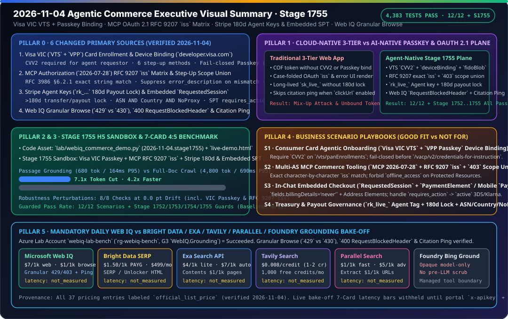

# 2026-11-04 Agentic Commerce 架构与协议研究日报（Stage 1755）

> **English companion**: [2026-11-04.en.md](2026-11-04.en.md)  
> **验证时间（北京时间）**：`2026-11-04T23:02:58+08:00` – `2026-11-04T23:35:00+08:00`  
> **机器可读来源快照**：[`research/daily/2026-11-04-sources.json`](2026-11-04-sources.json)（`total=51, ok=50, error=1, unchanged=44, changed=6`）



---

## 0. Pillar 0 — 追踪当日最热门的领域能力突破（Daily Hottest Domain Breakthrough Tracking）

运行 `python scripts/source_monitor.py`（生成 `research/daily/2026-11-04-sources.json`，检测到 **6 个一手官方来源发生内容变更**：`visa-vic`、`stripe-embedded`、`mcp-auth-2026-07-28`、`stripe-agent-keys`、`stripe-mcp`、`mcp`），并核验全部变更页面与 Microsoft Web IQ 官方正文，提炼出今日四大核心协议与能力突破：

1. **Visa Intelligent Commerce (`VIC`) / Visa Token Service (`VTS`) + Visa Payment Passkey (`VPP`) 卡注册与设备绑定闭锁机制**（[`https://developer.visa.com/docs/visa-intelligent-commerce`](https://developer.visa.com/docs/visa-intelligent-commerce)，`change: "changed"`）：
   - **Agent Token Requestor 强制要求 `CVV2`（区别于传统 COF）**：在发起任何 `POST /vacp/v2/credentials-for-instruction` 支付指令前，消费者卡片必须完成一次性注册流：`POST /vts/panEnrollments` 提交加密卡号（`encryptedPaymentInstrument.accountNumber`）、账单地址与 **`CVV2`（Visa 官方明确注明：传统 Card-on-File VTS Token 不要求 CVV2，但在 VIC 中智能体作为 Token Requestor 必须传 CVV2）**，换取 `vPanEnrollmentID`，再调用 `POST /vts/panEnrollments/{vPanEnrollmentID}/provisionedTokens` 换取 `vProvisionedTokenID`（智能体永不存储或接触 16 位原始卡号/Token）。
   - **Passkey 存在性探测与 6 种 Step-Up 设备绑定通道**：调用 `POST /vts/provisionedTokens/{vProvisionedTokenID}/attestation/options`（`type="AUTHENTICATE"`, `reasonCode="PAYMENT"`）：若返回 `action="AUTHENTICATE"` 则表明该卡已绑定 Passkey，可直接跳过设备绑定与注册；若返回 `action="REGISTER"`，则调用 `POST /vts/provisionedTokens/{vProvisionedTokenID}/deviceBinding`（`intent="FIDO"`）。当返回 `status="CHALLENGE"` 时，支持 **6 种发卡行 Step-Up 验证方式**：OTP 类（`OTPSMS`、`OTPEMAIL`、`OTPONLINEBANKING`，通过 `validateOTP` 校验）与带外（Out-of-Band）类（`APP-TO-APP`、`CUSTOMERSERVICE`、`OUTBOUNDCALL`，通过 Visa MAP 通知 `TOKEN_DEVICE_BINDING_APPROVED` 或 `CARDHOLDER_STEPUP_APPROVED` 并匹配 `vProvisionedTokenID` + `clientReferenceId` 确认）。
   - **Passkey 注册失败闭锁（Fail-Closed）与禁止静默重试**：若 Passkey 设置失败，**智能体严禁调用 `POST /vacp/v2/credentials-for-instruction`**（除非获显式豁免），且**严禁自行静默重试 Passkey 注册**，必须向用户显式暴露失败原因并引导重新通过 Step-Up 认证。

2. **MCP Authorization 规范（`2026-07-28`）RFC 9207 `iss` 逐字符校验矩阵与运行时 `403 insufficient_scope` 权限并集递增**（[`https://modelcontextprotocol.io/specification/2026-07-28/basic/authorization`](https://modelcontextprotocol.io/specification/2026-07-28/basic/authorization)，`change: "changed"`）：
   - **RFC 9207 授权响应 `iss` 校验矩阵（防多 AS 混淆攻击）**：MCP 客户端必须将已验证的 AS `issuer` 与 PKCE `code_verifier` 一起持久化，并在授权回调（**包括错误响应**）时执行校验：
     - 若 AS 元数据声明 `authorization_response_iss_parameter_supported=true` 但回调缺失 `iss` -> **立即拒绝**；
     - 若回调包含 `iss`（**即使 AS 元数据未声明或设为 `false`**）-> 必须使用 **RFC 3986 §6.2.1 简单字符串逐字符比对（Simple String Comparison）**，**严禁对协议/主机名做大小写折叠、默认端口剥离、末尾斜杠归一化或百分号编码归一化**；
     - **错误回调防钓鱼污染**：若授权错误响应的 `iss` 校验失败，客户端**严禁处理或向用户展示 `error`、`error_description` 或 `error_uri`**。
   - **运行时 `403 insufficient_scope` 步进授权与 `offline_access` 禁令**：MCP Server 返回 `HTTP 403` + `WWW-Authenticate: Bearer error="insufficient_scope", scope="..."` 时，客户端计算**已有 `scope` 与新增 `scope` 的并集（Union）**并限制重试次数；**Protected Resource 严禁在 `WWW-Authenticate` 或 `scopes_supported` 中包含 `offline_access`**；且 Access Token **严禁出现在 URI 查询字符串中**。

3. **Stripe Agent 专属受限密钥（180 天打款闲置锁 / 高危审批规则）与 Embedded 委托结账（`RequestedSession`, `2026-04-22.preview`）**（[`keys.md`](https://docs.stripe.com/keys.md)、[`mcp.md`](https://docs.stripe.com/mcp.md)、[`embedded.md`](https://docs.stripe.com/agentic-commerce/agents/embedded.md)，`change: "changed"`）：
   - **带 `Agent` 标签的受限密钥（`rk_live_*` / `rk_test_*`）与 180 天打款闲置自动锁定**：标记为 `Agent` 的受限密钥对提现（payouts）、退款（refunds）、账户配置变更，以及 Stripe MCP 资金工具（`convert_currency`、`send_money`、`transfer_money`）**强制触发人工审批规则（Approval Rules）**；任何连续 **超过 180 天** 未用于转账（transfers）、提现（payouts）或提现目标更新的 API Key，其打款能力会被**自动限制锁定**（需在 Dashboard 手动恢复）；密钥轮换支持最长 **7 天** 宽限期，高级访问策略（Advanced Access Policies）支持按 **`ASNs` AND `Countries` AND 拦截代理源（匿名 VPN、公共代理、住宅代理、Tor 出口节点）** 进行组合封禁。
   - **Embedded `RequestedSession`（`2026-04-22.preview`）组件契约与 `requires_action` 状态机**：`ExpressCheckoutElement` 必须同时开启 `emailRequired`、`phoneNumberRequired`、`billingAddressRequired`、`shippingAddressRequired`；`PaymentElement` 必须设置 `fields: { billingDetails: 'never' }` 并配合收货（`phone: 'always'`）与账单 Address Elements；当买家使用 Klarna/Affirm 重定向或触发 3DS 时，SPT 进入 `shared_payment.issued_token.requires_action`，待买家完成验证后转为 `active` 并触发 `delegated_checkout.requested_session.completed`；卖家接口非 `2xx` 统一映射为 `HTTP 424`。

4. **Microsoft Web IQ 细粒度 Browse 错误码、禁用调试请求头（`400 RequestBlockedHeader`）与 `clickUrl` / `citation` 遥测分离**（[`error-handling`](https://learn.microsoft.com/en-us/web-iq/reference/error-handling)、[`instrumentation`](https://learn.microsoft.com/en-us/web-iq/guides/instrumentation)、[`mcp`](https://learn.microsoft.com/en-us/web-iq/integrations/mcp)）：
   - **禁用调试请求头（`400 RequestBlockedHeader`）**：网关直接拒绝黑名单请求头 `X-Augmentations`、`X-DebugOptions`、`X-XapHostOverride`，必须改用 URL 查询参数 `?p1=`、`?debugoptions=`、`?atlahostname=`。
   - **默认启用的细粒度 Browse 错误码**：`URLFilteredOutSpamAdult` / `URLFilteredOutEncumbrance` / `URLFilteredOutSource403Forbidden`（`403`，约 24 小时 ISO-8601 时间戳）、`TooManyOnDemandCrawls`（`429` ISO-8601 时间戳，取代旧版粗糙模式的 `430 BrowseApiTooManyOnDemandCrawls`）、`FailedNoContent` / `DynamicRenderingTimeout` / `ProcessingTimeout`（`520`，约 5 分钟）、`PolitenessCancellation`（`523`，约 5 分钟）、`HostCrawlTimeout`（`524`，约 5 分钟）。
   - **`clickUrl` 与 `citation` 遥测分离**：启用 `clickUrl` 重定向时，响应省略 `instrumentationClickBase`（点击自动统计），但 **LLM 引用必须由智能体手动拼接 `instrumentationCitationBase` 发送 `[{"T":"CI.Info","FID":"LLM","Name":"citation","AppNS":"...","K":"..."}]` Ping**。

---

## 1. Pillar 1 — 架构设计：传统云原生三层 Web App WAF vs. Agentic Commerce AI-Native 架构（Stage 1755）

| 架构维度 | 传统云原生三层 Web App (Well-Architected) | Agentic Commerce AI-Native 控制面架构（Stage 1755） |
|---|---|---|
| **卡凭证入网与设备绑定（Visa VIC）** | 沿用传统 Card-on-File 逻辑省略 CVV2，或在 Passkey 注册失败后由后台定时任务盲目自动重试。 | **VTS `CVV2` 强制校验 + VPP Passkey 失败闭锁**：Agent Token Requestor 入网必传 `CVV2`，支持 6 类 OTP/MAP 带外 Step-Up；Passkey 失败立即阻断 `/vacp/v2/credentials-for-instruction` 且严禁静默重试。 |
| **多租户 OAuth 2.1 授权回调与步进权限（MCP）** | 对 `iss` 做大小写/末尾斜杠宽松匹配，在错误页直接渲染未验真的 `error_description`，或在资源端暴露 `offline_access`。 | **RFC 9207 逐字符精确匹配 + `403` 权限并集**：按 RFC 3986 §6.2.1 逐字符比对 `iss`，失配时静默丢弃 `error_description`；禁用 `offline_access` 与 URL 查询串 Token。 |
| **智能体 API 密钥治理与嵌入式结账（Stripe）** | 长期共用高权限 `sk_live_*`，缺乏闲置打款收敛与代理源过滤；PaymentElement 与 Address Element 重复收集账单信息。 | **`rk_live_*` Agent 标签 + 180 天打款锁 + `RequestedSession`**：>180 天未打款自动锁定提现能力；ASN+国家+反代理 AND 策略；`billingDetails: 'never'` 配合 `requires_action -> active` 3DS 闭环。 |
| **实时接地错误分类与引用归因（Web IQ）** | 透传调试请求头触发 `400`，混淆 `429` 与旧版 `430`，开启 `clickUrl` 后漏报 LLM 引用遥测。 | **细粒度 Browse 错误路由 + 手动 Citation Ping**：剥离禁用调试头，精确区分 `403` (~24h) / `429` / `520-524` (~5m)，并在 `clickUrl` 模式下强制补发 `instrumentationCitationBase` Ping。 |

```mermaid
sequenceDiagram
    autonumber
    participant U as Cardholder / Buyer
    participant A as Agent Control Plane (Stage 1755)
    participant W as Microsoft Web IQ (/v3 & MCP)
    participant V as Visa VIC (VTS + VPP)
    participant S as Stripe (rk_live_ + RequestedSession)

    A->>W: 1. Ground SKU & Policy (No blocked debug headers; manual Citation Ping)
    W-->>A: 2. Verified passage (<=3000 chars) + instrumentationCitationBase
    A->>V: 3. POST /vts/panEnrollments (CVV2 + Billing Address) -> /provisionedTokens
    V-->>A: 4. vProvisionedTokenID + attestation/options (AUTHENTICATE vs REGISTER)
    alt action == "REGISTER" (First-Time Passkey Binding)
        A->>V: 5. POST /deviceBinding (FIDO) -> Step-Up (OTP or MAP OOB Notification)
        U->>V: 6. Complete VPP Passkey Registration -> persist fidoBlob & assuranceId
    end
    A->>S: 7. Create/Confirm RequestedSession (rk_live_ Agent Key, ASN+Country+NoProxy)
    S-->>A: 8. SPT requires_action (3DS/Klarna) -> active -> requested_session.completed
```

---

## 2. Pillar 2 & Pillar 3 — 交互式 H5 沙盒 Demo 与 7-Card 4:5 可复现基准测试

1. **增量代码资产（Stage 1755，`2026-11-04.stage1755`）**：
   - [`lab/webiq_commerce_demo.py`](../../lab/webiq_commerce_demo.py)：新增 `VisaVICPasskeyEnrollmentDecision` / `validate_visa_vic_vts_passkey_enrollment()`、`MCPOAuth21RFC9207AndStepUpDecision` / `validate_mcp_oauth21_rfc9207_and_stepup()` 与 `StripeAgentKeyAndEmbeddedSessionDecision` / `validate_stripe_agent_key_and_embedded_session()`，集成至 `run_webiq_commerce_benchmark_suite()` 的 `stage_1755_guards` 与第 8 项鲁棒性扰动测试。
   - [`lab/webiq_search_bakeoff.py`](../../lab/webiq_search_bakeoff.py)：更新 `VERIFIED_ON = "2026-11-04"`，新增 `validate_webiq_granular_browse_and_instrumentation()`，覆盖黑名单调试头 `400 RequestBlockedHeader`、13 项细粒度 Browse 错误码分类及 `clickUrl` / `citation` 遥测分离校验。
   - [`tests/test_webiq_commerce_demo.py`](../../tests/test_webiq_commerce_demo.py) 与 [`tests/test_webiq_search_bakeoff.py`](../../tests/test_webiq_search_bakeoff.py)：新增 `test_stage_1755_visa_vic_mcp_rfc9207_and_stripe_agent_key_guards()` 与 `test_webiq_granular_browse_headers_and_instrumentation()`（专项测试 `27 passed`）。
2. **浏览器自包含交互式 H5 演示台（[`live-demo.html`](../../live-demo.html) / [`live-demo.en.html`](../../live-demo.en.html)）**：
   - 新增 **Stage 1755 交互式沙盒面板（`#stage1755-sandbox`）**，支持在浏览器中实时切换演练：
     - ① Visa VIC VTS 入网 `CVV2` 缺失拦截、已有 Passkey（`action='AUTHENTICATE'`）免绑定直通、Passkey 失败闭锁与静默重试封禁；
     - ② MCP OAuth 2.1（`2026-07-28`）RFC 9207 `iss` 大小写失配拦截（并抑制 `error_description` 渲染）、缺失 `iss` 拦截、`offline_access` 禁令、URL 查询串 Token 封禁与 `403 insufficient_scope` 权限并集递增；
     - ③ Stripe `rk_live_` Agent 密钥 180 天打款闲置锁、MCP Treasury `send_money` 无人工审批拦截、高级访问策略反代理封禁与 Embedded `PaymentElement` (`billingDetails: 'never'`) + 3DS `requires_action -> active` 跃迁。
3. **7-Card 4:5 视觉评测报告（[`benchmark-cards.html`](../../benchmark-cards.html) / [`benchmark-cards.en.html`](../../benchmark-cards.en.html)）**：
   - 严格遵循 `Content-Security-Policy: default-src 'none'; style-src 'unsafe-inline'` 与零虚构坐标护栏，全部坐标源自 [`reports/agentic-commerce-webiq-grounding-demo-bench/report.json`](../../reports/agentic-commerce-webiq-grounding-demo-bench/report.json)：
     - **护栏开启通过率**：`12 / 12`（`100.0%`）场景通过 + `Stage 1752` / `Stage 1753` / `Stage 1754` / `Stage 1755` 全部确定性契约护栏 `100%` 通过（无护栏基线 `0 / 12`）。
     - **检索效率与 Token 节省**：Web IQ `passage` 模式平均 `680 tokens` / `P95 = 164 ms`（相比全文抓取 `4,800 tokens` / `P95 = 690 ms` 实现 **`7.1x` Token 压缩与 `4.2x` 延迟加速**）。
     - **鲁棒性检验**：**8 / 8** 项顺序反转与契约扰动测试全部保持 **`0.0 pt` 漂移**。

---

## 3. Pillar 4 — 技术适用业务场景方案开发（Business Scenario Playbook: Good Fit vs. Not For）

| 业务场景 | 推荐技术栈与协议组合（✅ Good Fit） | 严禁误用模式（⛔ Not For） | 核心确定性护栏指标 |
|---|---|---|---|
| **1. 消费级智能体首次绑卡与生物识别授权** | Visa `VIC` (`POST /vts/panEnrollments` 含 `CVV2`) + `vProvisionedTokenID` + `VPP Passkey` (`fidoBlob`) | 禁止像传统 COF 一样省略 `CVV2`；禁止在 Passkey 注册失败后由 Agent 自动静默重试或强调支付指令 | `100%` 阻断无 `CVV2` 入网与未完成 Passkey 的 `/vacp/v2/credentials-for-instruction` 调用 |
| **2. 跨组织多授权服务器 MCP 商业工具调用** | MCP Authorization (`2026-07-28`) + RFC 9207 `iss` 精确字符串比对 + `HTTP 403 insufficient_scope` 权限并集 | 禁止对回调 `iss` 做大小写/末尾斜杠归一化；禁止在 `iss` 失配的错误回调中展示 `error_description`；禁止暴露 `offline_access` | `100%` 拦截多 AS Mix-Up 攻击、URL 查询串 Token 泄漏与越权刷新令牌请求 |
| **3. 对话内嵌入式结账（Web Elements & 移动端）** | Stripe Embedded `RequestedSession` (`2026-04-22.preview`) + `PaymentElement` (`billingDetails:'never'`) / Mobile `PaymentSheet` | 禁止在 `ExpressCheckoutElement` 漏开四项必填联系/地址开关；禁止在 `requires_action` 完成前提前交割订单 | 完整闭环 3DS / Klarna `requires_action -> active`；卖家非 `2xx` 100% 映射为 `HTTP 424` |
| **4. 智能体司库（Treasury）打款与企业密钥治理** | Stripe `Agent` 标签受限密钥 (`rk_live_*`) + 人工审批规则 + 高级访问策略 (`ASN AND Country AND NoProxy`) | 禁止对闲置 `> 180 天` 未打款的密钥直接发起提现；禁止无人工确认执行 MCP `send_money` / `transfer_money` | 180 天打款闲置自动锁定；密钥轮换宽限期强制 `<= 7 天`；100% 拦截匿名 VPN / 住宅代理 / Tor |

---

## 4. Pillar 5 — Web IQ 竞品基准（Web IQ vs. Bright Data / Exa / Tavily / Parallel / Foundry Grounding）

- **完整双语报告与状态卡**：
  - 中文报告：[`docs/research/2026-11-04-webiq-search-competitive.md`](../../docs/research/2026-11-04-webiq-search-competitive.md)
  - English Report：[`docs/research/2026-11-04-webiq-search-competitive.en.md`](../../docs/research/2026-11-04-webiq-search-competitive.en.md)
  - 状态 SVG：[`docs/research/webiq-search-competitive-2026-11-04.svg`](../../docs/research/webiq-search-competitive-2026-11-04.svg)
  - 离线契约与校验：[`lab/webiq_search_bakeoff.py`](../../lab/webiq_search_bakeoff.py)（`VERIFIED_ON = "2026-11-04"`，新增 `validate_webiq_granular_browse_and_instrumentation()`）
- **实测与标价边界结论**：
  1. **实测状态严格保持 `not_measured`**：实验室付费订阅已创建 G3 账户 `webiq-lab-bench`（`rg-webiq-bench`），但本机环境未设置 `WEBIQ_API_KEY`，且 `BRIGHTDATA_API_KEY`、`EXA_API_KEY`、`TAVILY_API_KEY`、`PARALLEL_API_KEY` 均为 `absent`。五家供应商全部记录为 `call="not_called"`、`latency="not_measured"`、`success="not_measured"`、`citation_check="not_measured"`，缺失延迟绝不写成 `0`，跨厂商延迟 7-Card 继续暂缓（`withheld_until_measured_latency_exists`）。
  2. **官方标价（`official_list_price`，核验日 `2026-11-04`）**：Web IQ 维持 `/web`、`/news`、`/images`、`/video` `$7/1k`、`/browse` `$1/1k`；Bright Data SERP / Web Unlocker 按量 `$1.50/1k` 成功请求；Exa `lite/instant` `$4/1k`、`auto/fast` `$7/1k`、`/contents` `$1/1k` 页；Tavily 按量 `$0.008/credit`；Parallel Search `turbo/fast` `$1/1k`、`advanced` `$5/1k`、Extract `$1/1k` URL。
  3. **Web IQ 细粒度 Browse 错误码、禁用调试头与遥测分离**：在 `lab/webiq_search_bakeoff.py` 完整固化 `X-Augmentations` / `X-DebugOptions` / `X-XapHostOverride` 触发 `400 RequestBlockedHeader`、细粒度 Browse 错误码（`429 TooManyOnDemandCrawls` vs 旧版 `430`）以及 `clickUrl` 模式下手动发送 `instrumentationCitationBase` Ping 的确定性校验。

---

## 5. 全库测试验证结果

- `python -m pytest -q tests/test_webiq_commerce_demo.py tests/test_webiq_search_bakeoff.py`：`27 passed`。
- `python -m pytest -q`（全库回归测试）：**`4,383 passed, 1,830 subtests passed`**（100% 全绿）。
