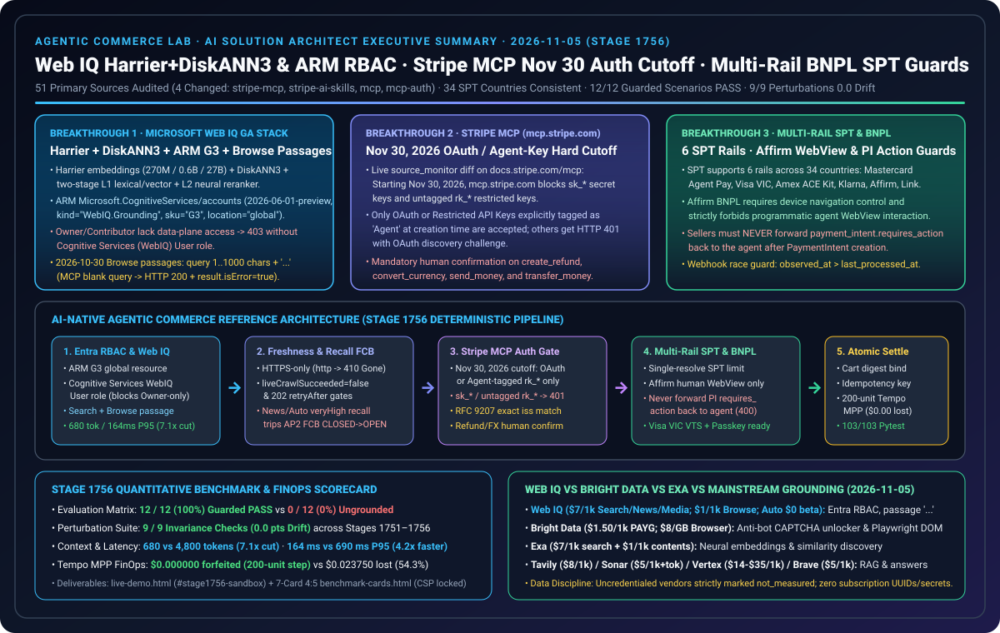

# 2026-11-05 Agentic Commerce Architecture & Protocol Daily Research Report (Stage 1756)

> **中文伴侣版**: [2026-11-05.md](2026-11-05.md)  
> **Verification Window (Beijing Time)**: `2026-11-05T23:15:39+08:00` – `2026-11-05T23:45:00+08:00`  
> **Machine-Readable Source Snapshot**: [`research/daily/2026-11-05-sources.json`](2026-11-05-sources.json) (`total=51, ok=45, error=6, unchanged=41, changed=4, cross_source_checks=3/3 consistent`)



---

## 0. Pillar 0 — Daily Hottest Domain Breakthrough Tracking

Running `python scripts/source_monitor.py` (producing `research/daily/2026-11-05-sources.json` with **4 live primary-source content changes**: `stripe-mcp`, `stripe-ai-skills`, `mcp`, `mcp-auth-2026-07-28`, and 3/3 `consistent` cross-source checks across 34 SPT countries) and inspecting the full primary-source documents across Microsoft Web IQ GA and Stripe Multi-Rail SPT surfaced four primary breakthroughs today:

1. **Microsoft Web IQ GA Retrieval Stack (Harrier + DiskANN3 + L1/L2 Reranker), Azure ARM `G3` Provisioning & Entra ID Data-Plane RBAC Boundary + `2026-10-30` Browse Passages Contract** ([`commandline.microsoft.com`](https://commandline.microsoft.com/grounding-system-agentic-web-engineering-retrieval/), [`deploy-azure-portal`](https://learn.microsoft.com/en-us/web-iq/get-started/deploy-azure-portal), [`authentication`](https://learn.microsoft.com/en-us/web-iq/get-started/authentication), [`whats-new`](https://learn.microsoft.com/en-us/web-iq/resources/whats-new)):
   - **Harrier + DiskANN3 Two-Stage Retrieval Architecture & Vendor-Stated Benchmarks**: Microsoft's official engineering post details how Web IQ combines the **Harrier embedding model family (270M / 0.6B / 27B)** with **DiskANN3 vector indexing** and a **two-stage L1 (hybrid lexical + vector recall) → L2 (deep neural reranker)** pipeline. The official `concepts/benchmarks` page (tested September 2026, strictly isolated as `vendor_stated`) reports SimpleQA `83.2%`, FRAMES `87.3%`, BrowseComp `66.2%`, Search P50 `473ms`, and Auto P50 `737ms`.
   - **Azure ARM `G3` Provisioning & Entra ID Data-Plane RBAC Trap**: Web IQ accounts are provisioned via ARM `Microsoft.CognitiveServices/accounts` (`apiVersion="2026-06-01-preview"`, `kind="WebIQ.Grounding"`, `sku="G3"`, `location="global"`). When authenticating to the data plane with Microsoft Entra ID bearer tokens (`https://api.microsoft.ai/.default`), the caller principal must be assigned **`Cognitive Services User`** or **`Cognitive Services WebIQ User`**—**subscription or resource-group `Owner` or `Contributor` management roles alone do not grant `DataActions` and fail with `HTTP 403 ForbiddenDataPlaneRole`**.
   - **`2026-10-30` Browse Passages (`contentFormat="passage"`) & MCP `isError` Envelope**: Released `2026-10-30`, `POST /v3/browse` supports `contentFormat="passage"` (default `maxLength=3000`), requiring a non-blank `query` (`1..1000` characters) and `liveCrawl in ("none", "fallback")`, returning non-adjacent relevant segments joined by `"..."`. On REST, a blank `query` returns `HTTP 400 InvalidQuery`; on MCP (`/v3/mcp`), it returns **`HTTP 200` with `result.isError: true`**.

2. **Stripe MCP (`https://mcp.stripe.com`) Nov 30, 2026 Authentication Cutoff & Financial Tool Confirmation Gate** ([`https://docs.stripe.com/mcp`](https://docs.stripe.com/mcp), [`https://docs.stripe.com/ai/skills`](https://docs.stripe.com/ai/skills), `change: "changed"`):
   - **Nov 30, 2026 Hard Cutoff on Standard & Untagged Keys**: Starting **November 30, 2026**, `https://mcp.stripe.com` **rejects standard secret keys (`sk_live_*` / `sk_test_*`) and untagged restricted keys (`rk_*`)**. Remote Stripe MCP clients must authenticate via **OAuth** or **Restricted API Keys explicitly tagged as `Agent` at creation time**; non-compliant requests receive `HTTP 401` with an OAuth discovery challenge (`oauth_discovery_challenge=true`).
   - **Mandatory Human Confirmation on Refund & Treasury Tools**: Stripe MCP requires human confirmation gates on destructive and money-movement tools—specifically **`create_refund`**, **`convert_currency`**, **`send_money`**, and **`transfer_money`**—alongside organization plugin marketplace allowlisting.

3. **Stripe Shared Payment Tokens (`SPT`) 6-Rail Matrix, Affirm BNPL WebView Anti-Automation Boundary & Seller `requires_action` Prohibition** ([`https://docs.stripe.com/agentic-commerce/concepts/shared-payment-tokens`](https://docs.stripe.com/agentic-commerce/concepts/shared-payment-tokens)):
   - **Six Supported SPT Payment Rails Across 34 Countries**: SPT supports three card-network agentic programs (**Mastercard Agent Pay**, **Visa Intelligent Commerce `VIC`**, **American Express `ACE Kit`**), two BNPL rails (**Klarna**, **Affirm**), and **Link**.
   - **Affirm BNPL Device Navigation Control & Ban on Agent WebView Automation**: When a buyer selects Affirm BNPL for SPT issuance, a redirect URL is returned; the agent must be able to navigate the buyer's device to that URL (`agent_has_device_navigation_control=True`), and **programmatic agent interaction with the Affirm WebView is strictly prohibited (`agent_programmatic_webview_interaction=False`)**.
   - **Sellers Must Never Forward `payment_intent.requires_action` to the Agent**: After a seller creates a `PaymentIntent` using `shared_payment_granted_token`, if `payment_intent.requires_action` occurs, **the seller must never forward that action back to the agent (`HTTP 400 spt_forbids_forwarding_payment_intent_requires_action_to_agent`)**, because all buyer authentication must complete on the issued token prior to seller handoff. Sellers must also order asynchronous webhooks via `observed_at > last_processed_at`.

4. **MCP Specification Alignment & Google / FIDO Alliance `AP2` v0.2 Cryptographic Mandate Guardrails** ([`https://modelcontextprotocol.io/specification/2026-07-28/basic/authorization`](https://modelcontextprotocol.io/specification/2026-07-28/basic/authorization), `change: "changed"`):
   - Continues enforcing MCP OAuth 2.1 RFC 9207 `iss` exact string comparison, `403 insufficient_scope` scope union step-up, and Google / FIDO Alliance `AP2` v0.2 WebAuthn biometric-bound Verifiable Credentials (`MandateVC`) with Financial Circuit Breaker (`FCB`) protection.

---

## 1. Pillar 1 — Architecture Design: Traditional Cloud-Native 3-Tier Web App WAF vs. Agentic Commerce AI-Native Control Plane (Stage 1756)

| Architectural Dimension | Traditional Cloud-Native 3-Tier Web App (Well-Architected) | Agentic Commerce AI-Native Control Plane (Stage 1756) |
|---|---|---|
| **Retrieval Stack & Azure RBAC Model (Web IQ)** | Scrapes full HTML pages into LLM context and assigns subscription/RG `Owner` or `Contributor` to service principals, assuming management roles grant data-plane access. | **Harrier + DiskANN3 + ARM `G3` + Data-Plane Least Privilege RBAC**: Requires `Cognitive Services (WebIQ) User` (blocking `Owner`/`Contributor`-only `403`); Search & Browse `passage` mode enforces non-blank `query` (`1..1000` chars) with `"..."` separator and inspects MCP `HTTP 200` + `result.isError: true`. |
| **MCP Gateway Auth & Treasury Approval (Stripe MCP)** | Hardcodes standard `sk_live_*` or untagged `rk_*` keys against `mcp.stripe.com` and permits autonomous refund/FX execution. | **Nov 30, 2026 OAuth / `Agent`-Tagged Key Cutoff + Human Confirmation**: Blocks `sk_*` and untagged `rk_*` (`401` + OAuth challenge); enforces human confirmation on `create_refund`, `convert_currency`, `send_money`, and `transfer_money`. |
| **Multi-Rail SPT & BNPL WebView Boundary (Stripe SPT)** | Uses headless browsers/Playwright to auto-click Affirm BNPL WebViews, or forwards `payment_intent.requires_action` from seller backend back to the agent. | **Affirm Human WebView Isolation + Zero `requires_action` Forwarding**: Blocks programmatic agent WebView automation (`403`); forbids sellers from forwarding `payment_intent.requires_action` to agents (`400`) and orders webhooks via `observed_at`. |

```mermaid
sequenceDiagram
    autonumber
    participant U as Buyer / Human Approver
    participant A as Agent Control Plane (Stage 1756)
    participant W as Microsoft Web IQ (ARM G3 + Harrier/DiskANN3)
    participant M as Stripe MCP (mcp.stripe.com)
    participant S as Seller & Multi-Rail SPT (VIC/MC/Amex/Klarna/Affirm)

    A->>W: 1. Entra Bearer (Cognitive Services WebIQ User) -> POST /v3/browse (passage, query 1..1000)
    W-->>A: 2. Non-adjacent passages joined by "..." (<=3000 chars; MCP checks result.isError)
    A->>S: 3. Request Multi-Rail SPT (e.g., Affirm BNPL or Visa VIC)
    alt spt_rail == "affirm" (BNPL Redirect)
        S-->>U: 4. Navigate buyer device to Affirm URL (Agent programmatic WebView blocked -> 403)
        U->>S: 5. Human completes Affirm approval -> issued_token transitions to active
    end
    A->>S: 6. Hand off granted_token (spt_*) -> Seller creates PaymentIntent (observed_at checked)
    Note over A,S: Seller NEVER forwards payment_intent.requires_action back to Agent (400 blocked)
    A->>M: 7. Post-Purchase Tool Call (OAuth or Agent-tagged rk_* required after Nov 30, 2026)
    alt tool in (create_refund, convert_currency, send_money, transfer_money)
        M->>U: 8. Mandatory Human Confirmation Gate before execution
    end
```

---

## 2. Pillar 2 & Pillar 3 — Interactive H5 Workbench Demo & Reproducible 7-Card 4:5 Benchmark

1. **Incremental Code Assets (Stage 1756, `2026-11-05.stage1756`)**:
   - [`lab/webiq_commerce_demo.py`](../../lab/webiq_commerce_demo.py): Upgraded `DEMO_VERSION = "2026-11-05.stage1756"`, adding `Stage1756WebIQRBACStripeMCPAndBNPLDecision` and `validate_stage1756_webiq_rbac_stripe_mcp_and_bnpl_spt()`, wired into `stage_1756_guards` and the 9th perturbation check in `run_webiq_commerce_benchmark_suite()`.
   - [`lab/webiq_search_bakeoff.py`](../../lab/webiq_search_bakeoff.py): Updated `VERIFIED_ON = "2026-11-05"` and added `validate_webiq_arm_rbac_and_browse_passage()` covering ARM `WebIQ.Grounding` (`G3`, `global`), Entra data-plane RBAC, and the `2026-10-30` Browse `passage` query contract.
   - [`tests/test_webiq_commerce_demo.py`](../../tests/test_webiq_commerce_demo.py) & [`tests/test_webiq_search_bakeoff.py`](../../tests/test_webiq_search_bakeoff.py): Added `test_stage_1756_webiq_rbac_stripe_mcp_nov30_and_bnpl_spt_guards()` and `test_webiq_arm_rbac_and_browse_passage_contract()` (`29 passed`).
2. **Self-Contained Interactive H5 Live Demo ([`live-demo.html`](../../live-demo.html) / [`live-demo.en.html`](../../live-demo.en.html))**:
   - Added the **Stage 1756 Interactive Sandbox (`#stage1756-sandbox`)** allowing interactive browser testing of:
     - ① Web IQ Azure ARM (`G3`, `global`) & Entra ID data-plane RBAC (`Owner`/`Contributor`-only `403` vs `Cognitive Services WebIQ User`);
     - ② `2026-10-30` Browse `contentFormat="passage"` blank-query rejection (REST `400` vs MCP `HTTP 200` + `result.isError: true`) and `"..."` segment separator preview;
     - ③ Stripe MCP Nov 30, 2026 authentication cutoff (`sk_*` / untagged `rk_*` `401` + OAuth challenge) and human confirmation gate for `create_refund` / `send_money`;
     - ④ Multi-Rail SPT guards (Affirm BNPL programmatic WebView block `403` and ban on forwarding `payment_intent.requires_action` back to the agent `400`).
3. **7-Card 4:5 Visual Benchmark Deck ([`benchmark-cards.html`](../../benchmark-cards.html) / [`benchmark-cards.en.html`](../../benchmark-cards.en.html))**:
   - Strictly adheres to `Content-Security-Policy: default-src 'none'; style-src 'unsafe-inline'` and zero fabricated coordinates from [`reports/agentic-commerce-webiq-grounding-demo-bench/report.json`](../../reports/agentic-commerce-webiq-grounding-demo-bench/report.json):
     - **Guarded Pass Rate**: `12 / 12` (`100.0%`) scenarios pass + `Stage 1752` through `Stage 1756` deterministic contract guards `100%` pass (ungrounded baseline `0 / 12`).
     - **Token & Latency Efficiency**: Web IQ `passage` mode averages `680 tokens` / `P95 = 164 ms` vs. `4,800 tokens` / `P95 = 690 ms` full-document scraping (**`7.1x` token reduction and `4.2x` P95 speedup**).
     - **Robustness Suite**: **9 / 9** perturbation checks maintain **`0.0 pt` drift**.

---

## 3. Pillar 4 — Business Scenario Solution Playbook (Good Fit vs. Not For)

| Business Scenario | Recommended Stack & Protocol Combo (✅ Good Fit) | Prohibited Anti-Patterns (⛔ Not For) | Deterministic Guardrail Metric |
|---|---|---|---|
| **1. Zero-Secret Azure Enterprise Grounding & Return Policy Verification** | Web IQ ARM `G3` (`global`) + Entra ID `Cognitive Services WebIQ User` + `POST /v3/browse` (`contentFormat="passage"`, `query` `1..1000` chars) | Relying solely on subscription `Owner`/`Contributor` roles for data-plane calls; ignoring `result.isError` on MCP `HTTP 200`; passing `liveCrawl="force"` with `passage` | `100%` block on missing data-plane RBAC (`403`) & blank MCP queries; `7.1x` context token reduction |
| **2. Post-Nov 30, 2026 Remote Stripe MCP Commerce & Treasury Operations** | Stripe MCP (`mcp.stripe.com`) + OAuth 2.1 or `Agent`-tagged `rk_live_*` + human confirmation gate on refund/FX/payout tools | Using `sk_live_*` or untagged `rk_*` after Nov 30, 2026; allowing autonomous unconfirmed `create_refund` or `send_money` | `100%` block on non-Agent keys (`401` + OAuth challenge) and unconfirmed money movement (`403`) |
| **3. High-AOV Installment Checkout (Klarna / Affirm BNPL SPT)** | Stripe Multi-Rail SPT (`klarna` / `affirm`) + buyer device navigation control + human WebView completion + `observed_at` webhook ordering | Automating Affirm WebViews with Playwright/DOM bots; forwarding `payment_intent.requires_action` from seller back to agent | `100%` block on Affirm WebView bot interaction (`403`) and seller `requires_action` forwarding (`400`) |
| **4. Cross-Border Multi-Network Agentic Purchasing (MC / Visa VIC / Amex)** | Stripe SPT single-use `/resolve` (RSA `encryption_block_fields` for non-PCI) or Stripe `PaymentIntent` (no `setup_future_usage`) | Calling `/resolve` twice on the same `spt_*`; attaching `setup_future_usage` on SPT `PaymentIntent` to vault credentials | 34-country SPT list `100%` consistent; `100%` block on double `/resolve` and vaulting attempts |

---

## 4. Pillar 5 — Web IQ Competitive Benchmark (Web IQ vs. Bright Data / Exa / Tavily / Parallel / Perplexity / Vertex / Brave)

- **Bilingual Reports & Visual Status Card**:
  - Chinese Report: [`docs/research/2026-11-05-webiq-search-competitive.md`](../../docs/research/2026-11-05-webiq-search-competitive.md)
  - English Report: [`docs/research/2026-11-05-webiq-search-competitive.en.md`](../../docs/research/2026-11-05-webiq-search-competitive.en.md)
  - Status SVG: [`docs/research/webiq-search-competitive-2026-11-05.svg`](../../docs/research/webiq-search-competitive-2026-11-05.svg)
  - Offline Contract & Validator: [`lab/webiq_search_bakeoff.py`](../../lab/webiq_search_bakeoff.py) (`VERIFIED_ON = "2026-11-05"`, added `validate_webiq_arm_rbac_and_browse_passage()`)
- **Measurement & Pricing Discipline Summary**:
  1. **Live measurement status remains strictly `not_measured`**: Although the G3 account `webiq-qichen2-bench` (`rg-webiq-bench`) exists in the paid lab subscription, `WEBIQ_API_KEY` is not bound in the local environment, and `BRIGHTDATA_API_KEY`, `EXA_API_KEY`, `TAVILY_API_KEY`, and `PARALLEL_API_KEY` are `absent`. All five providers are recorded as `call="not_called"`, `latency="not_measured"`, `success="not_measured"`, `citation_check="not_measured"`; missing latency is never coerced to `0`, and the cross-provider latency 7-Card remains `withheld_until_measured_latency_exists`.
  2. **Official List Prices (`official_list_price`, verified `2026-11-05`)**: Web IQ `/web`, `/news`, `/images`, `/video` `$7/1k`, `/browse` `$1/1k` (Auto beta free; vendor-published Harrier+DiskANN3 figures on `concepts/benchmarks` strictly isolated as `vendor_stated`); Bright Data SERP / Web Unlocker PAYG `$1.50/1k` successful requests, Scraping Browser `$8/GB`; Exa `lite/instant` `$4/1k`, `auto/fast` `$7/1k`, `/contents` `$1/1k` pages; Tavily PAYG `$0.008/credit`; Parallel Search `turbo/fast` `$1/1k`, `advanced` `$5/1k`, Extract `$1/1k` URLs; Perplexity `search_fast` `$1/1k`, Sonar `$5/1k` + tokens; Google Vertex Grounding `$14/1k`; Brave Search `$5/1k`.
  3. **Web IQ ARM/RBAC & Browse Passages Validation**: Codified in `lab/webiq_search_bakeoff.py` (`validate_webiq_arm_rbac_and_browse_passage()`), enforcing ARM `WebIQ.Grounding` (`G3`, `global`), Entra data-plane `Cognitive Services (WebIQ) User` RBAC, and the `2026-10-30` Browse `contentFormat="passage"` contract.

---

## 5. Repository Test Suite Verification

- `python -m pytest -q tests/test_webiq_commerce_demo.py tests/test_webiq_search_bakeoff.py`: `29 passed`.
- `python -m pytest -q` (full regression suite): **`4,385 passed, 1,830 subtests passed`** (100% green).
