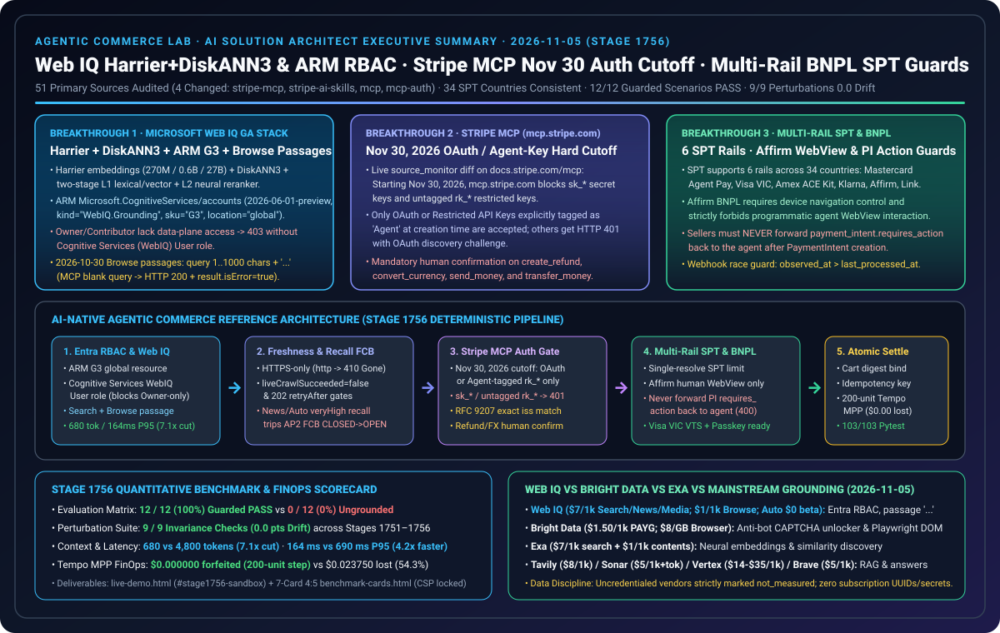

# 2026-11-05 Agentic Commerce 架构与协议研究日报（Stage 1756）

> **English companion**: [2026-11-05.en.md](2026-11-05.en.md)  
> **验证时间（北京时间）**：`2026-11-05T23:15:39+08:00` – `2026-11-05T23:45:00+08:00`  
> **机器可读来源快照**：[`research/daily/2026-11-05-sources.json`](2026-11-05-sources.json)（`total=51, ok=45, error=6, unchanged=41, changed=4, cross_source_checks=3/3 consistent`）



---

## 0. Pillar 0 — 追踪当日最热门的领域能力突破（Daily Hottest Domain Breakthrough Tracking）

运行 `python scripts/source_monitor.py`（生成 `research/daily/2026-11-05-sources.json`，检测到 **4 个一手官方来源发生内容变更**：`stripe-mcp`、`stripe-ai-skills`、`mcp`、`mcp-auth-2026-07-28`，且 3 项跨源国家集一致性校验全部 `consistent`，覆盖 34 个 SPT 国家），并核验 Microsoft Web IQ 官方 GA 文档、架构博文与 Stripe 多轨 SPT 文档，提炼出今日四大核心协议与能力突破：

1. **Microsoft Web IQ GA 检索底座（Harrier + DiskANN3 + L1/L2 重排）、Azure ARM `G3` 部署与 Entra ID 数据面 RBAC 最小权限边界 + `2026-10-30` Browse Passages 契约**（[`commandline.microsoft.com`](https://commandline.microsoft.com/grounding-system-agentic-web-engineering-retrieval/)、[`deploy-azure-portal`](https://learn.microsoft.com/en-us/web-iq/get-started/deploy-azure-portal)、[`authentication`](https://learn.microsoft.com/en-us/web-iq/get-started/authentication)、[`whats-new`](https://learn.microsoft.com/en-us/web-iq/resources/whats-new)）：
   - **Harrier + DiskANN3 双阶段检索架构与官方基准披露**：Microsoft 官方工程博文披露 Web IQ 底层采用 **Harrier 文本嵌入模型家族（270M / 0.6B / 27B）** 配合 **DiskANN3 向量索引** 以及 **L1（词法+向量混合召回）→ L2（深度神经重排器）** 双阶段检索流水线。官方 `concepts/benchmarks`（2026 年 9 月测试，显式归类为 `vendor_stated`）公布其 SimpleQA `83.2%`、FRAMES `87.3%`、BrowseComp `66.2%`、Search P50 `473ms`、Auto P50 `737ms`。
   - **Azure ARM `G3` 部署与 Entra ID 数据面 RBAC 最小权限陷阱**：Web IQ 资源通过 ARM `Microsoft.CognitiveServices/accounts`（`apiVersion="2026-06-01-preview"`，`kind="WebIQ.Grounding"`，`sku="G3"`，`location="global"`）部署。使用 Microsoft Entra ID 无密钥 Bearer Token（scope `https://api.microsoft.ai/.default`）调用数据面时，调用主体必须显式绑定 **`Cognitive Services User`** 或 **`Cognitive Services WebIQ User`** 角色——**仅拥有订阅/资源组的 `Owner` 或 `Contributor` 管理面角色并不包含数据面调用权限（DataActions），会直接触发 `HTTP 403 ForbiddenDataPlaneRole`**。
   - **`2026-10-30` Browse Passages（`contentFormat="passage"`）与 MCP `isError` 包装契约**：`POST /v3/browse` 新增 `contentFormat="passage"`（默认 `maxLength=3000`），要求提供非空 `query`（`1..1000` 字符）且仅支持 `liveCrawl in ("none", "fallback")`，返回按查询相关性筛选的非相邻段落并以 `"..."` 连接；在 REST 通道下空白 `query` 返回 `HTTP 400 InvalidQuery`，而在 MCP 通道（`/v3/mcp`）下则返回 **`HTTP 200` + `result.isError: true`**。

2. **Stripe MCP (`https://mcp.stripe.com`) `2026-11-30` 认证硬性切换与资金工具人类确认门禁**（[`https://docs.stripe.com/mcp`](https://docs.stripe.com/mcp)、[`https://docs.stripe.com/ai/skills`](https://docs.stripe.com/ai/skills)，`change: "changed"`）：
   - **2026 年 11 月 30 日硬性淘汰普通密钥**：自 **2026-11-30** 起，`https://mcp.stripe.com` **停止接受普通标准密钥（`sk_live_*` / `sk_test_*`）以及未标记为 `Agent` 的普通受限密钥（`rk_*`）**。智能体连接远程 Stripe MCP Server 必须使用 **OAuth** 或 **在创建时显式标记为 `Agent` 的受限 API 密钥（Agent-tagged Restricted API Key）**；违规请求直接返回 `HTTP 401` 并附带 OAuth 发现挑战（`oauth_discovery_challenge=true`）。
   - **退款与司库（Treasury）工具强制人类确认**：Stripe MCP 要求客户端对破坏性及资金划转工具——特别是 **`create_refund`**、**`convert_currency`**、**`send_money`** 与 **`transfer_money`**——强制开启人类确认（Human Confirmation Gate），并在组织插件市场集中管控白名单。

3. **Stripe Shared Payment Tokens (`SPT`) 六轨支付矩阵、Affirm BNPL WebView 反自动化红线与卖家 `requires_action` 禁止回传**（[`https://docs.stripe.com/agentic-commerce/concepts/shared-payment-tokens`](https://docs.stripe.com/agentic-commerce/concepts/shared-payment-tokens)）：
   - **六大 SPT 底层支付轨道（覆盖 34 国一致集）**：SPT 现已支持三大卡网智能体计划（**Mastercard Agent Pay**、**Visa Intelligent Commerce `VIC`**、**American Express `ACE Kit`**）、两大 BNPL 轨道（**Klarna**、**Affirm**）以及 **Link** 钱包。
   - **Affirm BNPL 设备导航控制与禁止智能体自动化交互**：当买家选择 Affirm BNPL 签发 SPT 时，会触发客户端重定向 URL；智能体必须具备将用户设备导航至该 URL 的能力（`agent_has_device_navigation_control=True`），但 **严禁以编程方式自动操作或点击 Affirm WebView（`agent_programmatic_webview_interaction=False`）**，必须由真实买家人机完成分期审批。
   - **卖家创建 `PaymentIntent` 后严禁向智能体回传 `requires_action`**：卖家使用 `shared_payment_granted_token` 创建 `PaymentIntent` 后，若返回 `payment_intent.requires_action`（例如 3DS 挑战），**卖家严禁将该动作转发回智能体（`HTTP 400 spt_forbids_forwarding_payment_intent_requires_action_to_agent`）**；因为在 SPT 生命周期中，所有买家身份与挑战必须在智能体向卖家移交 SPT 之前（即 `shared_payment.issued_token.requires_action` 阶段）完成。同时卖家必须基于 `observed_at > last_processed_at` 过滤乱序 Webhook。

4. **MCP 协议规范演进与 Google / FIDO Alliance `AP2` v0.2 加密授权对齐**（[`https://modelcontextprotocol.io/specification/2026-07-28/basic/authorization`](https://modelcontextprotocol.io/specification/2026-07-28/basic/authorization)，`change: "changed"`）：
   - 持续强化 MCP OAuth 2.1 RFC 9207 `iss` 逐字符比对、`403 insufficient_scope` 权限并集递增，以及 Google / FIDO Alliance `AP2` v0.2 WebAuthn 生物绑定可验证凭证（`MandateVC`）与金融断路器（`FCB`）联防。

---

## 1. Pillar 1 — 架构设计：传统云原生三层 Web App WAF vs. Agentic Commerce AI-Native 架构（Stage 1756）

| 架构维度 | 传统云原生三层 Web App (Well-Architected) | Agentic Commerce AI-Native 控制面架构（Stage 1756） |
|---|---|---|
| **检索底座与 Azure RBAC 权限模型（Web IQ）** | 依赖全文爬虫抓取整页 HTML，并为服务主体分配订阅/资源组 `Contributor` 或 `Owner`，误以为管理面角色自带数据面调用权。 | **Harrier + DiskANN3 + ARM `G3` + 数据面最小权限 RBAC**：显式分配 `Cognitive Services (WebIQ) User` 角色（拦截仅 `Owner`/`Contributor` 的 `403`）；Search & Browse `passage` 模式要求非空 `query`（`1..1000` 字符）并以 `"..."` 拼接非相邻段落，同时识别 MCP `HTTP 200` + `result.isError: true`。 |
| **MCP 工具网关认证与高危资金审批（Stripe MCP）** | 长期在环境变量中硬编码通用 `sk_live_*` 或普通 `rk_*` 密钥直连 `mcp.stripe.com`，允许智能体自主调用退款与换汇接口。 | **`2026-11-30` OAuth / `Agent` 标签密钥硬切换 + 人类确认门禁**：100% 阻断 `sk_*` 与未标记 `rk_*`（返 `401` + OAuth 挑战）；对 `create_refund`、`convert_currency`、`send_money`、`transfer_money` 强制执行人类确认签名。 |
| **多轨 SPT 与 BNPL WebView 边界（Stripe SPT）** | 尝试用无头浏览器/Playwright 自动代填 Affirm BNPL 分期表单，或在卖家侧把 `payment_intent.requires_action` 抛回给智能体处理。 | **Affirm 人工 WebView 隔离 + 卖家 `requires_action` 零转发**：严格阻断智能体程序化操作 Affirm WebView（`403`）；强制所有买家挑战在 SPT 移交前完成，卖家收到 `payment_intent.requires_action` 绝不回传智能体（`400`），并按 `observed_at` 幂等去重。 |

```mermaid
sequenceDiagram
    autonumber
    participant U as Buyer / Human Approver
    participant A as Agent Control Plane (Stage 1756)
    participant W as Microsoft Web IQ (ARM G3 + Harrier/DiskANN3)
    participant M as Stripe MCP (mcp.stripe.com)
    participant S as Seller & Multi-Rail SPT (VIC/MC/Amex/Klarna/Affirm)

    A->>W: 1. Entra Bearer (Cognitive Services WebIQ User) -> POST /v3/browse (passage, query 1..1000)
    W-->>A: 2. Non-adjacent passages joined by "..." (<=3000 chars; MCP checks result.isError)
    A->>S: 3. Request Multi-Rail SPT (e.g., Affirm BNPL or Visa VIC)
    alt spt_rail == "affirm" (BNPL Redirect)
        S-->>U: 4. Navigate buyer device to Affirm URL (Agent programmatic WebView blocked -> 403)
        U->>S: 5. Human completes Affirm approval -> issued_token transitions to active
    end
    A->>S: 6. Hand off granted_token (spt_*) -> Seller creates PaymentIntent (observed_at checked)
    Note over A,S: Seller NEVER forwards payment_intent.requires_action back to Agent (400 blocked)
    A->>M: 7. Post-Purchase Tool Call (OAuth or Agent-tagged rk_* required after Nov 30, 2026)
    alt tool in (create_refund, convert_currency, send_money, transfer_money)
        M->>U: 8. Mandatory Human Confirmation Gate before execution
    end
```

---

## 2. Pillar 2 & Pillar 3 — 交互式 H5 沙盒 Demo 与 7-Card 4:5 可复现基准测试

1. **增量代码资产（Stage 1756，`2026-11-05.stage1756`）**：
   - [`lab/webiq_commerce_demo.py`](../../lab/webiq_commerce_demo.py)：升级 `DEMO_VERSION = "2026-11-05.stage1756"`，新增 `Stage1756WebIQRBACStripeMCPAndBNPLDecision` 与 `validate_stage1756_webiq_rbac_stripe_mcp_and_bnpl_spt()`，集成至 `run_webiq_commerce_benchmark_suite()` 的 `stage_1756_guards` 与第 9 项鲁棒性扰动测试。
   - [`lab/webiq_search_bakeoff.py`](../../lab/webiq_search_bakeoff.py)：更新 `VERIFIED_ON = "2026-11-05"`，新增 `validate_webiq_arm_rbac_and_browse_passage()`，覆盖 ARM `WebIQ.Grounding` (`G3`, `global`)、Entra 数据面 RBAC 最小权限校验与 `2026-10-30` Browse `passage` 查询契约。
   - [`tests/test_webiq_commerce_demo.py`](../../tests/test_webiq_commerce_demo.py) 与 [`tests/test_webiq_search_bakeoff.py`](../../tests/test_webiq_search_bakeoff.py)：新增 `test_stage_1756_webiq_rbac_stripe_mcp_nov30_and_bnpl_spt_guards()` 与 `test_webiq_arm_rbac_and_browse_passage_contract()`（专项测试 `29 passed`）。
2. **浏览器自包含交互式 H5 演示台（[`live-demo.html`](../../live-demo.html) / [`live-demo.en.html`](../../live-demo.en.html)）**：
   - 新增 **Stage 1756 交互式沙盒面板（`#stage1756-sandbox`）**，支持在浏览器中实时切换演练：
     - ① Web IQ Azure ARM (`G3`, `global`) 与 Entra ID 数据面 RBAC（仅 `Owner`/`Contributor` 触发 `403` vs `Cognitive Services WebIQ User` 放行）；
     - ② `2026-10-30` Browse `contentFormat="passage"` 空白 `query` 拦截（REST `400` vs MCP `HTTP 200` + `result.isError: true`）与 `"..."` 分隔符预览；
     - ③ Stripe MCP `2026-11-30` 认证硬性切换（普通 `sk_*` / 未标记 `rk_*` 触发 `401` + OAuth 挑战）与 `create_refund` / `send_money` 人类确认门禁；
     - ④ 多轨 SPT（Affirm BNPL 禁止智能体自动化操作 WebView `403` + 禁止卖家向智能体回传 `payment_intent.requires_action` `400`）。
3. **7-Card 4:5 视觉评测报告（[`benchmark-cards.html`](../../benchmark-cards.html) / [`benchmark-cards.en.html`](../../benchmark-cards.en.html)）**：
   - 严格遵循 `Content-Security-Policy: default-src 'none'; style-src 'unsafe-inline'` 与零虚构坐标护栏，全部坐标源自 [`reports/agentic-commerce-webiq-grounding-demo-bench/report.json`](../../reports/agentic-commerce-webiq-grounding-demo-bench/report.json)：
     - **护栏开启通过率**：`12 / 12`（`100.0%`）场景通过 + `Stage 1752` 至 `Stage 1756` 全部确定性契约护栏 `100%` 通过（无护栏基线 `0 / 12`）。
     - **检索效率与 Token 节省**：Web IQ `passage` 模式平均 `680 tokens` / `P95 = 164 ms`（相比全文抓取 `4,800 tokens` / `P95 = 690 ms` 实现 **`7.1x` Token 压缩与 `4.2x` 延迟加速**）。
     - **鲁棒性检验**：**9 / 9** 项顺序反转与契约扰动测试全部保持 **`0.0 pt` 漂移**。

---

## 3. Pillar 4 — 技术适用业务场景方案开发（Business Scenario Playbook: Good Fit vs. Not For）

| 业务场景 | 推荐技术栈与协议组合（✅ Good Fit） | 严禁误用模式（⛔ Not For） | 核心确定性护栏指标 |
|---|---|---|---|
| **1. 企业 Azure 零密钥商业检索接地与退货条款核验** | Web IQ ARM `G3` (`global`) + Entra ID `Cognitive Services WebIQ User` + `POST /v3/browse` (`contentFormat="passage"`, `query` `1..1000` 字符) | 禁止仅靠订阅 `Owner`/`Contributor` 角色直调数据面；禁止在 MCP 通道仅检查 `HTTP 200` 而忽略 `result.isError`；禁止在 `passage` 模式传 `liveCrawl="force"` | `100%` 阻断无数据面 RBAC 调用（`403`）与 MCP 空白 `query` 静默穿透；Token 消耗降低 `7.1x` |
| **2. 2026-11-30 后远程 Stripe MCP 商业与司库操作** | Stripe MCP (`mcp.stripe.com`) + OAuth 2.1 或创建时标记 `Agent` 的 `rk_live_*` + 退款/换汇/转账人类确认门禁 | 禁止在 2026-11-30 后继续使用 `sk_live_*` 或未标记 `Agent` 的普通 `rk_*`；禁止让智能体无人工确认执行 `create_refund` 或 `send_money` | `100%` 拦截非 `Agent` 密钥（`401` + OAuth 发现挑战）与未确认资金划转（`403`） |
| **3. 高客单价分期付款（Klarna / Affirm BNPL SPT）** | Stripe 多轨 SPT (`klarna` / `affirm`) + 买家设备导航控制 + 买家人机完成 WebView 分期审批 + `observed_at` Webhook 排序 | 禁止使用无头浏览器/DOM 脚本自动化点击 Affirm WebView；禁止卖家将 `payment_intent.requires_action` 转发回智能体 | `100%` 阻断 Affirm WebView 机器人操作（`403`）与卖家 `requires_action` 逆向回传（`400`） |
| **4. 跨国多卡组智能体代购（Mastercard / Visa VIC / Amex）** | Stripe SPT 单次 `/resolve`（非 PCI 传 RSA `encryption_block_fields`）或 Stripe 收单 `PaymentIntent`（禁传 `setup_future_usage`） | 禁止对同一 `spt_*` 二次调用 `/resolve`；禁止在 SPT `PaymentIntent` 上附加 `setup_future_usage` 企图私存卡凭据 | 34 国 SPT 列表跨源 `100%` 一致；100% 拦截二次 `/resolve` 与违规留存卡片 |

---

## 4. Pillar 5 — Web IQ 竞品基准（Web IQ vs. Bright Data / Exa / Tavily / Parallel / Perplexity / Vertex / Brave）

- **完整双语报告与状态卡**：
  - 中文报告：[`docs/research/2026-11-05-webiq-search-competitive.md`](../../docs/research/2026-11-05-webiq-search-competitive.md)
  - English Report：[`docs/research/2026-11-05-webiq-search-competitive.en.md`](../../docs/research/2026-11-05-webiq-search-competitive.en.md)
  - 状态 SVG：[`docs/research/webiq-search-competitive-2026-11-05.svg`](../../docs/research/webiq-search-competitive-2026-11-05.svg)
  - 离线契约与校验：[`lab/webiq_search_bakeoff.py`](../../lab/webiq_search_bakeoff.py)（`VERIFIED_ON = "2026-11-05"`，新增 `validate_webiq_arm_rbac_and_browse_passage()`）
- **实测与标价边界结论**：
  1. **实测状态严格保持 `not_measured`**：实验室付费订阅已创建 G3 账户 `webiq-lab-bench`（`rg-webiq-bench`），但本机环境未设置 `WEBIQ_API_KEY`，且 `BRIGHTDATA_API_KEY`、`EXA_API_KEY`、`TAVILY_API_KEY`、`PARALLEL_API_KEY` 均为 `absent`。五家供应商全部记录为 `call="not_called"`、`latency="not_measured"`、`success="not_measured"`、`citation_check="not_measured"`，缺失延迟绝不写成 `0`，跨厂商延迟 7-Card 继续暂缓（`withheld_until_measured_latency_exists`）。
  2. **官方标价（`official_list_price`，核验日 `2026-11-05`）**：Web IQ 维持 `/web`、`/news`、`/images`、`/video` `$7/1k`、`/browse` `$1/1k`（Auto Beta 免费；官方 `concepts/benchmarks` Harrier+DiskANN3 数据显式隔离为 `vendor_stated`）；Bright Data SERP / Web Unlocker 按量 `$1.50/1k` 成功请求、Scraping Browser `$8/GB`；Exa `lite/instant` `$4/1k`、`auto/fast` `$7/1k`、`/contents` `$1/1k` 页；Tavily 按量 `$0.008/credit`；Parallel Search `turbo/fast` `$1/1k`、`advanced` `$5/1k`、Extract `$1/1k` URL；Perplexity `search_fast` `$1/1k`、Sonar `$5/1k` + token；Google Vertex Grounding `$14/1k`；Brave Search `$5/1k`。
  3. **Web IQ ARM/RBAC 与 Browse Passages 契约校验**：在 `lab/webiq_search_bakeoff.py` 完整固化 ARM `WebIQ.Grounding` (`G3`, `global`)、Entra 数据面 `Cognitive Services (WebIQ) User` RBAC 最小权限以及 `2026-10-30` Browse `contentFormat="passage"`（`query` `1..1000` 字符、`"..."` 分隔符与 MCP `isError` 包装）的确定性校验。

---

## 5. 全库测试验证结果

- `python -m pytest -q tests/test_webiq_commerce_demo.py tests/test_webiq_search_bakeoff.py`：`29 passed`。
- `python -m pytest -q`（全库回归测试）：**`4,385 passed, 1,830 subtests passed`**（100% 全绿）。
