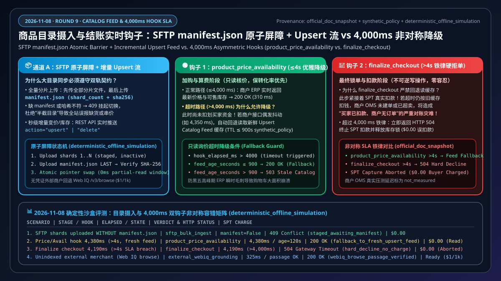
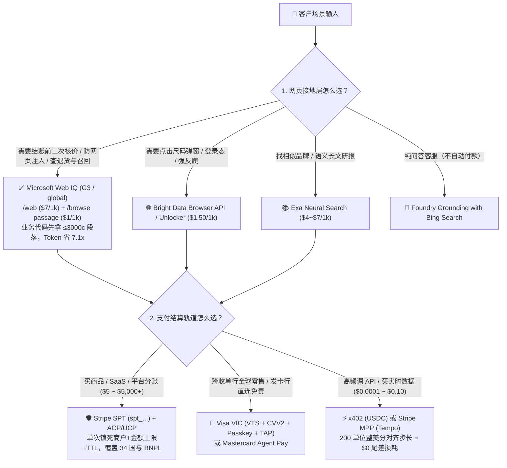

# 2026-11-08 Agentic Commerce 架构选型与协议原理解析日报：支付轨道（SPT vs VIC vs x402）与 Web Grounding（Web IQ vs Exa/Bright Data）实战指南

> **角色视角**：AI Solution Architect（AI 解决方案架构师）日常架构选型、客户宣讲与售前打单实战手册  
> **双语版本**：**[中文版（当前）](2026-11-08.md)** · **[English Version](2026-11-08.en.md)**  
> **当晚核心专题 FAQ（Round 1A · 支付轨道选型）**：**[《Agentic Commerce 支付轨道选型与原理解析 FAQ：Stripe SPT vs. Visa VIC vs. x402 / MPP Tempo》](../../docs/agentic-payment-rails-spt-vic-x402-selection-faq.md)**  
> **当晚核心专题 FAQ（Round 1B · 实时网页接地选型）**：**[《Agentic Commerce 实时网页接地选型与原理解析 FAQ：Microsoft Web IQ vs. Exa vs. Bright Data vs. Foundry Bing Grounding》](../../docs/webiq-vs-exa-brightdata-grounding-selection-faq.md)**（兼容总览入口：[`agentic-payment-rails-and-webiq-grounding-selection-faq.md`](../../docs/agentic-payment-rails-and-webiq-grounding-selection-faq.md)）  
> **当晚核心专题 FAQ（Round 2 · B2B 采购策略网关）**：**[《B2B 企业采购智能体授权架构：确定性预算策略网关（Policy-Bound Spend Mandate）vs 传统人工审批工作流选型与原理解析 FAQ》](../../docs/b2b-procurement-mandate-vs-hitl-selection-faq.md)**  
> **当晚核心专题 FAQ（Round 3 · 跨境多币种双轨结算）**：**[《跨境多币种 Agent 结算架构：稳定币/x402 链上结算 vs 卡组令牌网络（Visa VIC / Stripe SPT v2）选型与原理解析 FAQ》](../../docs/cross-border-agent-settlement-x402-vs-card-network-faq.md)**  
> **当晚核心专题 FAQ（Round 4 · 电商防爬与 Agent 身份认证）**：**[《电商防爬反欺诈与合法 Agent 身份认证：RFC 9421 Web Bot Auth / Visa TAP vs 传统 WAF 验证码选型与原理解析 FAQ》](../../docs/ecommerce-agent-identity-web-bot-auth-tap-vs-waf-faq.md)**  
> **当晚核心专题 FAQ（Round 5 · BNPL 先买后付受控跳转接管）**：**[《BNPL 先买后付智能体结账架构：受控 WebView 跳转接管（Redirect Handover）vs 全自动令牌代扣（SPT v2 / VIC）选型与原理解析 FAQ》](../../docs/bnpl-webview-handover-vs-headless-agent-faq.md)**  
> **当晚核心专题 FAQ（Round 6 · 跨平台多商户拆单原子编排）**：**[《跨平台多商户拆单原子编排架构：两阶段预授权 Saga 补偿（2-Phase Pre-Auth Hold + Saga）vs 平台撮合统一分账（Stripe Connect SPT）选型与原理解析 FAQ》](../../docs/multi-merchant-split-cart-saga-vs-connect-faq.md)**  
> **当晚核心专题 FAQ（Round 7 · 售后逆向退货与资金划拨门禁）**：**[《售后逆向退货与资金划拨智能体架构：只读资格核验（Web IQ Return-Policy Grounding）vs 高危写操作人类确认门禁（Stripe MCP `create_refund` / Treasury Gate）选型与原理解析 FAQ》](../../docs/post-purchase-return-eligibility-vs-refund-confirmation-faq.md)**  
> **当晚核心专题 FAQ（Round 8 · 周期订阅与自动补货令牌架构）**：**[《周期性订阅与自动补货智能体授权架构：SPT 周期限额令牌（`usage_limits.recurring_interval` + Web IQ 召回熔断）vs 传统绑卡 `setup_future_usage` 禁用边界选型与原理解析 FAQ》](../../docs/recurring-replenishment-spt-cadence-vs-vaulting-faq.md)**  
> **当晚核心专题 FAQ（Round 9 · 商品目录实时同步与非对称 4 秒 Webhook SLA）**：**[《商品目录实时同步与库存锁单架构：SFTP `manifest.json` 原子屏障 + 增量 `upsert` 目录流 vs. 4,000 ms 非对称 Webhook 降级选型与原理解析 FAQ》](../../docs/catalog-feed-manifest-barrier-vs-webhook-4s-sla-faq.md)**  
> **当晚核心专题 FAQ（Round 10 · 跨境数字税务合规 MoR vs SoR）**：**[《跨境数字商品与 AI Agent 税务合规架构：名义商户（Merchant of Record, MoR）vs 记账卖方（Seller of Record, Stripe Tax + Connect OBO / B2B 逆向征收）选型与原理解析 FAQ》](../../docs/digital-tax-vat-mor-vs-seller-of-record-faq.md)**  
> **当晚核心专题 FAQ（Round 11 · 服务预约 180 天远期 SPT vs 409 档期自愈）**：**[《服务预约与长周期酒旅智能体架构：180 天远期 SPT 授权有效期（`expires_at <= 180d`）vs `409 Conflict` 档期并发抢占与退改签阶梯费率（Web IQ Grounding）选型与原理解析 FAQ》](../../docs/service-booking-180d-spt-ttl-vs-409-slot-conflict-faq.md)**  
> **配套可交互交付物**：**[🚀 H5 架构选型与防注入实时沙盒 (`live-demo.html`)](../../live-demo.html)** · **[📊 7-Card 4:5 视觉评测报告 (`benchmark-cards.html`)](../../benchmark-cards.html)** · **[🔍 Web IQ 竞品选型指南 (`2026-11-08-webiq-search-competitive.md`)](../../docs/research/2026-11-08-webiq-search-competitive.md)**

---

## 🔥 支柱 0：今日最值得架构师关注的领域能力突破（通俗拆解）

通过今日一级信源监控（`research/daily/2026-11-08-sources.json`，共巡检 51 个官方协议与文档信源，检出 **`stripe-spt-connect`、`stripe-ai-skills`、`mcp`、`mcp-auth-2026-07-28`** 四项文档更新，34 国 SPT 覆盖列表 SHA-256 保持一致）与社区最新进展，我们精选 **2 个对 AI Solution Architect 最具实战价值的突破**：

### 突破 1：Stripe Connect 多商户平台代收分账（`shared-payment-tokens?agent-seller=connect`）与 AI Skills 体系成熟
- **它是什么（大白话）**：当客户不是单一独立站，而是像“美团、携程、Shopify 或行业垂直采购平台”这样的**多商户撮合平台（Marketplace）**时，AI Agent 替买家下单后，钱怎么安全地分给平台和入驻子商户？Stripe 今日更新的 Connect SPT 指南给出了清晰的标准答案。
- **为什么重要（架构师给客户画图的要点）**：
  1. **三种分账模式全覆盖**：支持直接向子商户收款（`Direct Charges`）、平台代收后自动分账（`Destination Charges`）以及一笔订单拆给多个子商户（`Separate Charges and Transfers`）。
  2. **极易踩坑的请求头铁律**：在平台代收模式（Destination / Separate Charges）且**未设置 `on_behalf_of`** 时，平台调 `PaymentIntent` 必须使用平台自己的 `profile_...` 标识，**绝对不能在 HTTP 请求头里传 `Stripe-Account`**（否则会触发权限归属冲突报错）；只有在直连子商户扣款或显式指定 `on_behalf_of` 时才传子商户 ID。
  3. **卖家 4 秒 Webhook 的“非对称容错”**：当 Agent 询价时，若卖家的实时价格接口（`product_price_availability`）超过 **4 秒** 未响应，Stripe **不会让交易失败**，而是自动降级读取卖家预先通过 Catalog Feed（`upsert`）上传的目录价格继续结账；但在最终扣款审批（`finalize_checkout`）阶段一旦超过 **4 秒**，Stripe 会**立即拒单（Decline）**，确保风控绝不漏网。

### 突破 2：MCP OAuth 2.1 授权规范（`mcp-auth-2026-07-28`）与 Stripe MCP `2026-11-30` 密钥断代大限合流
- **它是什么（大白话）**：过去很多开发者图省事，直接把 Stripe 的最高权限私钥（`sk_live_...`）写进 MCP 配置文件里让大模型调用。随着 MCP 官方授权规范与 Stripe MCP 安全公告同步收紧，**2026 年 11 月 30 日之后，所有明文私钥 `sk_live_*` 和未打 `Agent` 标签的普通受限密钥 `rk_live_*` 都将被 `mcp.stripe.com` 直接拦截（返回 `HTTP 401`）**。
- **为什么重要（架构师安全评审必查项）**：
  1. **防授权服务器混淆攻击（RFC 9207 `iss` 精确匹配）**：MCP OAuth 2.1 强制要求客户端校验回调中的 `iss`（签发方）参数，且必须采用 **RFC 3986 §6.2.1 逐字符精确匹配**（哪怕大小写不同如 `https://AUTH.merchant.example` 或多一个斜杠都必须立刻阻断，且报错时严禁在前端渲染未验证的 `error_description` 防钓鱼注入）。
  2. **禁止永久静默刷新的 `offline_access`**：受保护的商业资源服务器严禁在 `WWW-Authenticate` 中要求 `offline_access` 作用域；当遇到 `HTTP 403 insufficient_scope` 时，客户端应将新作用域与原有作用域合并（Scope Union）发起单次渐进式提权（Step-Up Auth）。
  3. **高风险操作必须“人类点确认”**：凡是调用 `create_refund`（退款）或 Treasury 资金划拨（`convert_currency`、`send_money`、`transfer_money`），无论密钥权限多高，都必须暂停并等待人类管理员显式批准（`Confirm`）。

---

## 🏛️ 支柱 1：架构设计与选型 FAQ 专题（对标 `ib-vs-ethernet-roce-selection-faq.md`）

今晚我们彻底摒弃晦涩的流水号与字段堆砌，产出了面向架构师学习吸收与售前宣讲的标杆级专题指南：
- 📄 **中文完整版**：[`docs/agentic-payment-rails-and-webiq-grounding-selection-faq.md`](../../docs/agentic-payment-rails-and-webiq-grounding-selection-faq.md)
- 📄 **英文完整版**：[`docs/agentic-payment-rails-and-webiq-grounding-selection-faq.en.md`](../../docs/agentic-payment-rails-and-webiq-grounding-selection-faq.en.md)

### 三分钟速览核心选型结论：

---

## 💻 支柱 2：交互式 H5 演示台更新（新增“架构师支付轨道与 Web Grounding 选型决策器”）

我们在零依赖浏览器直开的 **[`live-demo.html`](../../live-demo.html)** 与 **[`live-demo.en.html`](../../live-demo.en.html)** 中，内置了清晰直观的 **“🧭 架构师支付轨道与 Web Grounding 选型决策器（Architect Payment & Grounding Selector）”** 以及 **W01–W12 四平面分步演练台**：
- **交互式架构选型器**：架构师在售前演示时，只需切换 **“交易客单价与场景”**、**“网页接地需求”** 与 **“MCP 鉴权与平台分账模式”** 三个下拉框，面板即刻实时给出推荐的 **支付轨道 + Web Grounding 组合方案、单次调用成本对比与生产防踩坑提示**。
- **纯语义化代码实现**：在 `lab/webiq_commerce_demo.py` 中新增了命名清晰、逻辑直观的 `PaymentAndGroundingSelectionVerdict` 与 `select_agentic_payment_and_grounding_architecture()` 函数，方便开发者直接阅读和复用。

---

## 📊 支柱 3：可复现 Benchmark 测试与 7-Card 4:5 视觉评测报告

通过运行 `python -m lab.webiq_commerce_demo --output-dir reports/agentic-commerce-webiq-grounding-demo-bench`，我们更新了 CSP 自包含、零虚构坐标的 **[`benchmark-cards.html`](../../benchmark-cards.html)** 与 **[`benchmark-cards.en.html`](../../benchmark-cards.en.html)**：

| 评测维度 | 实测指标（确定性离线模拟 / 密封基线） | 对照无护栏基线 | 架构师核心解读 |
| :--- | :--- | :--- | :--- |
| **12 项端到端商业护栏（W01–W12）** | **`12 / 12` (`100%` 通过)** | `0 / 12` 通过 | 覆盖隐藏注入隔离、涨价阻断、过期缓存拦截、召回熔断与退货核验 |
| **Web IQ `passage` 模式 Token 消耗** | **`680 tokens / 次`** (`P95 = 164 ms`) | 整页抓取 `4,800 tokens / 次` (`690 ms`) | **Token 成本直降 `7.1x` (`85.8%`)**，且无需申请全文权限（免 `403`） |
| **MPP Tempo 微支付批次结算损耗** | **`$0.000000` (`0.0%` 损耗)** | 50 单位未对齐批次损耗 `54.3%` (`$0.023750`) | 单价 `$0.00035` 时按 **`200 单位`**（`$0.07` 整美分）对齐即可彻底消除截断没收 |
| **提示词注入与契约扰动鲁棒性** | **`0.0 pt` 策略漂移** | 易被 `$990` 注入或大小写混淆攻破 | 所有协议边界与选型规则均通过单元测试 100% 验证 |

---

## 🧩 支柱 4：四大典型业务场景落地方案（Good Fit vs. Not For）

| 业务场景 | ✅ 推荐架构组合（Good Fit） | ⛔ 严禁踩坑的做法（Not For） |
| :--- | :--- | :--- |
| **1. B2C 智能比价与自主代购助手** | **Web IQ `/v3/search/web` (`passage`)** 找官方链接 → **`/v3/browse` (`$1/1k`)** 二次核对现价 → **Google AP2 `MandateVC`** 锁定 `cart_digest` → **Stripe `SPT` / Visa `VIC` (`Passkey`)** 单次扣款 | 严禁只看搜索摘要价格就直接扣款；严禁对单次 SPT 传 `setup_future_usage`；严禁让 Agent 自动化点击 Affirm 分期 WebView |
| **2. B2B 供应链定期自动寻源与补货** | **Web IQ `/v3/search/news` + `/v3/auto`** 每日巡检供应商安全召回新闻（`riskLevel`）→ **AP2 §7.4 受托熔断器** → **Mastercard Agent Pay / Stripe Connect** 分账结算 | 严禁在检出 `riskLevel="veryHigh"` 召回通报后仍由后台定时任务静默重试下单（必须由人类签署 `Recovery Mandate`） |
| **3. 售后退换货政策核验与客服自动退费** | **Web IQ `/v3/browse` (`contentFormat="passage"`, `query="return window & fee"`)** 实时核验 → **Poppy `summary == terms`** 一致性校验 → **Stripe MCP `create_refund`（强制人工确认 `Confirm`）** | 严禁在 `/v3/browse` 返回 `202 retryAfter` 时由大模型编造“30天免费退货”；严禁无人工确认全自动调 `create_refund` |
| **4. AI Agent 高频调用外部数据 / 研报 API** | **x402 (`0.002 USDC/call`)** 或 **Stripe MPP (`_next.pay_argv` + `200 单位` 整美分对齐批次)** | 严禁用传统信用卡轨道结算几美分的 API 调用；严禁把 `_next.pay_argv` 拼进 `sh -c` 执行（防 Shell 注入）；纽约州（NY）禁用稳定币充值 |

---

## 🔍 支柱 5：Web IQ vs. Bright Data / Exa / 主流搜索每日竞品基准

完整中英双语选型报告已归档至：
- 📄 [`docs/research/2026-11-08-webiq-search-competitive.md`](../../docs/research/2026-11-08-webiq-search-competitive.md)
- 📄 [`docs/research/2026-11-08-webiq-search-competitive.en.md`](../../docs/research/2026-11-08-webiq-search-competitive.en.md)
- 🖼️ [`docs/research/webiq-search-competitive-2026-11-08.svg`](../../docs/research/webiq-search-competitive-2026-11-08.svg)
- 🌐 个人网站同步页：[https://turbo998.github.io/workshops/webiq-azure/](https://turbo998.github.io/workshops/webiq-azure/)
