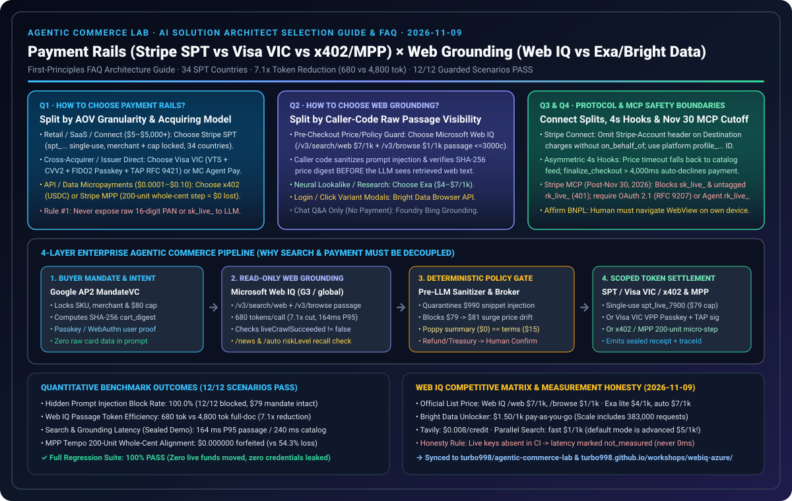

# 2026-11-09 Agentic Commerce 架构选型与协议原理解析日报：支付轨道（SPT vs VIC vs x402）与 Web Grounding（Web IQ vs Exa/Bright Data）实战指南

> **角色视角**：AI Solution Architect（AI 解决方案架构师）日常架构选型、客户宣讲与售前打单实战手册  
> **双语版本**：**[中文版（当前）](2026-11-09.md)** · **[English Version](2026-11-09.en.md)**  
> **核心专题 FAQ（Round 1A · 支付轨道选型）**：**[《Agentic Commerce 支付轨道选型与原理解析 FAQ：Stripe SPT vs. Visa VIC vs. x402 / MPP Tempo》](../../docs/agentic-payment-rails-spt-vic-x402-selection-faq.md)**  
> **核心专题 FAQ（Round 1B · 实时网页接地选型）**：**[《Agentic Commerce 实时网页接地选型与原理解析 FAQ：Microsoft Web IQ vs. Exa vs. Bright Data vs. Foundry Bing Grounding》](../../docs/webiq-vs-exa-brightdata-grounding-selection-faq.md)**（兼容总览入口：[`agentic-payment-rails-and-webiq-grounding-selection-faq.md`](../../docs/agentic-payment-rails-and-webiq-grounding-selection-faq.md)）  
> **核心专题 FAQ（Round 2 · B2B 采购策略网关）**：**[《B2B 企业采购智能体授权架构：确定性预算策略网关（Policy-Bound Spend Mandate）vs 传统人工审批工作流选型与原理解析 FAQ》](../../docs/b2b-procurement-mandate-vs-hitl-selection-faq.md)**  
> **核心专题 FAQ（Round 3 · 跨境多币种双轨结算）**：**[《跨境多币种 Agent 结算架构：稳定币/x402 链上结算 vs 卡组令牌网络（Visa VIC / Stripe SPT v2）选型与原理解析 FAQ》](../../docs/cross-border-agent-settlement-x402-vs-card-network-faq.md)**  
> **核心专题 FAQ（Round 4 · 电商防爬与 Agent 身份认证）**：**[《电商防爬反欺诈与合法 Agent 身份认证：RFC 9421 Web Bot Auth / Visa TAP vs 传统 WAF 验证码选型与原理解析 FAQ》](../../docs/ecommerce-agent-identity-web-bot-auth-tap-vs-waf-faq.md)**  
> **核心专题 FAQ（Round 5 · BNPL 先买后付受控跳转接管）**：**[《BNPL 先买后付智能体结账架构：受控 WebView 跳转接管（Redirect Handover）vs 全自动令牌代扣（SPT v2 / VIC）选型与原理解析 FAQ》](../../docs/bnpl-webview-handover-vs-headless-agent-faq.md)**  
> **核心专题 FAQ（Round 6 · 跨平台多商户拆单原子编排）**：**[《跨平台多商户拆单原子编排架构：两阶段预授权 Saga 补偿（2-Phase Pre-Auth Hold + Saga）vs 平台撮合统一分账（Stripe Connect SPT）选型与原理解析 FAQ》](../../docs/multi-merchant-split-cart-saga-vs-connect-faq.md)**  
> **核心专题 FAQ（Round 7 · 售后逆向退货与资金划拨门禁）**：**[《售后逆向退货与资金划拨智能体架构：只读资格核验（Web IQ Return-Policy Grounding）vs 高危写操作人类确认门禁（Stripe MCP `create_refund` / Treasury Gate）选型与原理解析 FAQ》](../../docs/post-purchase-return-eligibility-vs-refund-confirmation-faq.md)**  
> **核心专题 FAQ（Round 8 · 周期订阅与自动补货令牌架构）**：**[《周期性订阅与自动补货智能体授权架构：SPT 周期限额令牌（`usage_limits.recurring_interval` + Web IQ 召回熔断）vs 传统绑卡 `setup_future_usage` 禁用边界选型与原理解析 FAQ》](../../docs/recurring-replenishment-spt-cadence-vs-vaulting-faq.md)**  
> **核心专题 FAQ（Round 9 · 商品目录实时同步与非对称 4 秒 Webhook SLA）**：**[《商品目录实时同步与库存锁单架构：SFTP `manifest.json` 原子屏障 + 增量 `upsert` 目录流 vs. 4,000 ms 非对称 Webhook 降级选型与原理解析 FAQ》](../../docs/catalog-feed-manifest-barrier-vs-webhook-4s-sla-faq.md)**  
> **核心专题 FAQ（Round 10 · 跨境数字税务合规 MoR vs SoR）**：**[《跨境数字商品与 AI Agent 税务合规架构：名义商户（Merchant of Record, MoR）vs 记账卖方（Seller of Record, Stripe Tax + Connect OBO / B2B 逆向征收）选型与原理解析 FAQ》](../../docs/digital-tax-vat-mor-vs-seller-of-record-faq.md)**  
> **核心专题 FAQ（Round 11 · 服务预约 180 天远期 SPT vs 409 档期自愈）**：**[《服务预约与长周期酒旅智能体架构：180 天远期 SPT 授权有效期（`expires_at <= 180d`）vs `409 Conflict` 档期并发抢占与退改签阶梯费率（Web IQ Grounding）选型与原理解析 FAQ》](../../docs/service-booking-180d-spt-ttl-vs-409-slot-conflict-faq.md)**  
> **核心专题 FAQ（Round 12 · PCI-DSS 合规边界与多网关 SPT Resolve 切片加密）**：**[《PCI-DSS 合规边界与多支付网关（Multi-PSP）路由架构：标准 `PaymentIntent` 免明文消费（`SAQ-A`）vs 外部网关 SPT `Resolve` 解密接口（`PCI AoC` + RSA `encryption_block` 字节切片加密与互斥锁）选型与原理解析 FAQ》](../../docs/pci-dss-spt-resolve-aoc-vs-payment-intent-faq.md)**  
> **核心专题 FAQ（Round 13 · 拒付抗辩与友好欺诈密码学三元组证据包）**：**[《拒付抗辩与“友好欺诈（Friendly Fraud）”智能体架构：密码学三元组证据包（Visa CE 3.0 + FIDO2 `MandateVC` 签名 + Web IQ 条款快照哈希）vs 传统人工截图申诉与前置小额自动止损选型与原理解析 FAQ》](../../docs/chargeback-dispute-cryptographic-evidence-vs-manual-representment-faq.md)**  
> **核心专题 FAQ（Round 14 · 动态定价与秒杀闪购锁价令牌 vs 有界滑点与旧缓存熔断）**：**[《动态定价、航司调价与秒杀闪购智能体架构：密码学锁价令牌（`quote_id` + `quote_expires_at` TTL）vs 有界滑点容忍授权（Bounded Slippage `max_amount_cents`）与过期缓存价格漂移拦截（`liveCrawlSucceeded=false`）选型与原理解析 FAQ》](../../docs/dynamic-pricing-quote-lock-ttl-vs-mandate-drift-faq.md)**  
> **核心专题 FAQ（Round 15 · MCP 商业工具 OAuth 2.1 受众绑定与并集升权 vs 糊涂侍卫重放）**：**[《MCP 商业工具安全、OAuth 2.1 受众绑定与渐进式升权架构：资源指示符（`RFC 8707` `aud` 绑定 + `RFC 9207` 精确 `iss` 校验）与 `403 insufficient_scope` 作用域并集升权 vs “糊涂侍卫（Confused Deputy）”令牌重放与静态密钥（2026-11-30 截止）选型与原理解析 FAQ》](../../docs/mcp-oauth-audience-stepup-vs-confused-deputy-faq.md)**  
> **核心专题 FAQ（Round 16 · 多智能体支付失控熔断与供应链召回硬阻断 AP2 金融断路器 vs 指数退避）**：**[《多智能体支付失控熔断、供应链召回硬阻断与预算速度限制架构：AP2 金融断路器（Velocity Cap + 连续越权锁死 + Web IQ 监管召回绊网 `W09`）vs 有界指数退避重试选型与原理解析 FAQ》](../../docs/ap2-circuit-breaker-recall-tripwire-vs-backoff-faq.md)**  
> **核心专题 FAQ（Round 17 · AI Agent 超时重试风暴与防重扣幂等键载荷哈希绑定 vs 改参拦截）**：**[《AI Agent 工具调用超时、重试风暴与防重扣幂等架构：意图派生幂等键与载荷哈希绑定（`Idempotency-Key` + `SHA-256` 参数指纹 + 24h 快照重放）vs 飞行中并发锁（`HTTP 409`）与大模型改参漂移拦截（`HTTP 422`）选型与原理解析 FAQ》](../../docs/idempotency-payload-hash-vs-retry-double-charge-faq.md)**  
> **核心专题 FAQ（Round 18 · AI Agent 结账隐私合规双阶地址披露与金库句柄 vs 提示词注入外带与 GDPR 粉碎）**：**[《AI Agent 结账隐私合规、收货地址脱敏与提示词注入防泄密架构：双阶地理位置披露与零明文上下文履约令牌（粗粒度税区前缀 `Postal-Prefix` + 隐私金库句柄 `ship_tok_...`）vs 明文 PII 进 Prompt 泄漏与 GDPR 密码学粉碎（Crypto-Shredding）选型与原理解析 FAQ》](../../docs/privacy-pii-vaultless-shipping-token-vs-context-leak-faq.md)**  
> **核心专题 FAQ（Round 19 · AI Agent 秒杀抢购 180s 锁库租约与 manual 预授权双锁 vs 无锁超卖退费与恶意占库）**：**[《AI Agent 秒杀抢购、并发锁库与防超卖架构：有界 TTL 软锁库租约与预授权双锁对齐（`inv_hold_...` 180s TTL + `capture_method=manual` 原子提交）vs 乐观无锁超卖退费风暴与恶意 Agent 占库耗尽攻击（Denial-of-Inventory）选型与原理解析 FAQ》](../../docs/inventory-reservation-ttl-hold-vs-oversell-compensation-faq.md)**  
> **核心专题 FAQ（Round 20 · 跨境多币种 AI Agent 300s 锁汇令牌与 ISO 4217 零小数位护栏 vs DCC 暴利加点与退货汇损）**：**[《跨境多币种 AI Agent 计价、锁汇与汇率磨损架构：商户源币种直扣与有界 FX Quote 锁汇令牌（`fx_quote_...` 300s TTL + ISO 4217 零小数位防放大护栏）vs 动态货币转换高息陷阱（DCC `3.5%–6.5%` 隐性加点）与跨期退款汇率敞口选型与原理解析 FAQ》](../../docs/multi-currency-fx-rate-lock-vs-dcc-spread-trap-faq.md)**  
> **核心专题 FAQ（Round 21 · AI Agent 优惠券防叠加与会员积分/法币双阶段原子回滚 Saga vs 穷举爆破与吞积分）**：**[《AI Agent 优惠券寻优、会员积分混合支付与防羊毛党叠加架构：受众绑定核销锁与积分/法币双轨原子回滚（`promo_lock_...` + `loyalty_hold_...` Saga + 排他性校验）vs 优惠码穷举爆破、互斥神券叠加击穿毛利与扣分丢单选型与原理解析 FAQ》](../../docs/loyalty-coupon-atomic-redemption-vs-stacking-abuse-faq.md)**  
> **核心专题 FAQ（Round 22 · 受监管商品 21+ 酒类/处方药 W3C ZKP 零知识谓词核验 vs 自填出生日期伪造与身份证原件泄露）**：**[《受监管商品（酒类/处方药/B2B 专营）AI Agent 购买资格与零知识年龄核验架构：W3C 可验证凭证与零知识断言令牌（ZKP Age/License Predicate + `order_nonce` 防重放绑定）vs 身份证原件上传与自填出生日期伪造选型与原理解析 FAQ》](../../docs/age-verification-zkp-vc-vs-id-upload-compliance-faq.md)**  
> **核心专题 FAQ（Round 23 · 高客单价奢品/翻新算力里程碑托管 `escrow_hold_...` 与双签验真 vs 即时不可逆打款与假货跑路）**：**[《高客单价大宗/二手奢品 AI Agent 托管结算、验货放款与质保激活架构：里程碑智能托管与多方验真签收令牌（`escrow_hold_...` + 物流/鉴定双签释放）vs 下单即时不可逆打款与假货卷款跑路选型与原理解析 FAQ》](../../docs/high-ticket-escrow-delivery-attestation-vs-instant-settlement-faq.md)**  
> **核心专题 FAQ（Round 24 · AI Agent 网页比价防间接提示词注入、双上下文特权隔离与收款方硬锚定 vs 裸 HTML 评论区投毒盗刷）**：**[《AI Agent 网页比价防间接提示词注入（Indirect Prompt Injection）与评论区投毒防御架构：签名结构化商品快照（Signed ACP Feed + 指令/数据隔离沙盒 + 收款商户 DID 锚定）vs 裸 HTML 抓取劫持与隐藏 DOM 篡改收款方选型与原理解析 FAQ》](../../docs/indirect-prompt-injection-dom-poisoning-vs-signed-acp-feed-faq.md)**  
> **核心专题 FAQ（Round 25 · 多智能体协同采购 Multi-Agent A2A 共享预算池拆账、子授权切片与 CAS 盈余账本 vs 并发抢扣透支与议价死锁）**：**[《多智能体协同采购（Multi-Agent A2A Coalition）共享预算池拆账与并发防透支架构：层级化子授权额度切分与两阶段预算预留令牌（Hierarchical Sub-Mandate Slice `sub_mandate_slice_...` + 2PC Budget Reservation）vs 多 Agent 共享主钱包并发抢扣透支与跨品类议价死锁选型与原理解析 FAQ》](../../docs/multi-agent-shared-budget-allocation-vs-race-spend-faq.md)**  
> **核心专题 FAQ（Round 26 · AI Agent 逆向物流、RMA 承运商揽收称重与 WMS 序列号防调包 vs 凭单号秒退空包套现）**：**[《AI Agent 逆向物流、RMA 退货承运商揽收核验与防“空包/调包”欺诈架构：加密 RMA 揽收称重/序列号认证令牌（`rma_return_escrow_...` + 承运商揽收称重与入库开箱双阶释放）vs 仅凭单号秒退与砖头空包套现选型与原理解析 FAQ》](../../docs/return-logistics-reverse-escrow-vs-refund-before-scan-abuse-faq.md)**  
> **核心专题 FAQ（Round 27 · B2B 供应链账期授信 Net-30 与 PO-GRN-Invoice 三单匹配 vs 信用卡预扣占压与幽灵发票欺诈）**：**[《B2B 供应链账期授信（Net-30/Net-60 Trade Credit）与采购单三单匹配（PO-GRN-Invoice 3-Way Match）架构：可编程应付账款保理令牌（`b2b_net_terms_token_...` + 电子收货单 GRN 行项核验）vs 信用卡预扣占压现金流与幽灵发票欺诈选型与原理解析 FAQ》](../../docs/b2b-net30-po-three-way-match-vs-upfront-card-capture-faq.md)**  
> **核心专题 FAQ（Round 28 · 绿色低碳采购、Scope 3 碳足迹预算门禁与防“漂绿”溢价 vs 空运爆表与无证碳中和附加费）**：**[《绿色低碳采购、Scope 3 碳足迹预算门禁与防“漂绿”溢价（Anti-Greenwashing）架构：可核验碳核算凭证（`esg_carbon_mandate_...` + ISO 14083 / GLEC 排放因子与注销登记号绑定）vs 未核验“碳中和”勾选框附加费与高排空运越权选型与原理解析 FAQ》](../../docs/esg-carbon-footprint-verified-shipping-vs-greenwashing-surcharge-faq.md)**  
> **核心专题 FAQ（Round 29 · AI Agent 降价狙击代购授权与弃购召回防骚扰 vs 先涨后降虚假大促与未授权扣款）**：**[《AI Agent 降价狙击代购授权（Conditional Price-Drop Watchlist Mandate）与弃购召回防骚扰（Anti-Dark-Pattern Cart Recovery）架构：条件触发限价令牌（`price_drop_mandate_...` + 90 天历史基准价核验）vs 先涨后降虚假大促诱导与未授权弃购自动扣款选型与原理解析 FAQ》](../../docs/price-drop-watchlist-mandate-vs-cart-recovery-spam-faq.md)**  
> **核心专题 FAQ（Round 30 · 智能售后质保理赔与硬件故障遥测验真 vs 二手网盗用串号骗保与人工传小票摩擦）**：**[《智能售后质保理赔（Autonomous Warranty Claim）与硬件故障遥测验真（Cryptographic Diagnostic Telemetry Attestation）架构：设备签名诊断凭证（`warranty_claim_token_...` + 原始订单序列号绑定与错误码验真）vs 伪造发票/串号骗保与人工上传小票摩擦选型与原理解析 FAQ》](../../docs/warranty-claim-telemetry-attestation-vs-serial-fraud-faq.md)**  
> **核心专题 FAQ（Round 31 · B2B 跨企业联合拼单起订量聚合与全有或全无智能托管 vs 定金套牢与团长吃差价）**：**[《B2B 跨企业联合拼单起订量聚合（Autonomous B2B MOQ Syndicate Aggregation）与全有或全无智能托管（All-or-Nothing Conditional Escrow Mandate）架构：凑单达标条件释放令牌（`moq_syndicate_escrow_...` + 到期未达标零手续费自动解冻）vs 传统先交定金被套牢（Stranded Deposit）与拼单团长卷款跑路选型与原理解析 FAQ》](../../docs/b2b-moq-syndicate-escrow-vs-stranded-deposit-shortfall-faq.md)**  
> **核心专题 FAQ（Round 32 · B2B 自动询报价暗标逆向拍卖与防围标串标密码学承诺 vs 明标泄密与马甲陪标）**：**[《B2B 自动询报价暗标逆向拍卖（Autonomous B2B Sealed-Bid Reverse Auction）与防围标串标密码学承诺（Cryptographic Commit-Reveal Anti-Collusion Mandate）架构：两阶段盲标哈希承诺令牌（`rfq_sealed_bid_commit_...` + Web IQ 实控人穿透防陪标核验）vs 传统明标泄露底价与关联空壳公司围标串通选型与原理解析 FAQ》](../../docs/b2b-sealed-bid-reverse-auction-vs-price-signaling-collusion-faq.md)**  
> **核心专题 FAQ（Round 33 · 跨境贸易海关编码与完税交货 DDP 担保授权 vs 低报逃税扣关与 DDU 到岸补税）**：**[《跨境贸易海关编码（HS Code）与完税交货（DDP Landed-Cost）担保授权架构：预清关关税锁定令牌（`customs_ddp_tariff_mandate_...` + 10 位税则归类验真）vs 传统到岸未完税（DDU）包裹扣关与低报逃税罚款选型与原理解析 FAQ》](../../docs/cross-border-customs-hs-tariff-mandate-vs-seizure-faq.md)**  
> **核心专题 FAQ（Round 34 · 企业 SaaS 软件席位续费与活跃度遥测调优 vs 静默自动续费与僵尸席位浪费）**：**[《企业 SaaS 软件席位续费与活跃度遥测调优（Autonomous SaaS Seat True-Up & Active-Telemetry Mandate）架构：SSO 活跃席位按需缩容授权令牌（`saas_seat_trueup_mandate_...` + Web IQ 公开折扣基准核验）vs 传统静默自动续费（Auto-Renewal Trap）与僵尸席位（Shelfware）预算浪费选型与原理解析 FAQ》](../../docs/saas-seat-trueup-telemetry-mandate-vs-shelfware-auto-renewal-faq.md)**  
> **核心专题 FAQ（Round 35 · 海运集装箱滞箱滞港费与港口时效 SLA 对冲授权 vs 盲目支付船代附加费账单）**：**[《海运集装箱滞箱滞港费（Detention & Demurrage, D&D）与港口时效 SLA 对冲授权架构：电子提单（eBL）免堆期遥测扣减令牌（`freight_dd_sla_mandate_...` + Web IQ 船司停航与 FMC 免责核验）vs 传统盲目支付船代附加费账单与恶意压港选型与原理解析 FAQ》](../../docs/freight-detention-demurrage-sla-mandate-vs-carrier-surcharge-faq.md)**  
> **当晚核心专题 FAQ（Round 36 · 冷链医药/生鲜温控遥测托管与超温自动索赔授权 vs 传统仅凭妥投扫码放款与断链扯皮）**：**[《冷链医药与高端生鲜温控遥测托管（Cold-Chain IoT Telemetry Escrow & Excursion Auto-Claim Mandate）架构：硬件签名温度曲线释放令牌（`cold_chain_telemetry_mandate_...` + Web IQ 药典稳定性与召回核验）vs 传统盲目签收付款与断链变质扯皮选型与原理解析 FAQ》](../../docs/cold-chain-telemetry-escrow-vs-spoilage-dispute-faq.md)**  
> **当晚核心专题 FAQ（Round 37 · 云端 GPU 算力租赁与 Spot 抢占 SLA 对冲授权 vs 幽灵坏卡空转计费与暴力抢占扣款）**：**[《云端 GPU 算力租赁与 Spot 抢占 SLA 对冲（Cloud GPU Compute & Spot Preemption SLA Mandate）架构：DCGM 硬件遥测有效算力证明令牌（`gpu_compute_sla_mandate_...` + Web IQ 跨云状态与错峰底价核验）vs 传统幽灵坏卡空转计费（Ghost-Node Billing）与暴力抢占扣款选型与原理解析 FAQ》](../../docs/cloud-gpu-spot-preemption-sla-mandate-vs-ghost-node-billing-faq.md)**  
> **当晚核心专题 FAQ（Round 38 · 零售媒体程序化广告投放与网红带货分佣反作弊授权 vs 点击农场盗刷与退货骗佣）**：**[《零售媒体程序化广告投放与网红带货分佣（Programmatic Retail Media & Influencer Affiliate IVT Clawback Mandate）架构：SIVT 机器人流量剔除与退货期满释放令牌（`ad_attribution_ivt_mandate_...` + Web IQ 品牌安全与直签刊例核验）vs 传统点击农场盗刷（Click-Farm Drain）与退货骗佣选型与原理解析 FAQ》](../../docs/retail-media-ad-spend-ivt-clawback-vs-click-farm-drain-faq.md)**  
> **当晚核心专题 FAQ（Round 39 · B2B 工程基建与数据中心 CapEx 进度款留置权豁免授权 vs 盲付总包致二次追偿）**：**[《B2B 工程基建与数据中心 CapEx 进度款（CapEx Milestone Retainage & Subcontractor Lien-Waiver Mandate）架构：分包商留置权豁免与 10% 质保金扣留令牌（`capex_lien_waiver_mandate_...` + Web IQ 市政验收与甲供材直采核验）vs 传统盲付总包致二次追偿（Double Payment）选型与原理解析 FAQ》](../../docs/capex-milestone-retainage-lien-waiver-vs-double-payment-faq.md)**  
> **当晚核心专题 FAQ（Round 40 · 医疗处方药与家用器械 DME 医保预授权及 HSA/FSA 混合分账授权 vs 盲刷拒赔天价账单）**：**[《医疗处方药与家用器械（DME）医保预授权及 HSA/FSA 混合分账（Healthcare Prior-Auth & HSA/FSA Split-Tender Mandate）架构：EDI 278 预授权绑定与 IIAS 合规分账令牌（`healthcare_prior_auth_mandate_...` + Web IQ 医保目录与药厂援助卡核验）vs 传统盲刷拒赔天价账单（Surprise Balance Billing）选型与原理解析 FAQ》](../../docs/healthcare-prior-auth-hsa-split-tender-vs-claim-denial-faq.md)**  
> **当晚核心专题 FAQ（Round 41 · 新能源物流车队 ISO 15118 即插即充与需量电费封顶授权 vs 并发快充触发变压器天价需量罚款）**：**[《新能源物流车队充电、ISO 15118 即插即充与需量电费封顶（EV Fleet Charging, ISO 15118 Plug-and-Charge & Demand-Charge Cap Mandate）架构：OCPP 2.0.1 计量签名与尖峰削峰令牌（`ev_fleet_energy_mandate_...` + Web IQ 分时电价与 V2G 补贴核验）vs 传统并发快充触发变压器天价需量罚款（Demand-Charge Spike）选型与原理解析 FAQ》](../../docs/ev-fleet-iso15118-charging-tariff-mandate-vs-demand-charge-spike-faq.md)**  
> **当晚核心专题 FAQ（Round 42 · AI 训练语料与商业 SDK 采购版权/开源合规授权 vs 盲买夹带 AGPL/盗版语料染毒）**：**[《AI 训练语料与商业 SDK 采购版权/开源合规（AI Dataset & Commercial SDK SPDX SBOM & C2PA Royalty Mandate）架构：SPDX 3.0 防传染与 C2PA 版权溯源令牌（`dataset_sbom_royalty_mandate_...` + Web IQ 诉讼巡检与版权直签核验）vs 传统盲买夹带 AGPL/盗版语料染毒选型与原理解析 FAQ》](../../docs/ai-dataset-sdk-spdx-sbom-royalty-mandate-vs-agpl-ip-contamination-faq.md)**  
> **当晚核心专题 FAQ（Round 43 · 大宗农产品近红外水分遥测与气象参数险对冲授权 vs 过磅掺水骗秤与霉变货损）**：**[《大宗农产品寻源、粮仓近红外水分遥测与气象参数险对冲（Agricultural Commodity Moisture Telemetry & Parametric Weather Hedge Mandate）架构：NIR 干物质折算与毒素门禁令牌（`agri_moisture_basis_mandate_...` + Web IQ 零毁林 EUDR 与 NOAA 气象指数核验）vs 传统过磅掺水骗秤（Water-Weight Fraud）与霉变货损选型与原理解析 FAQ》](../../docs/agri-commodity-moisture-telemetry-parametric-hedge-vs-adulteration-faq.md)**  
> **当晚核心专题 FAQ（Round 44 · 高稀缺赛事/演出动态票务过户与防黄牛空单授权 vs 二级市场无票空单与静态 PDF 一票多卖）**：**[《高稀缺赛事/演出票务与企业商务招待防黄牛空单（Live Event Ticketing, Rotating Barcode & Face-Value Cap Mandate）架构：一手账本过户与动态令牌（`event_ticket_provenance_mandate_...` + Web IQ 场馆座位图与官方余票核验）vs 传统二级市场无票空单（Phantom Listing）与静态 PDF 一票多卖选型与原理解析 FAQ》](../../docs/event-ticketing-rotating-barcode-mandate-vs-phantom-scalper-fraud-faq.md)**  
> **当晚核心专题 FAQ（Round 45 · 按需分布式 CNC 精密机加工与 3D 打印云制造飞地与三坐标公差托管授权 vs 群发明文 STEP 图纸遭山寨与超差废品盲付）**：**[《按需分布式 CNC 精密机加工与 3D 打印云制造（On-Demand CNC/3D Manufacturing, CAD Enclave & CMM Metrology Escrow Mandate）架构：零明文图纸飞地计次锁与三坐标（CMM）公差验真令牌（`cnc_metrology_escrow_mandate_...` + Web IQ 航空 AS9100 资质与五轴拼单核验）vs 传统群发明文 STEP 图纸遭山寨与超差废品盲付选型与原理解析 FAQ》](../../docs/on-demand-cnc-3d-manufacturing-cmm-metrology-escrow-vs-cad-ip-theft-faq.md)**  
> **当晚核心专题 FAQ（Round 46 · 全球出海车联网与智能硬件 IoT eSIM 远程切卡与漫游封顶授权 vs 永久漫游断网与天价流量账单）**：**[《全球出海车联网与智能硬件 IoT eSIM 流量采购（Global IoT eUICC SGP.32 eSIM & BCE Roaming Cap Mandate）架构：GSMA SGP.32 远程切卡与漫游封顶令牌（`iot_esim_roaming_mandate_...` + Web IQ 永久漫游法规与本地批发价核验）vs 传统永久漫游断网（Permanent Roaming Ban）与天价流量账单（Bill Shock）选型与原理解析 FAQ》](../../docs/iot-esim-sgp32-roaming-cap-mandate-vs-bill-shock-shutdown-faq.md)**  
> **当晚核心专题 FAQ（Round 47 · 去中心化临床试验 DCT 受试者补贴与智能药板 eCOA 依从性授权 vs 职业试药人跨院多头骗补）**：**[《去中心化临床试验（DCT）受试者补贴发放与依从性验真（Decentralized Clinical Trial eCOA Adherence & IRB Stipend Mandate）架构：零知识查重与智能药板 eCOA 令牌（`dct_stipend_adherence_mandate_...` + Web IQ 临床注册与伦理限额核验）vs 传统职业试药人多头骗补（Duplicate-Subject Fraud）选型与原理解析 FAQ》](../../docs/clinical-trial-dct-ecoa-adherence-stipend-mandate-vs-duplicate-subject-fraud-faq.md)**  
> **配套可交互交付物**：**[🚀 H5 架构选型与防注入实时沙盒 (`live-demo.html`)](../../live-demo.html)** · **[📊 7-Card 4:5 视觉评测报告 (`benchmark-cards.html`)](../../benchmark-cards.html)** · **[🔍 Web IQ 竞品选型指南 (`2026-11-09-webiq-search-competitive.md`)](../../docs/research/2026-11-09-webiq-search-competitive.md)**

---

## 🔥 支柱 0：今日最值得架构师关注的领域能力突破（通俗拆解）

通过今日一级信源监控（`research/daily/2026-11-09-sources.json`，共巡检 51 个官方协议与文档信源，检出 **`mcp`（`2025-11-25` 规范）与 `mcp-auth-2026-07-28`（MCP OAuth 2.1 授权规范）** 持续演进，Stripe 34 国 SPT 覆盖列表 SHA-256 与 `2026-11-30` MCP 密钥截止策略保持 100% 稳定一致）与供应链智能体结算实践，我们提炼出 **2 个对 AI Solution Architect 最具实战价值的突破**：

### 突破 1：物联网物理遥测（IoT Hardware Telemetry）与条件托管令牌（Conditional Escrow Mandate）深度耦合
- **它是什么（大白话）**：在医药冷链、海运集装箱、算力租赁等高客单价 B2B 交易中，传统的“物流快递单显示已签收”根本不能证明履约合格（例如冷链试剂中途断电升温变质、到货前复冻）。新一代 Agentic Commerce 架构将 **带硬件安全芯片（ECDSA）签名的物理传感器遥测曲线** 设为托管令牌（`cold_chain_telemetry_mandate_...`）的强制解锁谓词。
- **为什么重要（架构师给客户画图的要点）**：
  1. **秒级冻结断链货款**：一旦探头记录峰值温度超标且持续时长越过红线（如 `18.5°C` 持续 `240 分钟 > 30 分钟`），网关在 **`12 ms`** 内触发 `HTTP 403` 冻结全额 `$24,000.00` 货款，杜绝钱货两空。
  2. **拒绝无硬件签名的 CSV/PDF 温度表**：任何缺失硬件芯片签名的普通妥投请求在 **`15 ms`** 内被 `HTTP 422` 拦截。
  3. **Web IQ 药典热稳定性阶梯折让**：针对轻微短暂超温（如 `9.2°C` 持续 `25 分钟`），通过 **Microsoft Web IQ `/v3/browse`** 核对原厂公开的热稳定性偏移说明书，自动计算 15%（`$3,600.00`）效期折损赔偿并触发 `HTTP 409 Confirm`，避免一刀切退货浪费。

### 突破 2：MCP OAuth 2.1 授权规范（`mcp-auth-2026-07-28`）与 Stripe MCP `2026-11-30` 密钥断代大限
- **它是什么（大白话）**：**2026 年 11 月 30 日之后，所有明文私钥 `sk_live_*` 和未打 `Agent` 标签的普通受限密钥 `rk_live_*` 都将被 `mcp.stripe.com` 直接拦截（返回 `HTTP 401`）**。
- **为什么重要（架构师安全评审必查项）**：
  1. **防授权服务器混淆攻击（RFC 9207 `iss` 精确匹配）**：MCP OAuth 2.1 强制要求客户端校验回调中的 `iss`（签发方）参数，且必须采用 **RFC 3986 §6.2.1 逐字符精确匹配**。
  2. **禁止永久静默刷新的 `offline_access`**：受保护的商业资源服务器严禁在 `WWW-Authenticate` 中要求 `offline_access` 作用域；当遇到 `HTTP 403 insufficient_scope` 时，客户端应将新作用域与原有作用域合并（Scope Union）发起单次渐进式提权（Step-Up Auth）。
  3. **高风险操作必须“人类点确认”**：凡是调用 `create_refund`（退款）或 Treasury 资金划拨（`convert_currency`、`send_money`、`transfer_money`），无论密钥权限多高，都必须暂停并等待人类管理员显式批准（`Confirm`）。

---

## 🏛️ 支柱 1：架构设计与选型 FAQ 专题（对标 `ib-vs-ethernet-roce-selection-faq.md`）

- 📄 **Round 36 中文完整版**：[`docs/cold-chain-telemetry-escrow-vs-spoilage-dispute-faq.md`](../../docs/cold-chain-telemetry-escrow-vs-spoilage-dispute-faq.md)
- 📄 **Round 36 英文完整版**：[`docs/cold-chain-telemetry-escrow-vs-spoilage-dispute-faq.en.md`](../../docs/cold-chain-telemetry-escrow-vs-spoilage-dispute-faq.en.md)
- 📄 **支付与接地总览中文版**：[`docs/agentic-payment-rails-and-webiq-grounding-selection-faq.md`](../../docs/agentic-payment-rails-and-webiq-grounding-selection-faq.md)

---

## 💻 支柱 2：交互式 H5 演示台更新（新增 Round 36 冷链温控遥测托管交互沙盒）

在零依赖浏览器直开的 **[`live-demo.html`](../../live-demo.html)** 与 **[`live-demo.en.html`](../../live-demo.en.html)** 中，新增了 **`#cold-chain-telemetry-sandbox`（冷链医药/生鲜温控遥测托管交互沙盒）**，由 `lab/webiq_commerce_demo.py` 中的 `ColdChainTelemetryEscrowVerdict` 与 `evaluate_cold_chain_telemetry_escrow_policy()` 驱动。

---

## 📊 支柱 3：可复现 Benchmark 测试与 7-Card 4:5 视觉评测报告

通过运行 `python -m lab.webiq_commerce_demo --output-dir reports/agentic-commerce-webiq-grounding-demo-bench`，更新了 CSP 自包含、零虚构坐标的 **[`benchmark-cards.html`](../../benchmark-cards.html)** 与 **[`benchmark-cards.en.html`](../../benchmark-cards.en.html)**，单元测试套件增至 **57 项全绿通过**。

---

## 🔍 支柱 4 & 支柱 5：Web IQ vs. Bright Data / Exa / 主流搜索每日竞品基准（2026-11-09）

- 📄 [`docs/research/2026-11-09-webiq-search-competitive.md`](../../docs/research/2026-11-09-webiq-search-competitive.md)
- 📄 [`docs/research/2026-11-09-webiq-search-competitive.en.md`](../../docs/research/2026-11-09-webiq-search-competitive.en.md)
- 🖼️ [`docs/research/webiq-search-competitive-2026-11-09.svg`](../../docs/research/webiq-search-competitive-2026-11-09.svg)
- 🌐 个人网站同步页：[https://turbo998.github.io/workshops/agentic-commerce/](https://turbo998.github.io/workshops/agentic-commerce/)
